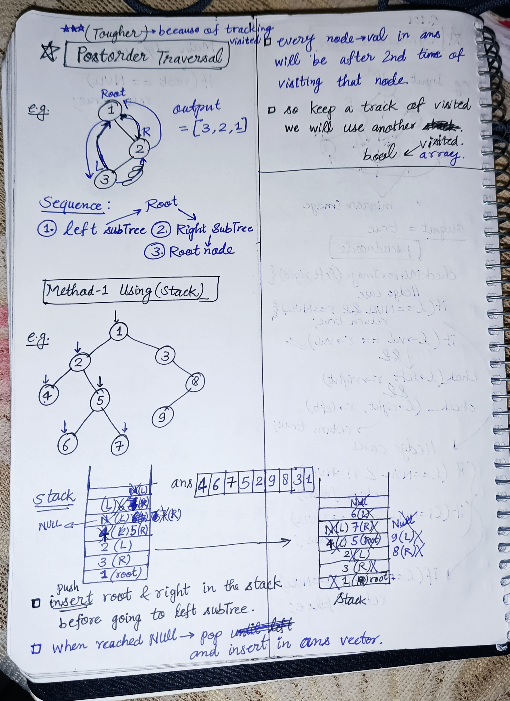

<h2><a href="https://leetcode.com/problems/binary-tree-postorder-traversal">145. Binary Tree Postorder Traversal</a></h2><h3>Easy</h3><hr><p>Given the <code>root</code> of a&nbsp;binary tree, return <em>the postorder traversal of its nodes&#39; values</em>.</p>

<p>&nbsp;</p>
<p><strong class="example">Example 1:</strong></p>

<div class="example-block">
<p><strong>Input:</strong> <span class="example-io">root = [1,null,2,3]</span></p>

<p><strong>Output:</strong> <span class="example-io">[3,2,1]</span></p>

<p><strong>Explanation:</strong></p>

<p></p>
</div>

<p><strong class="example">Example 2:</strong></p>

<div class="example-block">
<p><strong>Input:</strong> <span class="example-io">root = [1,2,3,4,5,null,8,null,null,6,7,9]</span></p>

<p><strong>Output:</strong> <span class="example-io">[4,6,7,5,2,9,8,3,1]</span></p>

<p><strong>Explanation:</strong></p>

<p></p>
</div>

<p><strong class="example">Example 3:</strong></p>

<div class="example-block">
<p><strong>Input:</strong> <span class="example-io">root = []</span></p>

<p><strong>Output:</strong> <span class="example-io">[]</span></p>
</div>

<p><strong class="example">Example 4:</strong></p>

<div class="example-block">
<p><strong>Input:</strong> <span class="example-io">root = [1]</span></p>

<p><strong>Output:</strong> <span class="example-io">[1]</span></p>
</div>

<p>&nbsp;</p>
<p><strong>Constraints:</strong></p>

<ul>
	<li>The number of the nodes in the tree is in the range <code>[0, 100]</code>.</li>
	<li><code>-100 &lt;= Node.val &lt;= 100</code></li>
</ul>

<p>&nbsp;</p>
<strong>Follow up:</strong> Recursive solution is trivial, could you do it iteratively?

<!-- AUTO-GENERATED-SOLUTION-START -->
---

## 🧠 Visual Solution & Intuition



---

## ⏱️ Complexity Analysis

```text
Time Complexity = O(n) => visiting n nodes
Space Complexity = O(n)
```

---

## 💻 C++ Solution

[View Original C++ File](./0145-binary-tree-postorder-traversal.cpp)

```cpp
/**
 * Definition for a binary tree node.
 * struct TreeNode {
 *     int val;
 *     TreeNode *left;
 *     TreeNode *right;
 *     TreeNode() : val(0), left(nullptr), right(nullptr) {}
 *     TreeNode(int x) : val(x), left(nullptr), right(nullptr) {}
 *     TreeNode(int x, TreeNode *left, TreeNode *right) : val(x), left(left), right(right) {}
 * };
 */
class Solution {
public:
    //Method-2 : Iterative postorder

    //Time Complexity = O(n) => visiting n nodes
    //Space Complexity = O(n) 

    vector<int> postorderTraversal(TreeNode* root) {

        //Sequence : Left -> Right -> Root

        //ans vector to store traversal node->val
        vector<int> ans;

        //edge-case : if empty tree
        if(root == NULL) return ans;

        //Two stacks for traversal
        stack<TreeNode*> s1;
        stack<TreeNode*> s2; 


        //push root into s1
        s1.push(root);

        while(!s1.empty()){
            //1.)
            TreeNode* node = s1.top();
            s1.pop();
            
            //2.)
            s2.push(node);
            
            //3.)
            if(node->left != NULL){
                s1.push(node->left);
            }
            
            //4.)
            if(node->right != NULL){
                s1.push(node->right);
            }            

        }


        while(!s2.empty()){

            //1.)
            TreeNode* node = s2.top();
            s2.pop();

            //2.) insert node->val
            ans.push_back(node->val);
        }

       //finally return the traversal vector 
       return ans;
    }
};
```

<!-- AUTO-GENERATED-SOLUTION-END -->
