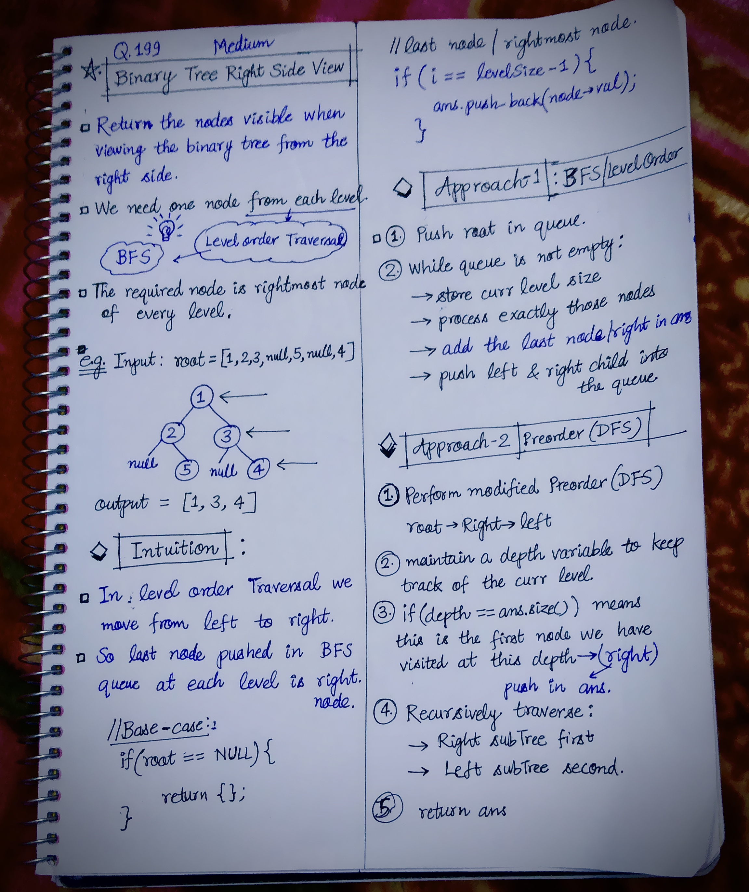

<h2><a href="https://leetcode.com/problems/binary-tree-right-side-view">199. Binary Tree Right Side View</a></h2><h3>Medium</h3><hr><p>Given the <code>root</code> of a binary tree, imagine yourself standing on the <strong>right side</strong> of it, return <em>the values of the nodes you can see ordered from top to bottom</em>.</p>

<p>&nbsp;</p>
<p><strong class="example">Example 1:</strong></p>

<div class="example-block">
<p><strong>Input:</strong> <span class="example-io">root = [1,2,3,null,5,null,4]</span></p>

<p><strong>Output:</strong> <span class="example-io">[1,3,4]</span></p>

<p><strong>Explanation:</strong></p>

<p></p>
</div>

<p><strong class="example">Example 2:</strong></p>

<div class="example-block">
<p><strong>Input:</strong> <span class="example-io">root = [1,2,3,4,null,null,null,5]</span></p>

<p><strong>Output:</strong> <span class="example-io">[1,3,4,5]</span></p>

<p><strong>Explanation:</strong></p>

<p></p>
</div>

<p><strong class="example">Example 3:</strong></p>

<div class="example-block">
<p><strong>Input:</strong> <span class="example-io">root = [1,null,3]</span></p>

<p><strong>Output:</strong> <span class="example-io">[1,3]</span></p>
</div>

<p><strong class="example">Example 4:</strong></p>

<div class="example-block">
<p><strong>Input:</strong> <span class="example-io">root = []</span></p>

<p><strong>Output:</strong> <span class="example-io">[]</span></p>
</div>

<p>&nbsp;</p>
<p><strong>Constraints:</strong></p>

<ul>
	<li>The number of nodes in the tree is in the range <code>[0, 100]</code>.</li>
	<li><code>-100 &lt;= Node.val &lt;= 100</code></li>
</ul>
<!---LeetCode Approaches Start-->
<hr>
<h3>💡 Solutions & Approaches</h3>

- [Approach 1 (C++)](0199-binary-tree-right-side-view.cpp)
- [Approach 2 (C++)](0199-binary-tree-right-side-view-approach-2-bfs.cpp) — *BFS(Level Order Traversal)*
- [Approach 3 (C++)](0199-binary-tree-right-side-view-approach-3-dfs.cpp) — *DFS(Preorder Traversal)*

<!---LeetCode Approaches End-->


<!-- AUTO-GENERATED-SOLUTION-START -->
---

## 🧠 Visual Solution & Intuition



---

## 💻 C++ Solution

### 0199-binary-tree-right-side-view.cpp

[View Original C++ File](./0199-binary-tree-right-side-view.cpp)

```cpp
/**
 * Definition for a binary tree node.
 * struct TreeNode {
 *     int val;
 *     TreeNode *left;
 *     TreeNode *right;
 *     TreeNode() : val(0), left(nullptr), right(nullptr) {}
 *     TreeNode(int x) : val(x), left(nullptr), right(nullptr) {}
 *     TreeNode(int x, TreeNode *left, TreeNode *right) : val(x), left(left), right(right) {}
 * };
 */
class Solution {
public:
    vector<int> rightSideView(TreeNode* root) {

        //base-case
        if(root == NULL){
            return {};
        }

        vector<int> ans; //to store rightmost nodes value

        //create a queue
        queue<TreeNode*> q;

        //1.) push root in queue
        q.push(root);

        while(!q.empty()){
            int levelSize = q.size(); //curr level size

            for(int i=0; i<levelSize; i++){//traverse in curr level
                TreeNode* node = q.front();
                q.pop();
                
                //add the last node in ans
                if(i == levelSize-1){
                    ans.push_back(node->val);
                }

                //push left, right child of node
                if(node->left != NULL){
                    q.push(node->left);
                }

                if(node->right != NULL){
                    q.push(node->right);
                }
            }
        }

        return ans;
    }
};
```

### 0199-binary-tree-right-side-view-approach-2-bfs.cpp

#### 💡 Approach

```text
Approach-1 : BFS(Level Order Traversal)
```

#### ⏱️ Complexity Analysis

```text
Time Complexity = O(n) => visiting n nodes
Space Complexity = O(n) => extra ans vector used to store nodes value
```

[View Original C++ File](./0199-binary-tree-right-side-view-approach-2-bfs.cpp)

```cpp
/**
 * Definition for a binary tree node.
 * struct TreeNode {
 *     int val;
 *     TreeNode *left;
 *     TreeNode *right;
 *     TreeNode() : val(0), left(nullptr), right(nullptr) {}
 *     TreeNode(int x) : val(x), left(nullptr), right(nullptr) {}
 *     TreeNode(int x, TreeNode *left, TreeNode *right) : val(x), left(left), right(right) {}
 * };
 */
class Solution {
public:
    //Approach-1 : BFS(Level Order Traversal)

    //Time Complexity = O(n) => visiting n nodes
    //Space Complexity = O(n) => extra ans vector used to store nodes value


    vector<int> rightSideView(TreeNode* root) {

        //base-case
        if(root == NULL){
            return {};
        }

        vector<int> ans; //to store rightmost nodes value

        //create a queue
        queue<TreeNode*> q;

        //1.) push root in queue
        q.push(root);

        while(!q.empty()){
            int levelSize = q.size(); //curr level size

            for(int i=0; i<levelSize; i++){//traverse in curr level
                TreeNode* node = q.front();
                q.pop();
                
                //add the last node in ans
                if(i == levelSize-1){
                    ans.push_back(node->val);
                }

                //push left, right child of node
                if(node->left != NULL){
                    q.push(node->left);
                }

                if(node->right != NULL){
                    q.push(node->right);
                }
            }
        }

        return ans;
    }
};
```

### 0199-binary-tree-right-side-view-approach-3-dfs.cpp

#### 💡 Approach

```text
Approach-2 : DFS(Preorder Traversal)
```

#### ⏱️ Complexity Analysis

```text
Time Complexity = O(h) => visiting n nodes
Space Complexity = O(h) => extra ans vector used to store nodes value
```

[View Original C++ File](./0199-binary-tree-right-side-view-approach-3-dfs.cpp)

```cpp
/**
 * Definition for a binary tree node.
 * struct TreeNode {
 *     int val;
 *     TreeNode *left;
 *     TreeNode *right;
 *     TreeNode() : val(0), left(nullptr), right(nullptr) {}
 *     TreeNode(int x) : val(x), left(nullptr), right(nullptr) {}
 *     TreeNode(int x, TreeNode *left, TreeNode *right) : val(x), left(left), right(right) {}
 * };
 */
class Solution {
public:
    //Approach-2 : DFS(Preorder Traversal)

    //Time Complexity = O(h) => visiting n nodes
    //Space Complexity = O(h) => extra ans vector used to store nodes value
    
    void solve(TreeNode* root, int depth, vector<int>& ans){
        //base case: empty tree
        if(root == NULL){
            return;
        }
        
        if(depth == ans.size()){ //right node of this depth
            ans.push_back(root->val);
        }

        //recursively traverse :
        //1.) right subTree
        solve(root->right, depth+1, ans);

        //2.) left subTree
        solve(root->left, depth+1, ans);
    }
    vector<int> rightSideView(TreeNode* root) {

        vector<int> ans; //to store rightmost nodes value

        int depth = 0;

        solve(root, depth, ans);

        return ans;
    }
};
```

<!-- AUTO-GENERATED-SOLUTION-END -->
