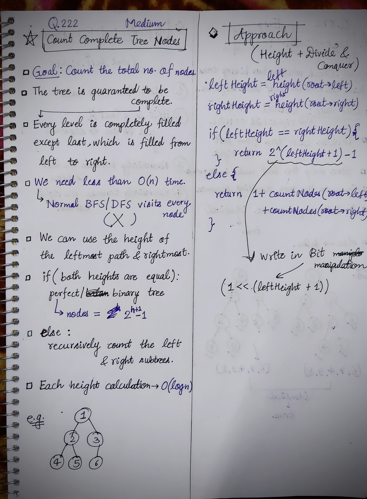

<h2><a href="https://leetcode.com/problems/count-complete-tree-nodes">222. Count Complete Tree Nodes</a></h2><h3>Medium</h3><hr><p>Given the <code>root</code> of a <strong>complete</strong> binary tree, return the number of the nodes in the tree.</p>

<p>According to <strong><a href="http://en.wikipedia.org/wiki/Binary_tree#Types_of_binary_trees" target="_blank">Wikipedia</a></strong>, every level, except possibly the last, is completely filled in a complete binary tree, and all nodes in the last level are as far left as possible. It can have between <code>1</code> and <code>2<sup>h</sup></code> nodes inclusive at the last level <code>h</code>.</p>

<p>Design an algorithm that runs in less than&nbsp;<code data-stringify-type="code">O(n)</code>&nbsp;time complexity.</p>

<p>&nbsp;</p>
<p><strong class="example">Example 1:</strong></p>

<pre>
<strong>Input:</strong> root = [1,2,3,4,5,6]
<strong>Output:</strong> 6
</pre>

<p><strong class="example">Example 2:</strong></p>

<pre>
<strong>Input:</strong> root = []
<strong>Output:</strong> 0
</pre>

<p><strong class="example">Example 3:</strong></p>

<pre>
<strong>Input:</strong> root = [1]
<strong>Output:</strong> 1
</pre>

<p>&nbsp;</p>
<p><strong>Constraints:</strong></p>

<ul>
	<li>The number of nodes in the tree is in the range <code>[0, 5 * 10<sup>4</sup>]</code>.</li>
	<li><code>0 &lt;= Node.val &lt;= 5 * 10<sup>4</sup></code></li>
	<li>The tree is guaranteed to be <strong>complete</strong>.</li>
</ul>


<!-- AUTO-GENERATED-SOLUTION-START -->
---

## 🧠 Visual Solution & Intuition



---

## 💡 Approach

```text
Approach : Binary Tree Height + Divide and Conquer
```

---

## ⏱️ Complexity Analysis

```text
Time Complexity = O(logn * logn) =>
Space Complexity = O(logn) =>
```

---

## 💻 C++ Solution

[View Original C++ File](./0222-count-complete-tree-nodes.cpp)

```cpp
/**
 * Definition for a binary tree node.
 * struct TreeNode {
 *     int val;
 *     TreeNode *left;
 *     TreeNode *right;
 *     TreeNode() : val(0), left(nullptr), right(nullptr) {}
 *     TreeNode(int x) : val(x), left(nullptr), right(nullptr) {}
 *     TreeNode(int x, TreeNode *left, TreeNode *right) : val(x), left(left), right(right) {}
 * };
 */
class Solution {
public:
    //Approach : Binary Tree Height + Divide and Conquer

    //Time Complexity = O(logn * logn) =>
    /* 1. leftHeight() → follows only the left path
    → O(log n)
    2. rightHeight() → follows only the right path
    → O(log n)
    * countNodes() recursively goes down at most O(log n) levels because the tree is complete.
    */


    //Space Complexity = O(logn) =>
    /* leftHeight() and rightHeight() use only while → O(1) extra space.
    * countNodes() uses recursion.
    * Complete binary tree height = O(log n).
    * Therefore recursion stack = O(log n).
    */


    int leftHeight(TreeNode* root){

        int h = 0;

        while(root != NULL){
            h++;
            root = root->left; //checking only one(left) side height
        }

        return h;
    }
    int rightHeight(TreeNode* root){

        int h = 0;

        while(root != NULL){
            h++;
            root = root->right; //checking only one(left) side height
        }

        return h;
    }
    int countNodes(TreeNode* root) {
        
        //base-case
        if(root == NULL){
            return 0;
        }
        
        int lh = leftHeight(root->left);
        int rh = rightHeight(root->right);

        if(lh == rh){ //nodes = 2^(h+1) - 1
            return (1 << (lh + 1)) - 1; // 1 << n = 2^n in Bit Manipulation //left shift 
        }
        else{
            return 1 + countNodes(root->left) + countNodes(root->right);
        }
    }
};
```

<!-- AUTO-GENERATED-SOLUTION-END -->
