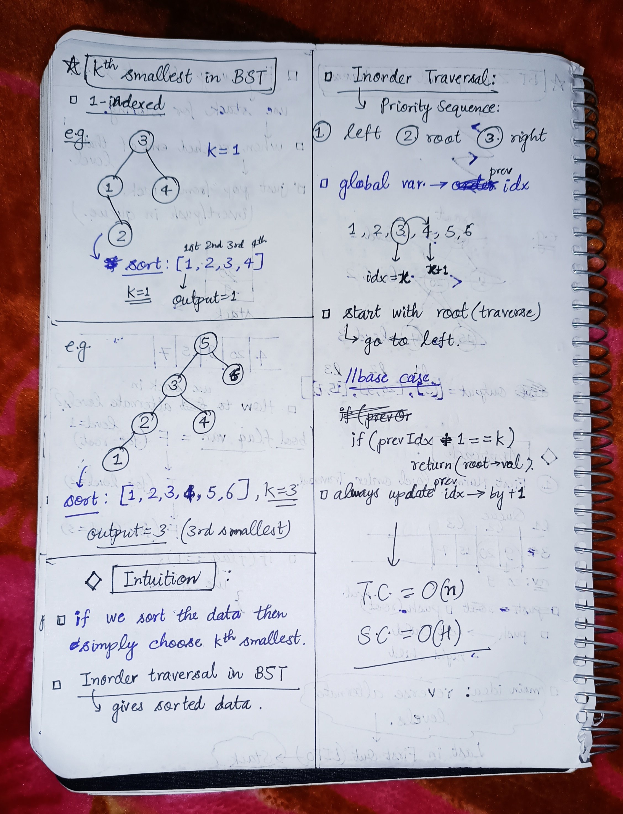

<h2><a href="https://leetcode.com/problems/kth-smallest-element-in-a-bst">230. Kth Smallest Element in a BST</a></h2><h3>Medium</h3><hr><p>Given the <code>root</code> of a binary search tree, and an integer <code>k</code>, return <em>the</em> <code>k<sup>th</sup></code> <em>smallest value (<strong>1-indexed</strong>) of all the values of the nodes in the tree</em>.</p>

<p>&nbsp;</p>
<p><strong class="example">Example 1:</strong></p>

<pre>
<strong>Input:</strong> root = [3,1,4,null,2], k = 1
<strong>Output:</strong> 1
</pre>

<p><strong class="example">Example 2:</strong></p>

<pre>
<strong>Input:</strong> root = [5,3,6,2,4,null,null,1], k = 3
<strong>Output:</strong> 3
</pre>

<p>&nbsp;</p>
<p><strong>Constraints:</strong></p>

<ul>
	<li>The number of nodes in the tree is <code>n</code>.</li>
	<li><code>1 &lt;= k &lt;= n &lt;= 10<sup>4</sup></code></li>
	<li><code>0 &lt;= Node.val &lt;= 10<sup>4</sup></code></li>
</ul>

<p>&nbsp;</p>
<p><strong>Follow up:</strong> If the BST is modified often (i.e., we can do insert and delete operations) and you need to find the kth smallest frequently, how would you optimize?</p>


<!-- AUTO-GENERATED-SOLUTION-START -->
---

## 🧠 Visual Solution & Intuition



---

## 💡 Approach

```text
Approach : Iterative Inorder Traversal using a Stack
```

---

## ⏱️ Complexity Analysis

```text
Time Complexity = O(h + k) =>
Space Complexity = O(h) =>
```

---

## 💻 C++ Solution

[View Original C++ File](./0230-kth-smallest-element-in-a-bst.cpp)

```cpp
/**
 * Definition for a binary tree node.
 * struct TreeNode {
 *     int val;
 *     TreeNode *left;
 *     TreeNode *right;
 *     TreeNode() : val(0), left(nullptr), right(nullptr) {}
 *     TreeNode(int x) : val(x), left(nullptr), right(nullptr) {}
 *     TreeNode(int x, TreeNode *left, TreeNode *right) : val(x), left(left), right(right) {}
 * };
 */
class Solution {
public:
    //Approach : Iterative Inorder Traversal using a Stack

    //Time Complexity = O(h + k) =>
    /* h is the tree’s height, and k is the requested rank.
    * Reaching the leftmost node initially takes up to O(h) work.
    * We pop and count exactly k nodes. Total stack operations take O(h + k) time.
    * Balanced BST: O(log n + k).
    * Worst case: O(n).
    */

    //Space Complexity = O(h) =>
    /* The stack stores waiting nodes along a root-to-node path.
    * It can hold at most h nodes.
    * Balanced BST: O(log n).
    * Skewed BST, worst case: O(n).
    * current and count use only O(1) extra space.
    */


    int kthSmallest(TreeNode* root, int k) {
        
        //1.) Initialization : Create an empty stack, set current = root, and initialize count = 0.

        stack<TreeNode*> st;
        TreeNode* curr = root;

        int count = 0;

        // Step 5: Repeat while a current node or waiting ancestor exists.
        while(curr != NULL || !st.empty()){
            
            // Step 2: Move as far left as possible.
            // This reaches the smallest remaining value.
            while(curr != NULL){
                
                st.push(curr);
                curr = curr->left;
            }

            // Step 3: Process the next node in ascending order.
            curr = st.top();
            st.pop();

            // Count when popping: all smaller nodes in this
            // node's left subtree have now been processed.
            count++;

            // Step 4: Return the kth smallest value.
            if(count == k){
                return curr->val;
            }

            // Otherwise, explore the right subtree.
            // The next iteration follows its leftmost path.
            curr = curr->right;

        }

        //If not possible 
        return -1;

    }
};
```

<!-- AUTO-GENERATED-SOLUTION-END -->
