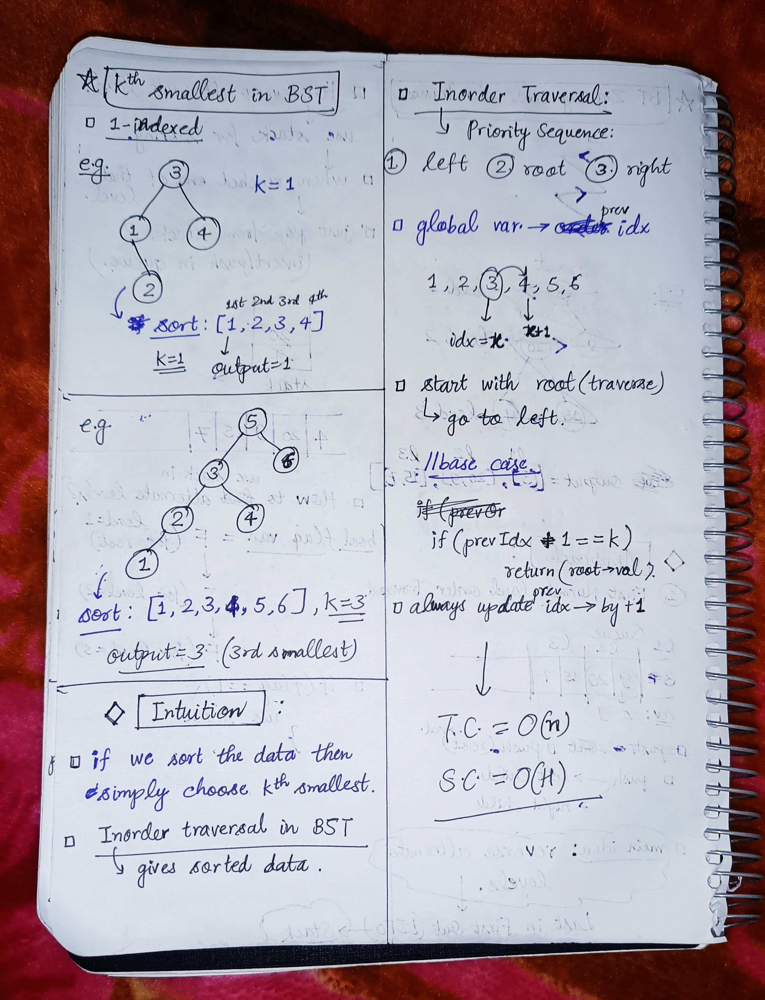

<h2><a href="https://leetcode.com/problems/kth-smallest-element-in-a-bst">230. Kth Smallest Element in a BST</a></h2><h3>Medium</h3><hr><p>Given the <code>root</code> of a binary search tree, and an integer <code>k</code>, return <em>the</em> <code>k<sup>th</sup></code> <em>smallest value (<strong>1-indexed</strong>) of all the values of the nodes in the tree</em>.</p>

<p>&nbsp;</p>
<p><strong class="example">Example 1:</strong></p>

<pre>
<strong>Input:</strong> root = [3,1,4,null,2], k = 1
<strong>Output:</strong> 1
</pre>

<p><strong class="example">Example 2:</strong></p>

<pre>
<strong>Input:</strong> root = [5,3,6,2,4,null,null,1], k = 3
<strong>Output:</strong> 3
</pre>

<p>&nbsp;</p>
<p><strong>Constraints:</strong></p>

<ul>
	<li>The number of nodes in the tree is <code>n</code>.</li>
	<li><code>1 &lt;= k &lt;= n &lt;= 10<sup>4</sup></code></li>
	<li><code>0 &lt;= Node.val &lt;= 10<sup>4</sup></code></li>
</ul>

<p>&nbsp;</p>
<p><strong>Follow up:</strong> If the BST is modified often (i.e., we can do insert and delete operations) and you need to find the kth smallest frequently, how would you optimize?</p>


<!-- AUTO-GENERATED-SOLUTION-START -->
---

## 🧠 Visual Solution & Intuition



---

## ⏱️ Complexity Analysis

```text
Time Complexity = O(n) => cause visting n nodes of the tree.
Space Complexity = O(H) => H = recursion stack height = height of the tree.
```

---

## 💻 C++ Solution

[View Original C++ File](./0230-kth-smallest-element-in-a-bst.cpp)

```cpp
/**
 * Definition for a binary tree node.
 * struct TreeNode {
 *     int val;
 *     TreeNode *left;
 *     TreeNode *right;
 *     TreeNode() : val(0), left(nullptr), right(nullptr) {}
 *     TreeNode(int x) : val(x), left(nullptr), right(nullptr) {}
 *     TreeNode(int x, TreeNode *left, TreeNode *right) : val(x), left(left), right(right) {}
 * };
 */
class Solution {
public:
    //Time Complexity = O(n) => cause visting n nodes of the tree.
    //Space Complexity = O(H) => H = recursion stack height = height of the tree.
    int prevIdx = 0 ;

    int kthSmallest(TreeNode* root, int k) {
        //for empty tree
        if(root == NULL) return -1 ;
        
        //Inorder Traversal sequence : 1.)left 2.)root 3.)right
        //1.) call for left SubTree
        if(root->left != NULL){
            int leftAns = kthSmallest(root->left,k) ;

            if(leftAns != -1)
                return leftAns ; //as final ans.
        }

        //2.) for root val
        if(prevIdx + 1 == k){
            return root->val ;           
        }
        prevIdx ++; //update prevIdx in backtracking

        //3.) call for right subTree
        if(root->right != NULL){
            int rightAns = kthSmallest(root->right,k) ;

            if(rightAns != -1){
                return rightAns ; //as final ans.
            }
        }


        //if in above calls no ans found then
        return -1 ;

    }
};
```

<!-- AUTO-GENERATED-SOLUTION-END -->
