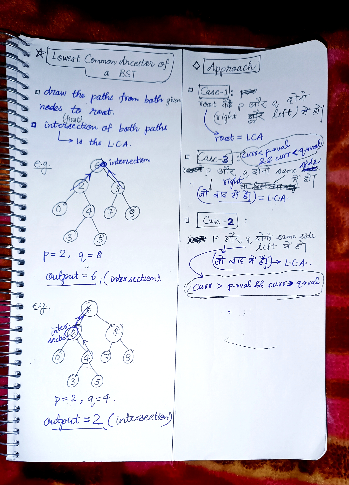

<h2><a href="https://leetcode.com/problems/lowest-common-ancestor-of-a-binary-search-tree">235. Lowest Common Ancestor of a Binary Search Tree</a></h2><h3>Medium</h3><hr><p>Given a binary search tree (BST), find the lowest common ancestor (LCA) node of two given nodes in the BST.</p>

<p>According to the <a href="https://en.wikipedia.org/wiki/Lowest_common_ancestor" target="_blank">definition of LCA on Wikipedia</a>: &ldquo;The lowest common ancestor is defined between two nodes <code>p</code> and <code>q</code> as the lowest node in <code>T</code> that has both <code>p</code> and <code>q</code> as descendants (where we allow <strong>a node to be a descendant of itself</strong>).&rdquo;</p>

<p>&nbsp;</p>
<p><strong class="example">Example 1:</strong></p>

<pre>
<strong>Input:</strong> root = [6,2,8,0,4,7,9,null,null,3,5], p = 2, q = 8
<strong>Output:</strong> 6
<strong>Explanation:</strong> The LCA of nodes 2 and 8 is 6.
</pre>

<p><strong class="example">Example 2:</strong></p>

<pre>
<strong>Input:</strong> root = [6,2,8,0,4,7,9,null,null,3,5], p = 2, q = 4
<strong>Output:</strong> 2
<strong>Explanation:</strong> The LCA of nodes 2 and 4 is 2, since a node can be a descendant of itself according to the LCA definition.
</pre>

<p><strong class="example">Example 3:</strong></p>

<pre>
<strong>Input:</strong> root = [2,1], p = 2, q = 1
<strong>Output:</strong> 2
</pre>

<p>&nbsp;</p>
<p><strong>Constraints:</strong></p>

<ul>
	<li>The number of nodes in the tree is in the range <code>[2, 10<sup>5</sup>]</code>.</li>
	<li><code>-10<sup>9</sup> &lt;= Node.val &lt;= 10<sup>9</sup></code></li>
	<li>All <code>Node.val</code> are <strong>unique</strong>.</li>
	<li><code>p != q</code></li>
	<li><code>p</code> and <code>q</code> will exist in the BST.</li>
</ul>


<!-- AUTO-GENERATED-SOLUTION-START -->
---

## 🧠 Visual Solution & Intuition



---

## ⏱️ Complexity Analysis

```text
Time Complexity = O(H) => H = height of the tree.
Space Complexity= O(H) => H = recursion stack height= height of the tree.
```

---

## 💻 C++ Solution

[View Original C++ File](./0235-lowest-common-ancestor-of-a-binary-search-tree.cpp)

```cpp
/**
 * Definition for a binary tree node.
 * struct TreeNode {
 *     int val;
 *     TreeNode *left;
 *     TreeNode *right;
 *     TreeNode(int x) : val(x), left(NULL), right(NULL) {}
 * };
 */

class Solution {
public:
    //Time Complexity = O(H) => H = height of the tree.
    // H = logn for balanced tree.
    //Space Complexity= O(H) => H = recursion stack height= height of the tree.
    TreeNode* lowestCommonAncestor(TreeNode* root, TreeNode* p, TreeNode* q) {
        //for empty tree
        if(root == NULL) return NULL ;

        //stores value of current node for comparing
        int curr = root->val ;

        //Case-2 : if both p,q lies on the left side
        // if p,q are smaller than curr, the move to left
        if(curr > p->val && curr > q->val){
            return lowestCommonAncestor(root->left,p,q) ;
        }

        //Case-3 : if both p,q lies on the right side
        //if p,q are greater than curr, then move to right.
        if(curr < p->val && curr < q->val){
            return lowestCommonAncestor(root->right,p,q) ;
        }

        //Case-1 : if in above ans not found then ans is root
        return root ;
    }
};
```

<!-- AUTO-GENERATED-SOLUTION-END -->
