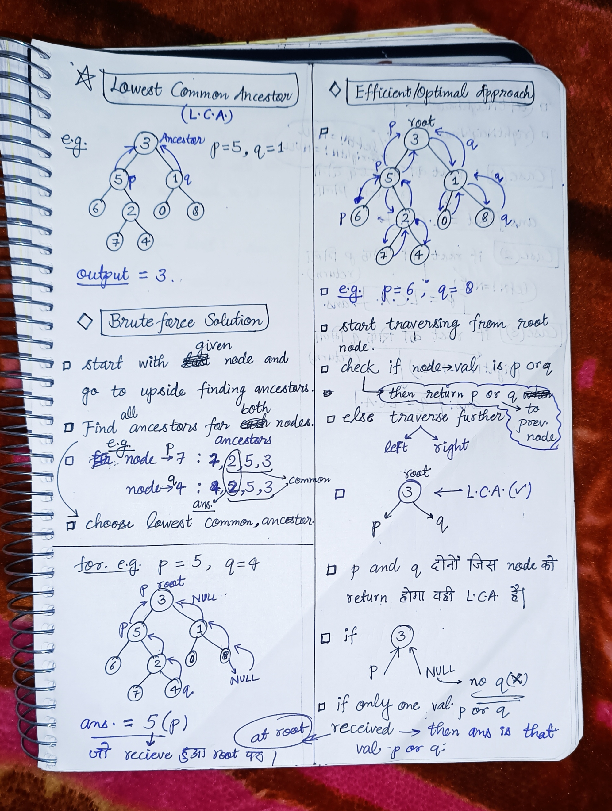
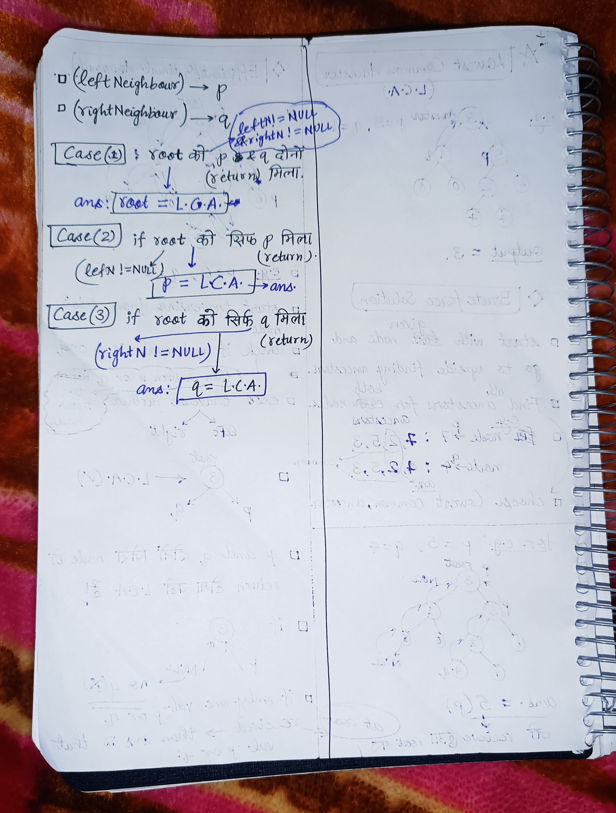

<h2><a href="https://leetcode.com/problems/lowest-common-ancestor-of-a-binary-tree">236. Lowest Common Ancestor of a Binary Tree</a></h2><h3>Medium</h3><hr><p>Given a binary tree, find the lowest common ancestor (LCA) of two given nodes in the tree.</p>

<p>According to the <a href="https://en.wikipedia.org/wiki/Lowest_common_ancestor" target="_blank">definition of LCA on Wikipedia</a>: &ldquo;The lowest common ancestor is defined between two nodes <code>p</code> and <code>q</code> as the lowest node in <code>T</code> that has both <code>p</code> and <code>q</code> as descendants (where we allow <b>a node to be a descendant of itself</b>).&rdquo;</p>

<p>&nbsp;</p>
<p><strong class="example">Example 1:</strong></p>

<pre>
<strong>Input:</strong> root = [3,5,1,6,2,0,8,null,null,7,4], p = 5, q = 1
<strong>Output:</strong> 3
<strong>Explanation:</strong> The LCA of nodes 5 and 1 is 3.
</pre>

<p><strong class="example">Example 2:</strong></p>

<pre>
<strong>Input:</strong> root = [3,5,1,6,2,0,8,null,null,7,4], p = 5, q = 4
<strong>Output:</strong> 5
<strong>Explanation:</strong> The LCA of nodes 5 and 4 is 5, since a node can be a descendant of itself according to the LCA definition.
</pre>

<p><strong class="example">Example 3:</strong></p>

<pre>
<strong>Input:</strong> root = [1,2], p = 1, q = 2
<strong>Output:</strong> 1
</pre>

<p>&nbsp;</p>
<p><strong>Constraints:</strong></p>

<ul>
	<li>The number of nodes in the tree is in the range <code>[2, 10<sup>5</sup>]</code>.</li>
	<li><code>-10<sup>9</sup> &lt;= Node.val &lt;= 10<sup>9</sup></code></li>
	<li>All <code>Node.val</code> are <strong>unique</strong>.</li>
	<li><code>p != q</code></li>
	<li><code>p</code> and <code>q</code> will exist in the tree.</li>
</ul>


<!-- AUTO-GENERATED-SOLUTION-START -->
---

## 🧠 Visual Solution & Intuition

### Part 1



### Part 2



---

## ⏱️ Complexity Analysis

```text
Time Complexity = O(n)  => cause traversing n nodes of the tree
Space Complexity = O(H) => where H is height of the tree(recursion stack height)
```

---

## 💻 C++ Solution

[View Original C++ File](./0236-lowest-common-ancestor-of-a-binary-tree.cpp)

```cpp
/**
 * Definition for a binary tree node.
 * struct TreeNode {
 *     int val;
 *     TreeNode *left;
 *     TreeNode *right;
 *     TreeNode(int x) : val(x), left(NULL), right(NULL) {}
 * };
 */
class Solution {
public:
    //Time Complexity = O(n)  => cause traversing n nodes of the tree
    //Space Complexity = O(H) => where H is height of the tree(recursion stack height)
    TreeNode* lowestCommonAncestor(TreeNode* root, TreeNode* p, TreeNode* q) {
        //edge case
        if(root == NULL) 
            return NULL ; //for empty tree

        //edge case 
        if(root == p || root == q) 
            return root ;
       
       //finding leftN that is (p)
       TreeNode* leftN = lowestCommonAncestor(root->left, p, q) ;

       //finding rightN that is q
       TreeNode* rightN = lowestCommonAncestor(root->right, p, q) ;

      //Case-1: when both leftN & rightN are not NULL(p,q both return to root)
      if(leftN != NULL && rightN != NULL){
         return root ; //then ans is root
      }
      
      //Case-2 : when one val(leftN) is not NULL ,rightN is NULL
      if(leftN != NULL)
         return leftN ; //then ans is leftN

      //Case-3 : when rightN is not NULL, leftN is NULL
       else{
        return rightN ;
       }

    
    }
};
```

<!-- AUTO-GENERATED-SOLUTION-END -->
