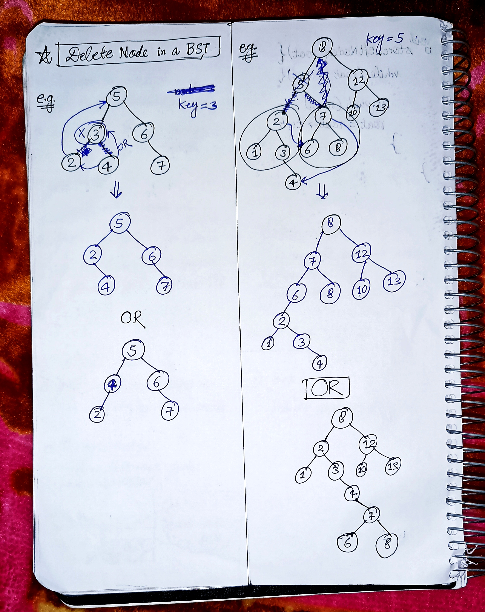
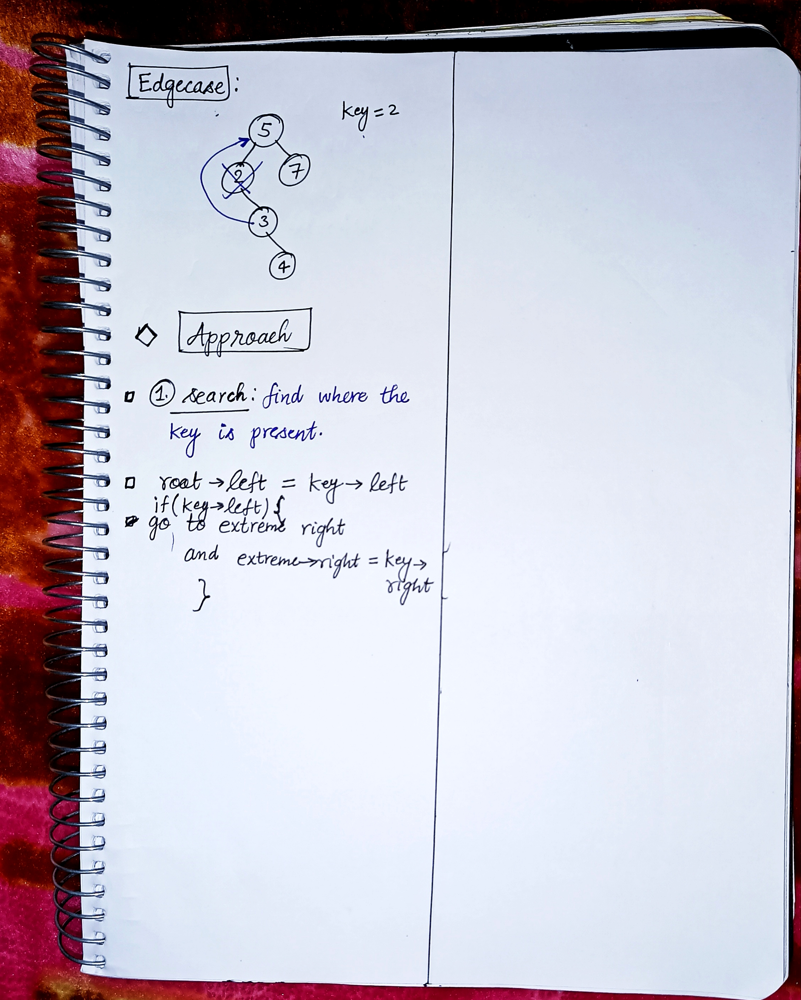

<h2><a href="https://leetcode.com/problems/delete-node-in-a-bst">450. Delete Node in a BST</a></h2><h3>Medium</h3><hr><p>Given a root node reference of a BST and a key, delete the node with the given key in the BST. Return <em>the <strong>root node reference</strong> (possibly updated) of the BST</em>.</p>

<p>Basically, the deletion can be divided into two stages:</p>

<ol>
	<li>Search for a node to remove.</li>
	<li>If the node is found, delete the node.</li>
</ol>

<p>&nbsp;</p>
<p><strong class="example">Example 1:</strong></p>

<pre>
<strong>Input:</strong> root = [5,3,6,2,4,null,7], key = 3
<strong>Output:</strong> [5,4,6,2,null,null,7]
<strong>Explanation:</strong> Given key to delete is 3. So we find the node with value 3 and delete it.
One valid answer is [5,4,6,2,null,null,7], shown in the above BST.
Please notice that another valid answer is [5,2,6,null,4,null,7] and it&#39;s also accepted.

</pre>

<p><strong class="example">Example 2:</strong></p>

<pre>
<strong>Input:</strong> root = [5,3,6,2,4,null,7], key = 0
<strong>Output:</strong> [5,3,6,2,4,null,7]
<strong>Explanation:</strong> The tree does not contain a node with value = 0.
</pre>

<p><strong class="example">Example 3:</strong></p>

<pre>
<strong>Input:</strong> root = [], key = 0
<strong>Output:</strong> []
</pre>

<p>&nbsp;</p>
<p><strong>Constraints:</strong></p>

<ul>
	<li>The number of nodes in the tree is in the range <code>[0, 10<sup>4</sup>]</code>.</li>
	<li><code>-10<sup>5</sup> &lt;= Node.val &lt;= 10<sup>5</sup></code></li>
	<li>Each node has a <strong>unique</strong> value.</li>
	<li><code>root</code> is a valid binary search tree.</li>
	<li><code>-10<sup>5</sup> &lt;= key &lt;= 10<sup>5</sup></code></li>
</ul>

<p>&nbsp;</p>
<p><strong>Follow up:</strong> Could you solve it with time complexity <code>O(height of tree)</code>?</p>


<!-- AUTO-GENERATED-SOLUTION-START -->
---

## 🧠 Visual Solution & Intuition

### Part 1



### Part 2



---

## ⏱️ Complexity Analysis

```text
Time Complexity = O(h)
Space Complexity = O(h)
```

---

## 💻 C++ Solution

[View Original C++ File](./0450-delete-node-in-a-bst.cpp)

```cpp
/**
 * Definition for a binary tree node.
 * struct TreeNode {
 *     int val;
 *     TreeNode *left;
 *     TreeNode *right;
 *     TreeNode() : val(0), left(nullptr), right(nullptr) {}
 *     TreeNode(int x) : val(x), left(nullptr), right(nullptr) {}
 *     TreeNode(int x, TreeNode *left, TreeNode *right) : val(x), left(left), right(right) {}
 * };
 */
class Solution {
public:
    //BST Deletion : Recursive

    //Time Complexity = O(h)
    //Space Complexity = O(h)
    // h = height of the tree
    // h = logn, if balanced tree
    // h = n, if skewed tree


    TreeNode* deleteNode(TreeNode* root, int key) {
        //edge-case/ base-case
        if(root == NULL) return NULL;

        //if key is smaller than root => go to left Subtree
        if(key < root->val){
           root->left = deleteNode(root->left, key);
        }

        //if key is greater than root => go to right Subtree
        else if(key > root->val){
            root->right = deleteNode(root->right, key);
        }

        else{

            TreeNode* temp;
            //Case-1 : no children => leaf node or single node tree
            if(root->left == NULL && root->right == NULL){
                //delete root
                delete root;
                return NULL;
            }

            //Case-2 : single child
            if(root->left == NULL){
                temp = root->right;
                //delete root
                delete root;
                return temp;
            }
            
            if(root->right == NULL){
                temp = root->left;
                //delete root
                delete root;
                return temp;
            }


            //Case-3 : if both children exist
            /*. 1. Find inorder successor => min(right subtree)
                2. Copy successor’s value
                3. Delete successor 
            */

            temp = root->right; 
           
            //find the min in right subtree
            while(temp->left != NULL){
                temp = temp->left;
            }
            //copy successor's value
            root->val = temp->val;

            //delete inorder successor
            root->right = deleteNode(root->right, temp->val);
            
        }

        //finally return the root
        return root;
    }
};
```

<!-- AUTO-GENERATED-SOLUTION-END -->
