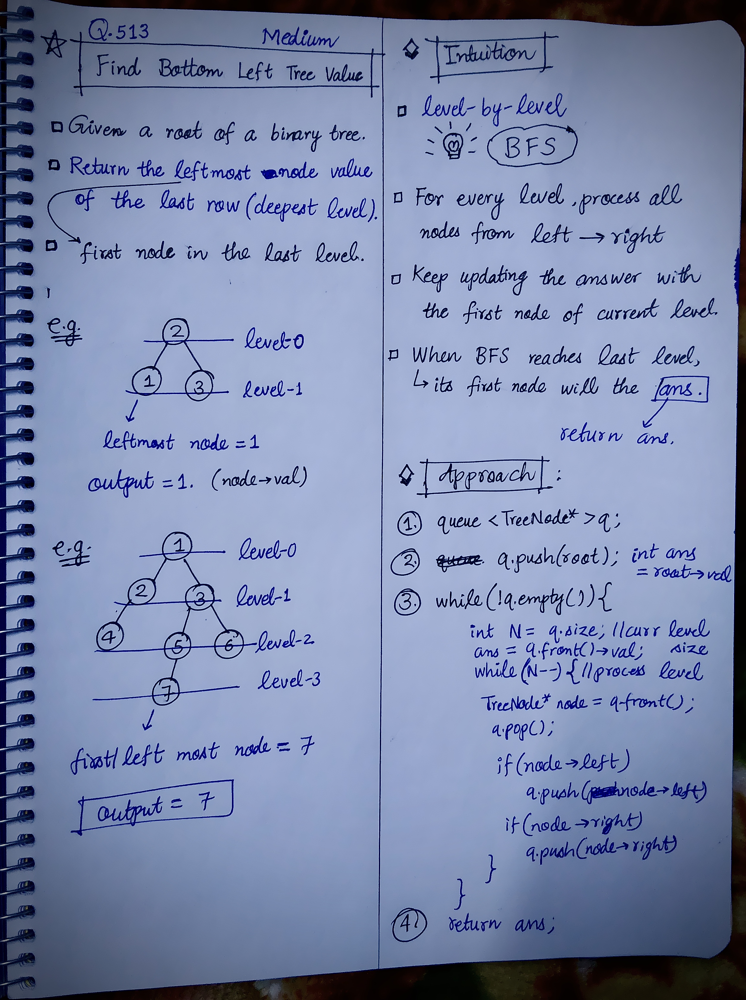

<h2><a href="https://leetcode.com/problems/find-bottom-left-tree-value/">513. Find Bottom Left Tree Value</a></h2><h3>Medium</h3><hr><p>You are given the <code>root</code> of a binary tree.</p>

<p>Return the <strong>leftmost</strong> value in the <strong>last</strong> row of the tree.</p>

<p>&nbsp;</p>
<p><strong class="example">Example 1:</strong></p>

<pre>
<strong>Input:</strong> root = [2,1,3]
<strong>Output:</strong> 1
<strong>Explanation:</strong> The last row is [1,3], so the leftmost value is 1.
</pre>

<p><strong class="example">Example 2:</strong></p>

<pre>
<strong>Input:</strong> root = [1,2,3,4,null,5,6,null,null,7]
<strong>Output:</strong> 7
<strong>Explanation:</strong> The last row contains only the node 7.
</pre>

<p>&nbsp;</p>
<p><strong>Constraints:</strong></p>

<ul>
	<li>The number of nodes in the tree is in the range <code>[1, 10<sup>4</sup>]</code>.</li>
	<li><code>-2<sup>31</sup> &lt;= Node.val &lt;= 2<sup>31</sup> - 1</code></li>
</ul>


<!-- AUTO-GENERATED-SOLUTION-START -->
---

## 🧠 Visual Solution & Intuition



---

## 💡 Approach

```text
Approach : BFS(Level Order Traversal)
```

---

## ⏱️ Complexity Analysis

```text
Time Complexity = O(N) =>
Space Complexity = O(W) => W = N/2 => O(N)
```

---

## 💻 C++ Solution

[View Original C++ File](./0513-find-bottom-left-tree-value.cpp)

```cpp
/**
 * Definition for a binary tree node.
 * struct TreeNode {
 *     int val;
 *     TreeNode *left;
 *     TreeNode *right;
 *     TreeNode() : val(0), left(nullptr), right(nullptr) {}
 *     TreeNode(int x) : val(x), left(nullptr), right(nullptr) {}
 *     TreeNode(int x, TreeNode *left, TreeNode *right) : val(x), left(left), right(right) {}
 * };
 */
class Solution {
public:
    //Approach : BFS(Level Order Traversal)

    //Time Complexity = O(N) =>
    /* We use BFS, so every node is visited exactly once.
    * For each node, we perform constant-time operations: checking its left/right child and pushing/popping from the queue.
    * Therefore, for N nodes: O(N)
    */

    //Space Complexity = O(W) => W = N/2 => O(N)
    /*     The queue stores nodes of the current level.
    * At most, the queue can contain W nodes, where W is the maximum number of nodes at any level.
    * For example, in a complete binary tree, the last level can contain roughly N/2 nodes.

    So: O(N)
    */


    int findBottomLeftValue(TreeNode* root) {
        //base-case
        if(root == NULL) return -1;

        //1.)queue for BFS
        queue<TreeNode*> q;
        
        //2.)
        q.push(root);
        
        int ans = root->val;
        
        //3.)
        while(!q.empty()){
            int N = q.size(); //curr level size
            ans = q.front()->val; //leftmost is the first node

            while(N--){
                
                TreeNode* node = q.front();
                q.pop();

                //if left exists
                if(node->left != NULL){
                    q.push(node->left);
                }

                //if right exists
                if(node->right != NULL){
                    q.push(node->right);
                }
            }
        }

        //4.) finally return the leftmose node value
        return ans;
    }
};
```

<!-- AUTO-GENERATED-SOLUTION-END -->
