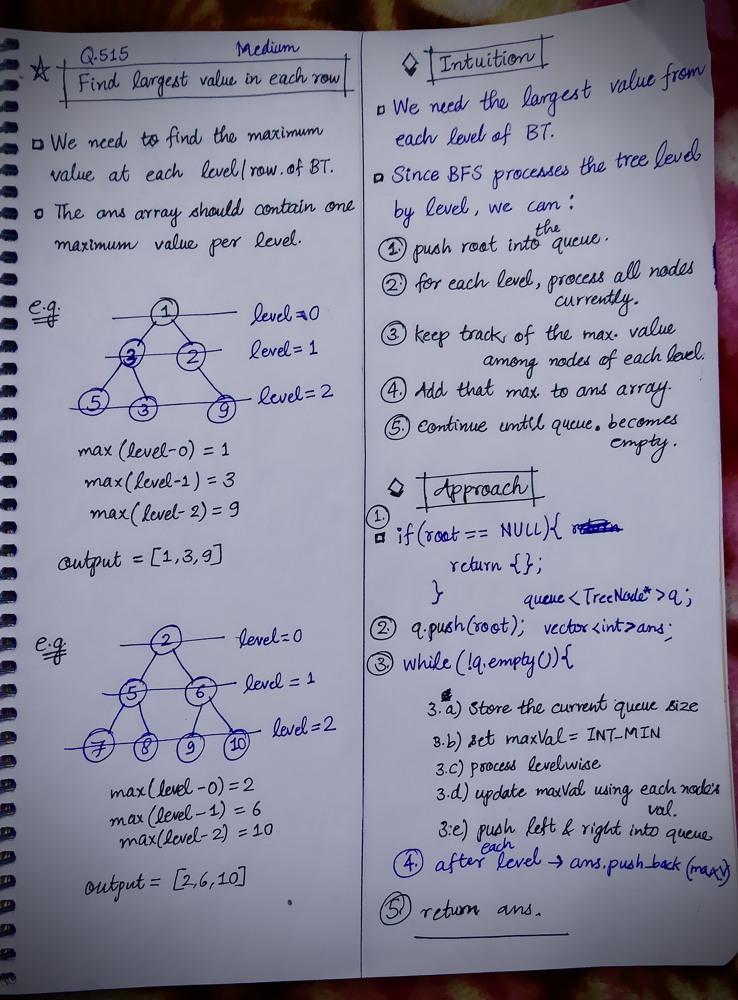

<h2><a href="https://leetcode.com/problems/find-largest-value-in-each-tree-row">515. Find Largest Value in Each Tree Row</a></h2><h3>Medium</h3><hr><p>Given the <code>root</code> of a binary tree, return <em>an array of the largest value in each row</em> of the tree <strong>(0-indexed)</strong>.</p>

<p>&nbsp;</p>
<p><strong class="example">Example 1:</strong></p>

<pre>
<strong>Input:</strong> root = [1,3,2,5,3,null,9]
<strong>Output:</strong> [1,3,9]
</pre>

<p><strong class="example">Example 2:</strong></p>

<pre>
<strong>Input:</strong> root = [1,2,3]
<strong>Output:</strong> [1,3]
</pre>

<p>&nbsp;</p>
<p><strong>Constraints:</strong></p>

<ul>
	<li>The number of nodes in the tree will be in the range <code>[0, 10<sup>4</sup>]</code>.</li>
	<li><code>-2<sup>31</sup> &lt;= Node.val &lt;= 2<sup>31</sup> - 1</code></li>
</ul>


<!-- AUTO-GENERATED-SOLUTION-START -->
---

## 🧠 Visual Solution & Intuition



---

## 💡 Approach

```text
Approach : BFS (Level Order Traversal) + Maximum Value Tracking
```

---

## ⏱️ Complexity Analysis

```text
Time Complexity = O(N) =>
Space Complexity = O(N) =>
```

---

## 💻 C++ Solution

[View Original C++ File](./0515-find-largest-value-in-each-tree-row.cpp)

```cpp
/**
 * Definition for a binary tree node.
 * struct TreeNode {
 *     int val;
 *     TreeNode *left;
 *     TreeNode *right;
 *     TreeNode() : val(0), left(nullptr), right(nullptr) {}
 *     TreeNode(int x) : val(x), left(nullptr), right(nullptr) {}
 *     TreeNode(int x, TreeNode *left, TreeNode *right) : val(x), left(left), right(right) {}
 * };
 */
class Solution {
public:
    //Approach : BFS (Level Order Traversal) + Maximum Value Tracking

    //Time Complexity = O(N) =>
    /* Every node is visited exactly once.
    */

    
    //Space Complexity = O(N) =>
    /* The queue can hold up to N/2 nodes in the worst case (for a complete/balanced binary tree).
    * The ans array stores one value per level, which takes O(H).
    * Therefore, overall SC = O(N).
    */ 

    void bfs(TreeNode* root, vector<int>& ans){
        //1.) base-case
        if(root == NULL){
           return; 
        }
        
        //2.)
        queue<TreeNode* > q;
        q.push(root);

        //3.) 
        while(!q.empty()){
            int N = q.size(); //current levelsize

            int maxVal = INT_MIN; // (-)infinity

            while(N--){//3.c) process all nodes of curr level
                TreeNode* node = q.front();
                q.pop();

                if(maxVal < node->val){ //3.d) update maxValue
                    maxVal = node->val;
                }

                //3.e) push left, right into queue
                if(node->left != NULL){
                    q.push(node->left);
                }

                if(node->right != NULL){
                    q.push(node->right);
                }
            }
            //level completed
            ans.push_back(maxVal);
        }

    }
    vector<int> largestValues(TreeNode* root) {
        
        vector<int> ans;//to store the output
        
        //func. call to bfs
        bfs(root, ans);
        
        //finally return the output
        return ans;
    }
};
```

<!-- AUTO-GENERATED-SOLUTION-END -->
