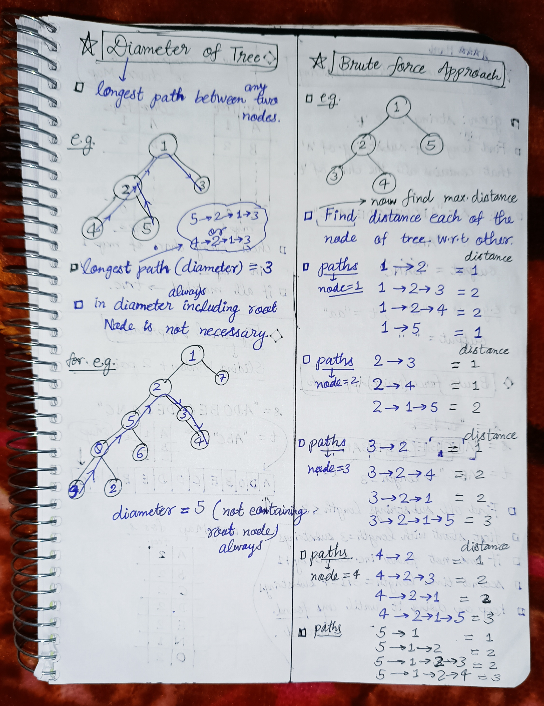
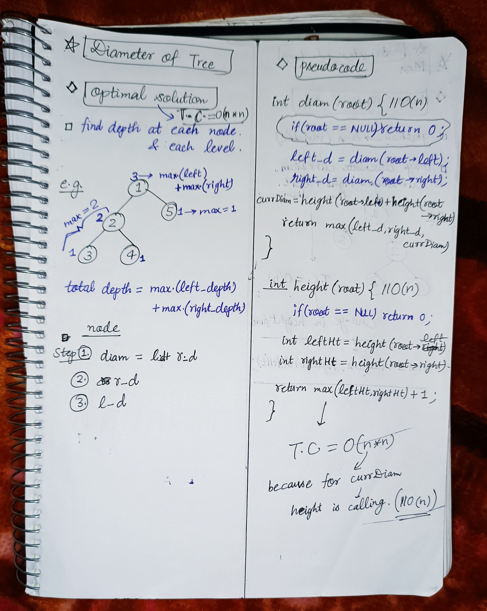
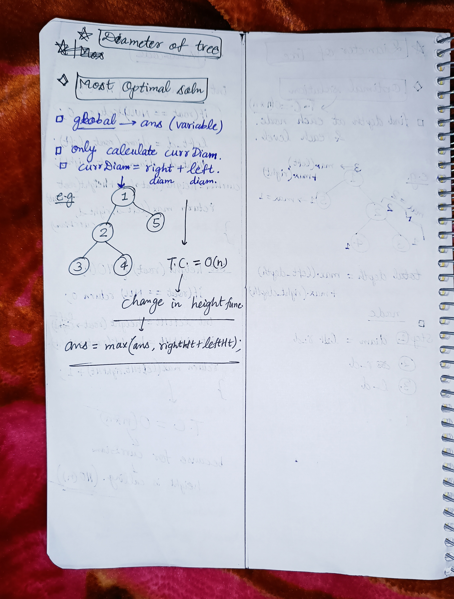

<h2><a href="https://leetcode.com/problems/diameter-of-binary-tree">543. Diameter of Binary Tree</a></h2><h3>Easy</h3><hr><p>Given the <code>root</code> of a binary tree, return <em>the length of the <strong>diameter</strong> of the tree</em>.</p>

<p>The <strong>diameter</strong> of a binary tree is the <strong>length</strong> of the longest path between any two nodes in a tree. This path may or may not pass through the <code>root</code>.</p>

<p>The <strong>length</strong> of a path between two nodes is represented by the number of edges between them.</p>

<p>&nbsp;</p>
<p><strong class="example">Example 1:</strong></p>

<pre>
<strong>Input:</strong> root = [1,2,3,4,5]
<strong>Output:</strong> 3
<strong>Explanation:</strong> 3 is the length of the path [4,2,1,3] or [5,2,1,3].
</pre>

<p><strong class="example">Example 2:</strong></p>

<pre>
<strong>Input:</strong> root = [1,2]
<strong>Output:</strong> 1
</pre>

<p>&nbsp;</p>
<p><strong>Constraints:</strong></p>

<ul>
	<li>The number of nodes in the tree is in the range <code>[1, 10<sup>4</sup>]</code>.</li>
	<li><code>-100 &lt;= Node.val &lt;= 100</code></li>
</ul>


<!-- AUTO-GENERATED-SOLUTION-START -->
---

## 🧠 Visual Solution & Intuition

### Part 1



### Part 2



### Part 3



---

## 💡 Approach

```text
Approach : Postorder DFS with height calculation
```

---

## ⏱️ Complexity Analysis

```text
Time Complexity = O(n) =>
Space Complexity = O(h) =>
```

---

## 💻 C++ Solution

[View Original C++ File](./0543-diameter-of-binary-tree.cpp)

```cpp
/**
 * Definition for a binary tree node.
 * struct TreeNode {
 *     int val;
 *     TreeNode *left;
 *     TreeNode *right;
 *     TreeNode() : val(0), left(nullptr), right(nullptr) {}
 *     TreeNode(int x) : val(x), left(nullptr), right(nullptr) {}
 *     TreeNode(int x, TreeNode *left, TreeNode *right) : val(x), left(left), right(right) {}
 * };
 */
class Solution {
public:
    //Approach : Postorder DFS with height calculation

    //Time Complexity = O(n) =>
    /* Each node is visited exactly once.
    * At each node, adding heights, comparing values, and returning height take O(1) time.
    * For n nodes, total time is O(n).
    */

    //Space Complexity = O(h) =>
    /* Recursive calls use stack space proportional to the tree’s height h.
    * Balanced tree: height is O(log n), so space is O(log n).
    * Skewed tree: height is O(n), so space is O(n).
    * Each call uses only a constant amount of local storage.
    */


    int height(TreeNode* root, int& diameter){

        //base-case
        if(root == NULL) return 0;

        // Step 5: Calculate the left & right subtree's height in nodes.
        int leftHeight = height(root->left, diameter);
        int rightHeight = height(root->right, diameter);

        //Step 6: Update diameter
        diameter = max(diameter, leftHeight + rightHeight);

        // Step 8: Return this subtree's height to its parent.
        // A parent can extend only one branch, so choose the taller one
        // and add 1 to include the current node.
        return 1 + max(leftHeight, rightHeight);
    }
    int diameterOfBinaryTree(TreeNode* root) {
        
        // Step 1: Initialize the longest path length to 0 edges.
        int diameter = 0;
        
        // Step 2: Traverse the tree and update the diameter.
        height(root, diameter);
        
        //Finally 
        return diameter;
    }
};
```

<!-- AUTO-GENERATED-SOLUTION-END -->
