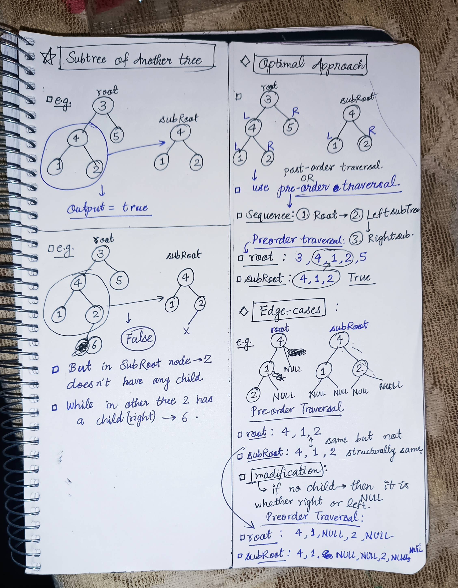

<h2><a href="https://leetcode.com/problems/subtree-of-another-tree">572. Subtree of Another Tree</a></h2><h3>Easy</h3><hr><p>Given the roots of two binary trees <code>root</code> and <code>subRoot</code>, return <code>true</code> if there is a subtree of <code>root</code> with the same structure and node values of<code> subRoot</code> and <code>false</code> otherwise.</p>

<p>A subtree of a binary tree <code>tree</code> is a tree that consists of a node in <code>tree</code> and all of this node&#39;s descendants. The tree <code>tree</code> could also be considered as a subtree of itself.</p>

<p>&nbsp;</p>
<p><strong class="example">Example 1:</strong></p>

<pre>
<strong>Input:</strong> root = [3,4,5,1,2], subRoot = [4,1,2]
<strong>Output:</strong> true
</pre>

<p><strong class="example">Example 2:</strong></p>

<pre>
<strong>Input:</strong> root = [3,4,5,1,2,null,null,null,null,0], subRoot = [4,1,2]
<strong>Output:</strong> false
</pre>

<p>&nbsp;</p>
<p><strong>Constraints:</strong></p>

<ul>
	<li>The number of nodes in the <code>root</code> tree is in the range <code>[1, 2000]</code>.</li>
	<li>The number of nodes in the <code>subRoot</code> tree is in the range <code>[1, 1000]</code>.</li>
	<li><code>-10<sup>4</sup> &lt;= root.val &lt;= 10<sup>4</sup></code></li>
	<li><code>-10<sup>4</sup> &lt;= subRoot.val &lt;= 10<sup>4</sup></code></li>
</ul>


<!-- AUTO-GENERATED-SOLUTION-START -->
---

## 🧠 Visual Solution & Intuition



---

## ⏱️ Complexity Analysis

```text
Time Complexity = O(N) => traversing n elements of the tree
Space Complexity =  O(N + M) => N = no. of nodes in root , M = no. of nodes in subRoot
```

---

## 💻 C++ Solution

[View Original C++ File](./0572-subtree-of-another-tree.cpp)

```cpp
/**
 * Definition for a binary tree node.
 * struct TreeNode {
 *     int val;
 *     TreeNode *left;
 *     TreeNode *right;
 *     TreeNode() : val(0), left(nullptr), right(nullptr) {}
 *     TreeNode(int x) : val(x), left(nullptr), right(nullptr) {}
 *     TreeNode(int x, TreeNode *left, TreeNode *right) : val(x), left(left), right(right) {}
 * };
 */
class Solution {
public:
    //Time Complexity = O(N) => traversing n elements of the tree
    //Space Complexity =  O(N + M) => N = no. of nodes in root , M = no. of nodes in subRoot
    //also recursion stack height = N, => O(N) for recursion preorder

    string preorder(TreeNode* node){
        //base case
        if(node == NULL) return "null" ;
        
        //now do preorder traversal
        //1.) add root node val in string
        string s = "," + to_string(node->val) ;
        //2.) left child
        s += preorder(node->left) ;
        //3.) right child
        s += preorder(node->right) ;
        

        return s ; //after the traversal
    }
    bool isSubtree(TreeNode* root, TreeNode* subRoot) {
        //converting both trees to string to do pre-order traversal and check subtree(substring)
        string fullTree = preorder(root) ;
        string subTree = preorder(subRoot) ;

        //return true if subTree exists inside fullTree
        return fullTree.find(subTree) != string::npos ;
        //npos → means “not found”
    
    }
};
```

<!-- AUTO-GENERATED-SOLUTION-END -->
