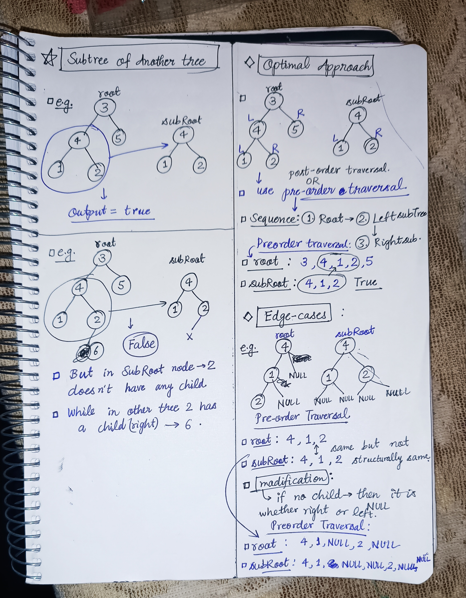

<h2><a href="https://leetcode.com/problems/subtree-of-another-tree">572. Subtree of Another Tree</a></h2><h3>Easy</h3><hr><p>Given the roots of two binary trees <code>root</code> and <code>subRoot</code>, return <code>true</code> if there is a subtree of <code>root</code> with the same structure and node values of<code> subRoot</code> and <code>false</code> otherwise.</p>

<p>A subtree of a binary tree <code>tree</code> is a tree that consists of a node in <code>tree</code> and all of this node&#39;s descendants. The tree <code>tree</code> could also be considered as a subtree of itself.</p>

<p>&nbsp;</p>
<p><strong class="example">Example 1:</strong></p>

<pre>
<strong>Input:</strong> root = [3,4,5,1,2], subRoot = [4,1,2]
<strong>Output:</strong> true
</pre>

<p><strong class="example">Example 2:</strong></p>

<pre>
<strong>Input:</strong> root = [3,4,5,1,2,null,null,null,null,0], subRoot = [4,1,2]
<strong>Output:</strong> false
</pre>

<p>&nbsp;</p>
<p><strong>Constraints:</strong></p>

<ul>
	<li>The number of nodes in the <code>root</code> tree is in the range <code>[1, 2000]</code>.</li>
	<li>The number of nodes in the <code>subRoot</code> tree is in the range <code>[1, 1000]</code>.</li>
	<li><code>-10<sup>4</sup> &lt;= root.val &lt;= 10<sup>4</sup></code></li>
	<li><code>-10<sup>4</sup> &lt;= subRoot.val &lt;= 10<sup>4</sup></code></li>
</ul>


<!-- AUTO-GENERATED-SOLUTION-START -->
---

## 🧠 Visual Solution & Intuition



---

## 💡 Approach

```text
Approach : Brute Force using DFS + Recursive Tree Comparison
```

---

## ⏱️ Complexity Analysis

```text
Time Complexity = O(n × m) =>
Space Complexity = O(hRoot + hSub) =>
```

---

## 💻 C++ Solution

[View Original C++ File](./0572-subtree-of-another-tree.cpp)

```cpp
/**
 * Definition for a binary tree node.
 * struct TreeNode {
 *     int val;
 *     TreeNode *left;
 *     TreeNode *right;
 *     TreeNode() : val(0), left(nullptr), right(nullptr) {}
 *     TreeNode(int x) : val(x), left(nullptr), right(nullptr) {}
 *     TreeNode(int x, TreeNode *left, TreeNode *right) : val(x), left(left), right(right) {}
 * };
 */
class Solution {
public:
    //Approach : Brute Force using DFS + Recursive Tree Comparison

    //Time Complexity = O(n × m) =>
    /* n = number of nodes in root.
    * m = number of nodes in subRoot.
    * isSubtree() can visit all n nodes as possible starting points.
    * At each starting point, isSameTree() can compare up to m nodes.
    * Therefore, the worst-case time is n × O(m) = O(n × m).
    */

    //Space Complexity = O(hRoot + hSub) =>
    /* hRoot and hSub are the heights of the two trees.
    * Searching through root uses a recursion stack of up to O(hRoot).
    * Comparing trees adds up to O(hSub) recursive calls while search calls remain active.
    No additional arrays or other data structures are created.
    Balanced trees: O(log n + log m).
    Worst-case skewed trees: O(n + m).
    */


    bool isSameTree(TreeNode* p, TreeNode* q) {
        
        //1.) Start with root nodes
        if(p == NULL && q == NULL){
            
            return true;
        }

        //2.) Only one empty subtree means different structures.
        if(p == NULL || q == NULL){

            return false;
        }

        //3.) Corresponding nodes must have equal values.
        if(p->val != q->val){
            return false;
        }

        //4.) Both left and right subtree pairs must match.
        return isSameTree(p->left, q->left) &&
            isSameTree(p->right, q->right);
    }

    bool isSubtree(TreeNode* root, TreeNode* subRoot) {
        
        //1.) An empty target is a subtree of any tree.
        if(subRoot == NULL) return true;

        //2.) An empty tree cannot contain a non-empty target.
        if(root == NULL) return false;

        //3.) Check whether the entire tree starting at
        // the current node matches subRoot exactly.
        if(isSameTree(root, subRoot)) return true;

        //4.) If the current node does not start a match,
        // try every possible starting point in its left subtree.
        if(isSubtree(root->left, subRoot)) return true;

        //5.) Search the right subtree.
        // Return false if no match exists there either.
        return isSubtree(root->right, subRoot);
        
    }
};
```

<!-- AUTO-GENERATED-SOLUTION-END -->
