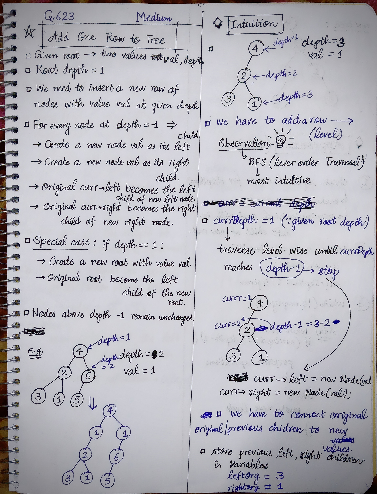
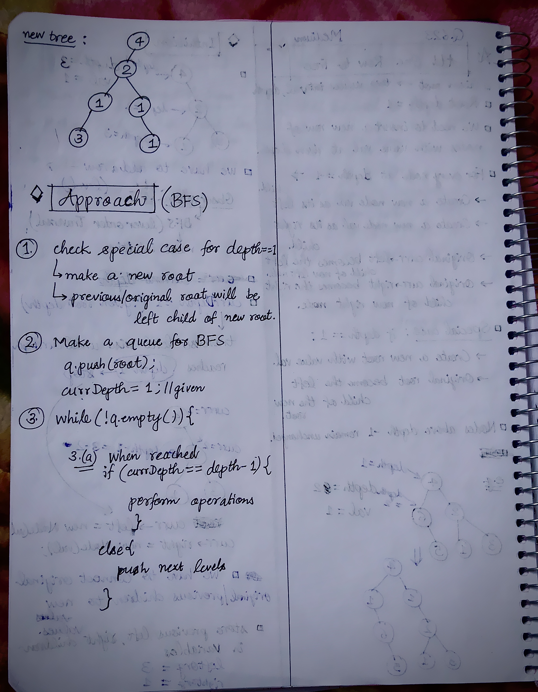

<h2><a href="https://leetcode.com/problems/add-one-row-to-tree">623. Add One Row to Tree</a></h2><h3>Medium</h3><hr><p>Given the <code>root</code> of a binary tree and two integers <code>val</code> and <code>depth</code>, add a row of nodes with value <code>val</code> at the given depth <code>depth</code>.</p>

<p>Note that the <code>root</code> node is at depth <code>1</code>.</p>

<p>The adding rule is:</p>

<ul>
	<li>Given the integer <code>depth</code>, for each not null tree node <code>cur</code> at the depth <code>depth - 1</code>, create two tree nodes with value <code>val</code> as <code>cur</code>&#39;s left subtree root and right subtree root.</li>
	<li><code>cur</code>&#39;s original left subtree should be the left subtree of the new left subtree root.</li>
	<li><code>cur</code>&#39;s original right subtree should be the right subtree of the new right subtree root.</li>
	<li>If <code>depth == 1</code> that means there is no depth <code>depth - 1</code> at all, then create a tree node with value <code>val</code> as the new root of the whole original tree, and the original tree is the new root&#39;s left subtree.</li>
</ul>

<p>&nbsp;</p>
<p><strong class="example">Example 1:</strong></p>

<pre>
<strong>Input:</strong> root = [4,2,6,3,1,5], val = 1, depth = 2
<strong>Output:</strong> [4,1,1,2,null,null,6,3,1,5]
</pre>

<p><strong class="example">Example 2:</strong></p>

<pre>
<strong>Input:</strong> root = [4,2,null,3,1], val = 1, depth = 3
<strong>Output:</strong> [4,2,null,1,1,3,null,null,1]
</pre>

<p>&nbsp;</p>
<p><strong>Constraints:</strong></p>

<ul>
	<li>The number of nodes in the tree is in the range <code>[1, 10<sup>4</sup>]</code>.</li>
	<li>The depth of the tree is in the range <code>[1, 10<sup>4</sup>]</code>.</li>
	<li><code>-100 &lt;= Node.val &lt;= 100</code></li>
	<li><code>-10<sup>5</sup> &lt;= val &lt;= 10<sup>5</sup></code></li>
	<li><code>1 &lt;= depth &lt;= the depth of tree + 1</code></li>
</ul>


<!-- AUTO-GENERATED-SOLUTION-START -->
---

## 🧠 Visual Solution & Intuition

### Part 1



### Part 2



---

## 💡 Approach

```text
Approach : BFS(Level Order Traversal)
```

---

## ⏱️ Complexity Analysis

```text
Time Complexity = O(N) =>
Space Complexity = O(N) =>
```

---

## 💻 C++ Solution

[View Original C++ File](./0623-add-one-row-to-tree.cpp)

```cpp
/**
 * Definition for a binary tree node.
 * struct TreeNode {
 *     int val;
 *     TreeNode *left;
 *     TreeNode *right;
 *     TreeNode() : val(0), left(nullptr), right(nullptr) {}
 *     TreeNode(int x) : val(x), left(nullptr), right(nullptr) {}
 *     TreeNode(int x, TreeNode *left, TreeNode *right) : val(x), left(left), right(right) {}
 * };
 */
class Solution {
public:
    //Approach : BFS(Level Order Traversal)

    //Time Complexity = O(N) => 
    /* BFS may visit every node once.
    */

    //Space Complexity = O(N) =>
    /* Queue can store up to N nodes in the worst case.
    */

    TreeNode* addOneRow(TreeNode* root, int val, int depth) {
       
        //Special case
        if(depth == 1){
            //make a new root with value = val
            TreeNode* newRoot = new TreeNode(val);
            newRoot->left = root;//make original root to its left child
            return newRoot;
        }
        
        queue<TreeNode*> q; //queue for BFS

        q.push(root);

        int currDepth = 1; //given root depth = 1

        while(!q.empty()){

            int N = q.size();//size of curr level
            
            while(N--){//Process every node at this level
                
                TreeNode* curr = q.front();
                q.pop();

                if(currDepth == depth-1){ //if we have reached depth-1

                //store original left & right children
                TreeNode* leftOrg = curr->left;
                TreeNode* rightOrg = curr->right;
                
                //make new nodes
                TreeNode* newLeft = new TreeNode(val);
                TreeNode* newRight = new TreeNode(val);
                
                //attach new left, new right
                curr->left = newLeft;
                curr->right = newRight;
                
                //preserve original subTrees
                newLeft->left = leftOrg;
                newRight->right = rightOrg;                
                }

                else{
                    if(curr->left != NULL){
                        q.push(curr->left);
                    }
                    if(curr->right != NULL){
                        q.push(curr->right);
                    }
                }
            }

            //if row was inserted, then stop
            if(currDepth == depth-1){
                break;
            }

            currDepth++;//update level or depth            
            
        }

        //finally return root of the new tree
        return root;

    }
};
```

<!-- AUTO-GENERATED-SOLUTION-END -->
