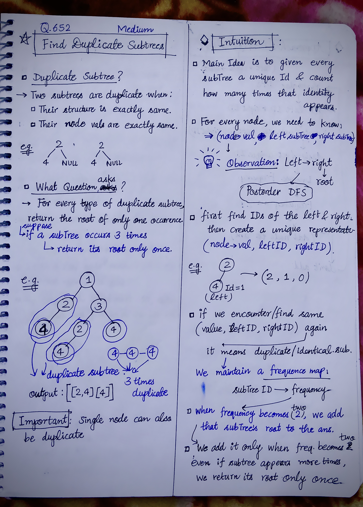
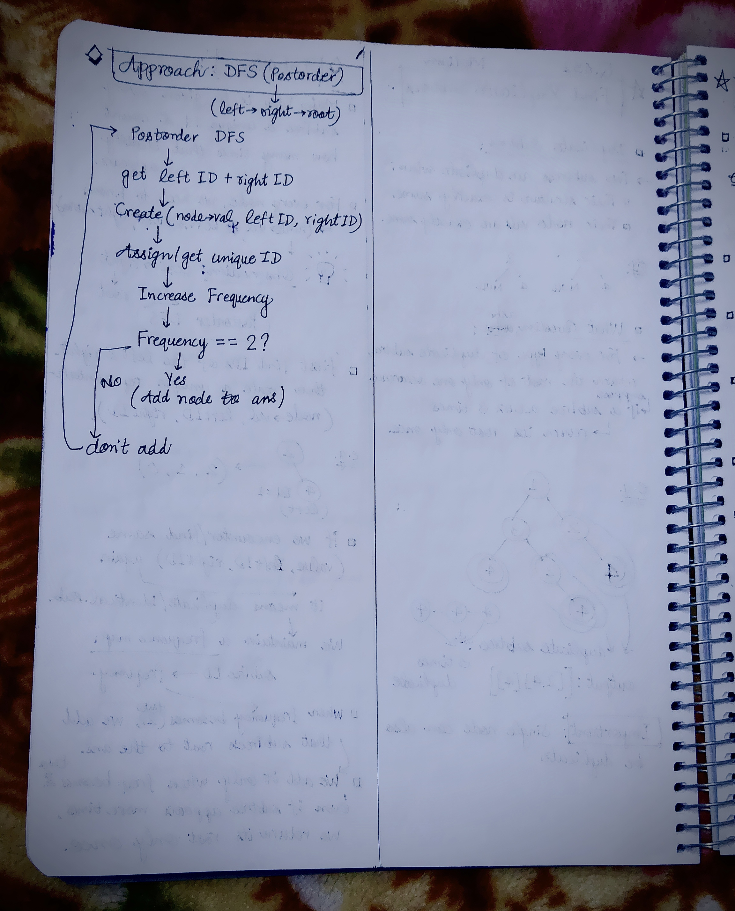

<h2><a href="https://leetcode.com/problems/find-duplicate-subtrees">652. Find Duplicate Subtrees</a></h2><h3>Medium</h3><hr><p>Given the <code>root</code>&nbsp;of a binary tree, return all <strong>duplicate subtrees</strong>.</p>

<p>For each kind of duplicate subtrees, you only need to return the root node of any <b>one</b> of them.</p>

<p>Two trees are <strong>duplicate</strong> if they have the <strong>same structure</strong> with the <strong>same node values</strong>.</p>

<p>&nbsp;</p>
<p><strong class="example">Example 1:</strong></p>

<pre>
<strong>Input:</strong> root = [1,2,3,4,null,2,4,null,null,4]
<strong>Output:</strong> [[2,4],[4]]
</pre>

<p><strong class="example">Example 2:</strong></p>

<pre>
<strong>Input:</strong> root = [2,1,1]
<strong>Output:</strong> [[1]]
</pre>

<p><strong class="example">Example 3:</strong></p>

<pre>
<strong>Input:</strong> root = [2,2,2,3,null,3,null]
<strong>Output:</strong> [[2,3],[3]]
</pre>

<p>&nbsp;</p>
<p><strong>Constraints:</strong></p>

<ul>
	<li>The number of the nodes in the tree will be in the range <code>[1, 5000]</code></li>
	<li><code>-200 &lt;= Node.val &lt;= 200</code></li>
</ul>


<!-- AUTO-GENERATED-SOLUTION-START -->
---

## 🧠 Visual Solution & Intuition

### Part 1



### Part 2



---

## 💡 Approach

```text
Approach : Postorder DFS + Subtree Serialization using Unique IDs + HashMap Frequency Counting
```

---

## ⏱️ Complexity Analysis

```text
Time Complexity = O(n * logn) =>
```

---

## 💻 C++ Solution

[View Original C++ File](./0652-find-duplicate-subtrees.cpp)

```cpp
/**
 * Definition for a binary tree node.
 * struct TreeNode {
 *     int val;
 *     TreeNode *left;
 *     TreeNode *right;
 *     TreeNode() : val(0), left(nullptr), right(nullptr) {}
 *     TreeNode(int x) : val(x), left(nullptr), right(nullptr) {}
 *     TreeNode(int x, TreeNode *left, TreeNode *right) : val(x), left(left), right(right) {}
 * };
 */
class Solution {
public:
    //Approach : Postorder DFS + Subtree Serialization using Unique IDs + HashMap Frequency Counting

    //Time Complexity = O(n * logn) =>
    /* For every node, we:
    1. Visit it once using DFS → O(n) total.
    2. Create the subtree key:
        (node->val, leftID, rightID) -> O(1)

    3. Search/insert this key in a map:
        subtreeMap[key] => A map operation costs O(log n).
    
    Therefore:
        n nodes × O(log n) = O(n * logn)
    */

    //Space Compexity = O(n) =>
    /* We store information for up to n different subtrees:
        subtreeMap
        freqMap
        Each can contain up to n entries → O(n).
    * Also, the DFS recursion stack can be:
        * Balanced tree → O(log n)
        * Skewed tree → O(n)
    
    Overall : O(n) + O(logn) + O(n) = O(n)
    */


    //(node val, leftID, rightID) = uniqueID
    map<tuple<int, int, int>, int> subtreeMap;

    //unqueID -> frequency
    unordered_map<int, int> freqMap;

    vector<TreeNode* > ans;
    
    int id = 1;

    int dfs(TreeNode* node){
        //base-case
        if(node == NULL) return 0;
        
        int leftID = dfs(node->left);
        int rightID = dfs(node->right);
        
        //create subtree signature
        auto key = make_tuple(node->val, leftID, rightID);
        
        //Get uniqueID
        if(subtreeMap.find(key) == subtreeMap.end()){
            subtreeMap[key] = id++;
        }
       
        int uniqueID = subtreeMap[key];
        
        //increase frequency
        freqMap[uniqueID]++;

        //if frequency == 2 then add node to ans
        if(freqMap[uniqueID] == 2){
            ans.push_back(node);
        }

        return uniqueID;
    }
    vector<TreeNode*> findDuplicateSubtrees(TreeNode* root) {
        
        //func. call to perform necessary operations and get ans
        dfs(root);

        return ans;
    }
};
```

<!-- AUTO-GENERATED-SOLUTION-END -->
