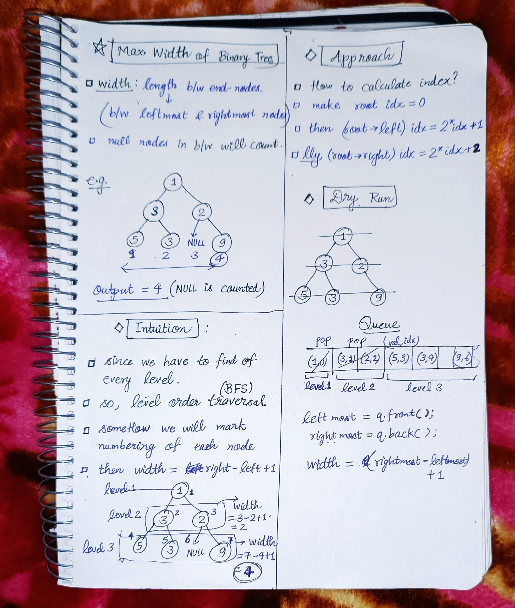

<h2><a href="https://leetcode.com/problems/maximum-width-of-binary-tree">662. Maximum Width of Binary Tree</a></h2><h3>Medium</h3><hr><p>Given the <code>root</code> of a binary tree, return <em>the <strong>maximum width</strong> of the given tree</em>.</p>

<p>The <strong>maximum width</strong> of a tree is the maximum <strong>width</strong> among all levels.</p>

<p>The <strong>width</strong> of one level is defined as the length between the end-nodes (the leftmost and rightmost non-null nodes), where the null nodes between the end-nodes that would be present in a complete binary tree extending down to that level are also counted into the length calculation.</p>

<p>It is <strong>guaranteed</strong> that the answer will in the range of a <strong>32-bit</strong> signed integer.</p>

<p>&nbsp;</p>
<p><strong class="example">Example 1:</strong></p>

<pre>
<strong>Input:</strong> root = [1,3,2,5,3,null,9]
<strong>Output:</strong> 4
<strong>Explanation:</strong> The maximum width exists in the third level with length 4 (5,3,null,9).
</pre>

<p><strong class="example">Example 2:</strong></p>

<pre>
<strong>Input:</strong> root = [1,3,2,5,null,null,9,6,null,7]
<strong>Output:</strong> 7
<strong>Explanation:</strong> The maximum width exists in the fourth level with length 7 (6,null,null,null,null,null,7).
</pre>

<p><strong class="example">Example 3:</strong></p>

<pre>
<strong>Input:</strong> root = [1,3,2,5]
<strong>Output:</strong> 2
<strong>Explanation:</strong> The maximum width exists in the second level with length 2 (3,2).
</pre>

<p>&nbsp;</p>
<p><strong>Constraints:</strong></p>

<ul>
	<li>The number of nodes in the tree is in the range <code>[1, 3000]</code>.</li>
	<li><code>-100 &lt;= Node.val &lt;= 100</code></li>
</ul>


<!-- AUTO-GENERATED-SOLUTION-START -->
---

## 🧠 Visual Solution & Intuition



---

## 💻 C++ Solution

[View Original C++ File](./0662-maximum-width-of-binary-tree.cpp)

```cpp
/**
 * Definition for a binary tree node.
 * struct TreeNode {
 *     int val;
 *     TreeNode *left;
 *     TreeNode *right;
 *     TreeNode() : val(0), left(nullptr), right(nullptr) {}
 *     TreeNode(int x) : val(x), left(nullptr), right(nullptr) {}
 *     TreeNode(int x, TreeNode *left, TreeNode *right) : val(x), left(left), right(right) {}
 * };
 */
class Solution {
public:
    typedef unsigned long long ll ; //this will help to avoid writing long long everywhere.
    //int datatype will give overflow size
    int widthOfBinaryTree(TreeNode* root) {
        //make pair queue to store (val,idx) 
        queue<pair<TreeNode*, ll>> q ;
        //push (root,0)
        q.push({root,0}) ;

        ll maxWidth = 0 ;
        //Level order traversal
        while(!q.empty()){
            //find leftmost & rightmost idx
            ll L = q.front().second ;
            ll R = q.back().second ;
            ll width = R-L+1 ;

            maxWidth = max(maxWidth, width) ;

            int n = q.size() ; //current level size

            while(n--){
                TreeNode* curr = q.front().first ; //curr node of tree
                ll idx = q.front().second ;
                q.pop() ; 

                if(curr->left)
                    q.push({curr->left, 2*idx+1}) ;
                
                if(curr->right)
                    q.push({curr->right, 2*idx+2}) ;
            }
        }

        return maxWidth ; //very important to return the ans.
    }
};
```

<!-- AUTO-GENERATED-SOLUTION-END -->
