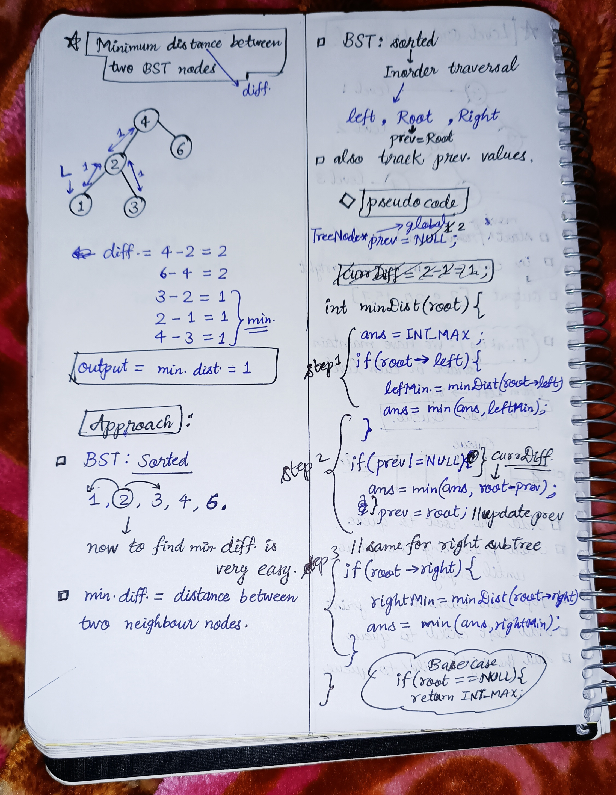

<h2><a href="https://leetcode.com/problems/minimum-distance-between-bst-nodes">799. Minimum Distance Between BST Nodes</a></h2><h3>Easy</h3><hr><p>Given the <code>root</code> of a Binary Search Tree (BST), return <em>the minimum difference between the values of any two different nodes in the tree</em>.</p>

<p>&nbsp;</p>
<p><strong class="example">Example 1:</strong></p>

<pre>
<strong>Input:</strong> root = [4,2,6,1,3]
<strong>Output:</strong> 1
</pre>

<p><strong class="example">Example 2:</strong></p>

<pre>
<strong>Input:</strong> root = [1,0,48,null,null,12,49]
<strong>Output:</strong> 1
</pre>

<p>&nbsp;</p>
<p><strong>Constraints:</strong></p>

<ul>
	<li>The number of nodes in the tree is in the range <code>[2, 100]</code>.</li>
	<li><code>0 &lt;= Node.val &lt;= 10<sup>5</sup></code></li>
</ul>

<p>&nbsp;</p>
<p><strong>Note:</strong> This question is the same as 530: <a href="https://leetcode.com/problems/minimum-absolute-difference-in-bst/" target="_blank">https://leetcode.com/problems/minimum-absolute-difference-in-bst/</a></p>


<!-- AUTO-GENERATED-SOLUTION-START -->
---

## 🧠 Visual Solution & Intuition



---

## ⏱️ Complexity Analysis

```text
Time Complexity = O(n)
Space Complexity = O(H) where H = height of the tree
```

---

## 💻 C++ Solution

[View Original C++ File](./0783-minimum-distance-between-bst-nodes.cpp)

```cpp
/**
 * Definition for a binary tree node.
 * struct TreeNode {
 *     int val;
 *     TreeNode *left;
 *     TreeNode *right;
 *     TreeNode() : val(0), left(nullptr), right(nullptr) {}
 *     TreeNode(int x) : val(x), left(nullptr), right(nullptr) {}
 *     TreeNode(int x, TreeNode *left, TreeNode *right) : val(x), left(left), right(right) {}
 * };
 */
class Solution {
public:
    //Time Complexity = O(n)
    //Space Complexity = O(H) where H = height of the tree
    //global prev pointer 
    TreeNode *prev = NULL ;

    int minDiffInBST(TreeNode* root) {
        
        //base case
        if(root == NULL){
            return INT_MAX ; 
        }

        int ans = INT_MAX ;
        //Step 1 : for left subTree
        if(root->left){
            int leftMin = minDiffInBST(root->left) ;
            ans = min(ans, leftMin) ;
        }

        //Step 2 : for root node
        if(prev != NULL){
            ans = min(ans, root->val - prev->val) ; //currDiff = root-prev
        }
        prev = root ; //update prev pointer
        

        //Step 3 : for right subTree
        if(root->right){
            int rightMin = minDiffInBST(root->right) ;
            ans = min(ans, rightMin) ;
        }

        return ans ; //very important to return the ans
    }
};
```

<!-- AUTO-GENERATED-SOLUTION-END -->
