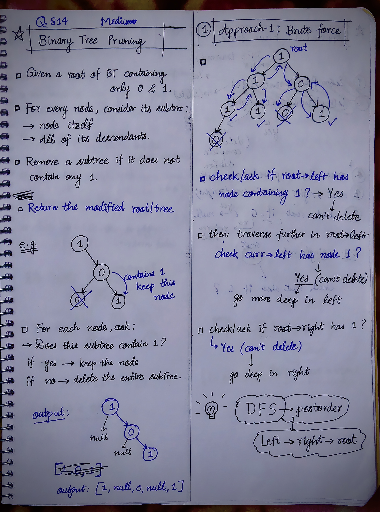
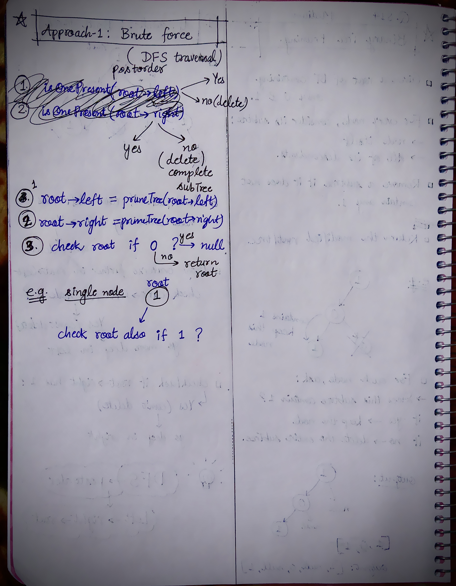

<h2><a href="https://leetcode.com/problems/binary-tree-pruning">832. Binary Tree Pruning</a></h2><h3>Medium</h3><hr><p>Given the <code>root</code> of a binary tree, return <em>the same tree where every subtree (of the given tree) not containing a </em><code>1</code><em> has been removed</em>.</p>

<p>A subtree of a node <code>node</code> is <code>node</code> plus every node that is a descendant of <code>node</code>.</p>

<p>&nbsp;</p>
<p><strong class="example">Example 1:</strong></p>

<pre>
<strong>Input:</strong> root = [1,null,0,0,1]
<strong>Output:</strong> [1,null,0,null,1]
<strong>Explanation:</strong> 
Only the red nodes satisfy the property &quot;every subtree not containing a 1&quot;.
The diagram on the right represents the answer.
</pre>

<p><strong class="example">Example 2:</strong></p>

<pre>
<strong>Input:</strong> root = [1,0,1,0,0,0,1]
<strong>Output:</strong> [1,null,1,null,1]
</pre>

<p><strong class="example">Example 3:</strong></p>

<pre>
<strong>Input:</strong> root = [1,1,0,1,1,0,1,0]
<strong>Output:</strong> [1,1,0,1,1,null,1]
</pre>

<p>&nbsp;</p>
<p><strong>Constraints:</strong></p>

<ul>
	<li>The number of nodes in the tree is in the range <code>[1, 200]</code>.</li>
	<li><code>Node.val</code> is either <code>0</code> or <code>1</code>.</li>
</ul>


<!-- AUTO-GENERATED-SOLUTION-START -->
---

## 🧠 Visual Solution & Intuition

### Part 1



### Part 2



---

## 💡 Approach

```text
Approach : PostOrder DFS (left -> right -> root)
```

---

## ⏱️ Complexity Analysis

```text
Time Complexity = O(N) =>
Space Complexity = O(H) =>
```

---

## 💻 C++ Solution

[View Original C++ File](./0814-binary-tree-pruning.cpp)

```cpp
/**
 * Definition for a binary tree node.
 * struct TreeNode {
 *     int val;
 *     TreeNode *left;
 *     TreeNode *right;
 *     TreeNode() : val(0), left(nullptr), right(nullptr) {}
 *     TreeNode(int x) : val(x), left(nullptr), right(nullptr) {}
 *     TreeNode(int x, TreeNode *left, TreeNode *right) : val(x), left(left), right(right) {}
 * };
 */
class Solution {
public:
    //Approach : PostOrder DFS (left -> right -> root)

    //Time Complexity = O(N) =>
    /* Each node is visited once.
    * For every node, we perform constant-time work.
    * Therefore, total time = O(N).
    */

    //Space Complexity = O(H) =>
    /* Due to the recursion stack.
    * H = height of the tree.
    * Worst case (skewed tree): O(N).
    * Best case (balanced tree): O(log N).
    */

    
    TreeNode* pruneTree(TreeNode* root) {
        //base-case or edge-case
        //if empty tree
        if(root == NULL){
            return NULL;
        }

        //1.) recursively call for root->left
        root->left = pruneTree(root->left);

        //2.) recursively call for root->right
        root->right = pruneTree(root->right);


        //3.) check if root == 0 ? or 1 ? for single node
        if(root->left == NULL && root->right == NULL && root->val == 0){
            return NULL;
        }
        
        else{
            return root;
        }
    }
};
```

<!-- AUTO-GENERATED-SOLUTION-END -->
