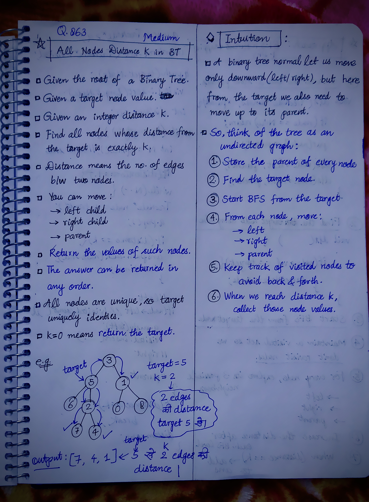
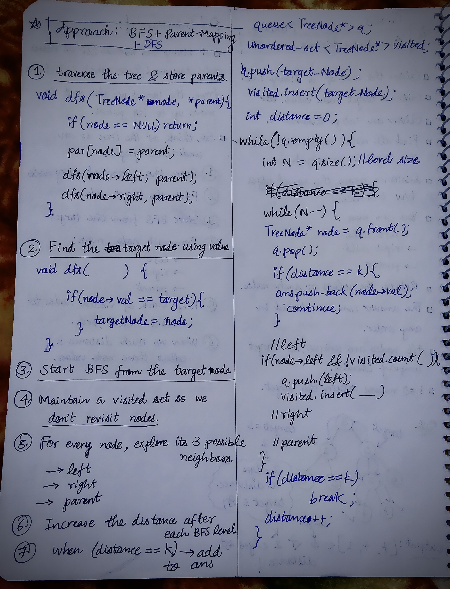

<h2><a href="https://leetcode.com/problems/all-nodes-distance-k-in-binary-tree/">863. All Nodes Distance K in Binary Tree</a></h2><h3>Medium</h3><hr><p>Given the <code>root</code> of a binary tree, the value of a target node <code>target</code>, and an integer <code>k</code>, return <em>an array of the values of all nodes that have a distance </em><code>k</code><em> from the target node.</em></p>

<p>You can return the answer in <strong>any order</strong>.</p>

<p>&nbsp;</p>
<p><strong class="example">Example 1:</strong></p>

<pre>
<strong>Input:</strong> root = [3,5,1,6,2,0,8,null,null,7,4], target = 5, k = 2
<strong>Output:</strong> [7,4,1]
Explanation: The nodes that are a distance 2 from the target node (with value 5) have values 7, 4, and 1.
</pre>

<p><strong class="example">Example 2:</strong></p>

<pre>
<strong>Input:</strong> root = [1], target = 1, k = 3
<strong>Output:</strong> []
</pre>

<p>&nbsp;</p>
<p><strong>Constraints:</strong></p>

<ul>
	<li>The number of nodes in the tree is in the range <code>[1, 500]</code>.</li>
	<li><code>0 &lt;= Node.val &lt;= 500</code></li>
	<li>All the values <code>Node.val</code> are <strong>unique</strong>.</li>
	<li><code>target</code> is the value of one of the nodes in the tree.</li>
	<li><code>0 &lt;= k &lt;= 1000</code></li>
</ul>


<!-- AUTO-GENERATED-SOLUTION-START -->
---

## 🧠 Visual Solution & Intuition

### Part 1



### Part 2



---

## 💡 Approach

```text
Approach : Parent Mapping(DFS) + BFS (Level Order Traversal)
```

---

## ⏱️ Complexity Analysis

```text
Time Complexity = O(N) =>
Space Complexity = O(N) =>
```

---

## 💻 C++ Solution

[View Original C++ File](./0863-all-nodes-distance-k-in-binary-tree.cpp)

```cpp
/**
 * Definition for a binary tree node.
 * struct TreeNode {
 *     int val;
 *     TreeNode *left;
 *     TreeNode *right;
 *     TreeNode(int x) : val(x), left(NULL), right(NULL) {}
 * };
 */
class Solution {
public:
    //Approach : Parent Mapping(DFS) + BFS (Level Order Traversal)

    //Time Complexity = O(N) =>
    /* DFS visits every node once → O(N)
    * BFS visits every node at most once → O(N)
    * Overall → O(N) 
    */

    //Space Complexity = O(N) =>
    /* Parent map → O(N)
    * Queue → O(N) in worst case
    * Visited set → O(N)
    * Recursion stack → O(H)
    */


    TreeNode* targetNode = NULL;
    unordered_map<TreeNode*, TreeNode* > par;
    
    //Step-1:
    void dfs(TreeNode* node, TreeNode* parent, int target){
        //base-case
        if(node == NULL) return;
        
        par[node] = parent;//store parents in map

        //Step-2: 
        if(node->val == target){
            targetNode = node;
        }

        dfs(node->left, node, target);
        dfs(node->right, node, target);
    }

    vector<int> distanceK(TreeNode* root, TreeNode* target, int k) {
        
        // Build parent map and find targetNode
        dfs(root, NULL, target->val);
        
        vector<int > ans;//to store the output

        queue<TreeNode* > q;
        unordered_set<TreeNode* > visited;

        //Step-3: start with BFS with targetNode
        q.push(targetNode);
        visited.insert(targetNode);

        int distance = 0;

        while(!q.empty()){
            int N = q.size();//size of current level

            while(N--){//process all nodes of current level

                TreeNode* node = q.front();
                q.pop();

                //check if reached (distance == k) then add to ans
                if(distance == k){
                    ans.push_back(node->val);
                    continue;
                }
                
                //explore neighbors in 3 directions
                //left
                if(node->left && visited.count(node->left) == false){
                    q.push(node->left);
                    visited.insert(node->left);
                }

                //right
                if(node->right && visited.count(node->right) == false){
                    q.push(node->right);
                    visited.insert(node->right);
                }

                //parent
                if(par[node] && visited.count(par[node]) == false){
                    q.push(par[node]);
                    visited.insert(par[node]);
                }
            }
            //after current level
            if(distance == k){
                break;
            }
            distance++;
        }

        //finally return the output array
        return ans;
       
    }
};
```

<!-- AUTO-GENERATED-SOLUTION-END -->
