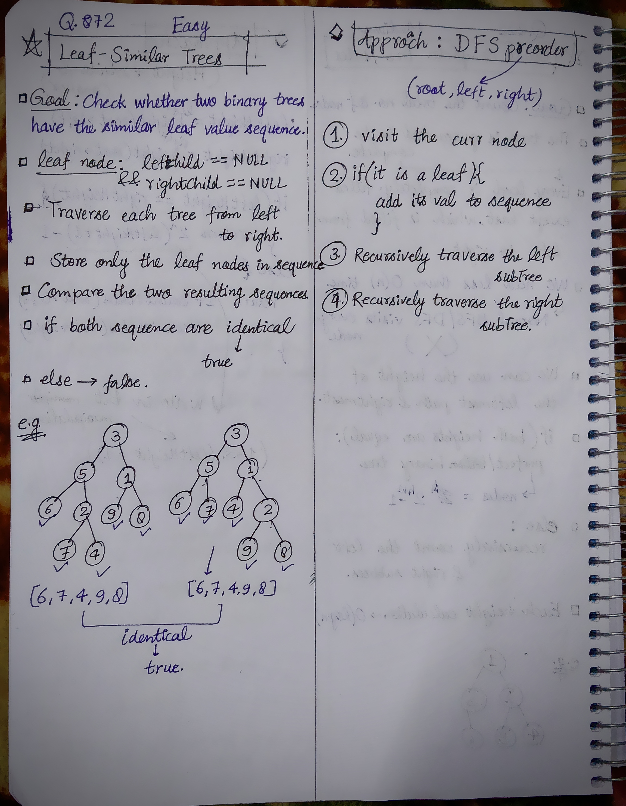

<h2><a href="https://leetcode.com/problems/leaf-similar-trees">904. Leaf-Similar Trees</a></h2><h3>Easy</h3><hr><p>Consider all the leaves of a binary tree, from&nbsp;left to right order, the values of those&nbsp;leaves form a <strong>leaf value sequence</strong><em>.</em></p>

<p></p>

<p>For example, in the given tree above, the leaf value sequence is <code>(6, 7, 4, 9, 8)</code>.</p>

<p>Two binary trees are considered <em>leaf-similar</em>&nbsp;if their leaf value sequence is the same.</p>

<p>Return <code>true</code> if and only if the two given trees with head nodes <code>root1</code> and <code>root2</code> are leaf-similar.</p>

<p>&nbsp;</p>
<p><strong class="example">Example 1:</strong></p>

<pre>
<strong>Input:</strong> root1 = [3,5,1,6,2,9,8,null,null,7,4], root2 = [3,5,1,6,7,4,2,null,null,null,null,null,null,9,8]
<strong>Output:</strong> true
</pre>

<p><strong class="example">Example 2:</strong></p>

<pre>
<strong>Input:</strong> root1 = [1,2,3], root2 = [1,3,2]
<strong>Output:</strong> false
</pre>

<p>&nbsp;</p>
<p><strong>Constraints:</strong></p>

<ul>
	<li>The number of nodes in each tree will be in the range <code>[1, 200]</code>.</li>
	<li>Both of the given trees will have values in the range <code>[0, 200]</code>.</li>
</ul>


<!-- AUTO-GENERATED-SOLUTION-START -->
---

## 🧠 Visual Solution & Intuition



---

## 💡 Approach

```text
Approach : DFS (Preorder)
```

---

## ⏱️ Complexity Analysis

```text
Time Complexity = O(n + m) =>
Space Complexity = O(n) =>
```

---

## 💻 C++ Solution

[View Original C++ File](./0872-leaf-similar-trees.cpp)

```cpp
/**
 * Definition for a binary tree node.
 * struct TreeNode {
 *     int val;
 *     TreeNode *left;
 *     TreeNode *right;
 *     TreeNode() : val(0), left(nullptr), right(nullptr) {}
 *     TreeNode(int x) : val(x), left(nullptr), right(nullptr) {}
 *     TreeNode(int x, TreeNode *left, TreeNode *right) : val(x), left(left), right(right) {}
 * };
 */
class Solution {
public:
    //Approach : DFS (Preorder)

    //Time Complexity = O(n + m) =>
    /* n = number of nodes in root1
    * m = number of nodes in root2
    * dfs(root1) visits every node → O(n)
    * dfs(root2) visits every node → O(m)
    * Comparing leaf1 == leaf2 takes O(L), where L is the number of leaves.
    * Since L ≤ n,m, total remains: O(n + m)
    */

    //Space Complexity = O(n) =>
    /* leaf1 stores up to n leaf values → O(n)
    * leaf2 stores up to m leaf values → O(m)
    * DFS recursion stack:
        * Worst case skewed tree → O(n + m) 
    */

    void dfs(TreeNode* root, vector<int>& leaf){
        //base-case
        if(root == NULL){
            return;
        }

        //check if it a leaf node
        if(root->left == NULL && root->right == NULL){
            leaf.push_back(root->val);
            return;
        }

        //recursively traverse the left, right subTree
        dfs(root->left, leaf);
        dfs(root->right, leaf);

    }
    bool leafSimilar(TreeNode* root1, TreeNode* root2) {

        vector<int> leaf1; //stores the leaf sequence of root1
        vector<int> leaf2;
        
        dfs(root1, leaf1);
        dfs(root2, leaf2);

        if(leaf1 == leaf2){
            return true;
        }

        else{
            return false;
        }

    }
};
```

<!-- AUTO-GENERATED-SOLUTION-END -->
