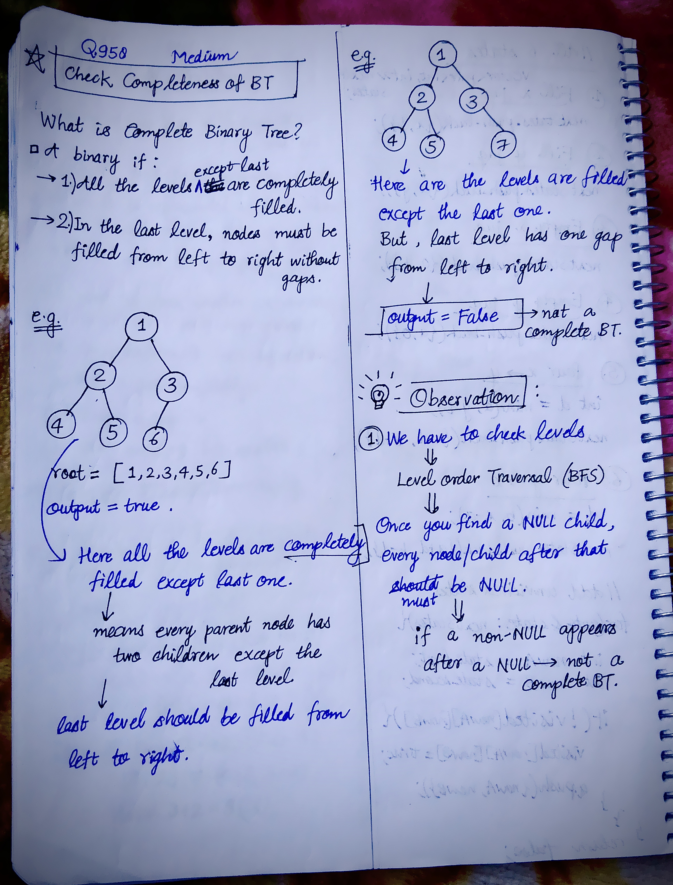
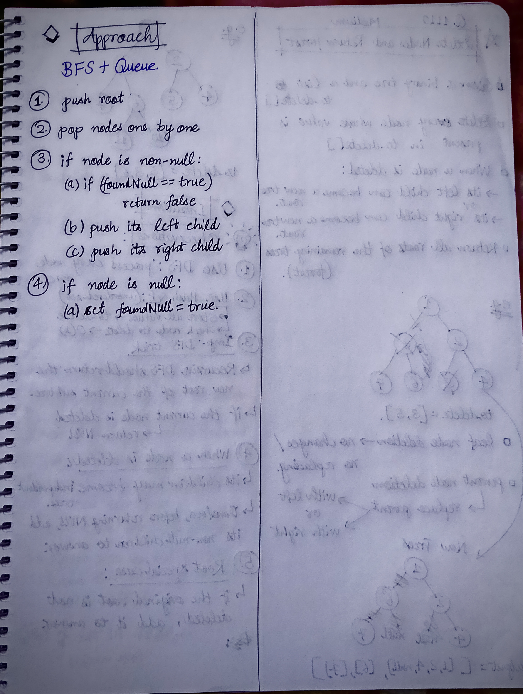

<h2><a href="https://leetcode.com/problems/check-completeness-of-a-binary-tree">998. Check Completeness of a Binary Tree</a></h2><h3>Medium</h3><hr><p>Given the <code>root</code> of a binary tree, determine if it is a <em>complete binary tree</em>.</p>

<p>In a <strong><a href="http://en.wikipedia.org/wiki/Binary_tree#Types_of_binary_trees" target="_blank">complete binary tree</a></strong>, every level, except possibly the last, is completely filled, and all nodes in the last level are as far left as possible. It can have between <code>1</code> and <code>2<sup>h</sup></code> nodes inclusive at the last level <code>h</code>.</p>

<p>&nbsp;</p>
<p><strong class="example">Example 1:</strong></p>

<pre>
<strong>Input:</strong> root = [1,2,3,4,5,6]
<strong>Output:</strong> true
<strong>Explanation:</strong> Every level before the last is full (ie. levels with node-values {1} and {2, 3}), and all nodes in the last level ({4, 5, 6}) are as far left as possible.
</pre>

<p><strong class="example">Example 2:</strong></p>

<pre>
<strong>Input:</strong> root = [1,2,3,4,5,null,7]
<strong>Output:</strong> false
<strong>Explanation:</strong> The node with value 7 isn&#39;t as far left as possible.
</pre>

<p>&nbsp;</p>
<p><strong>Constraints:</strong></p>

<ul>
	<li>The number of nodes in the tree is in the range <code>[1, 100]</code>.</li>
	<li><code>1 &lt;= Node.val &lt;= 1000</code></li>
</ul>


<!-- AUTO-GENERATED-SOLUTION-START -->
---

## 🧠 Visual Solution & Intuition

### Part 1



### Part 2



---

## 💡 Approach

```text
Approach : BFS + Queue
```

---

## ⏱️ Complexity Analysis

```text
Time Complexity = O(n) => for n nodes
Space Complexity = O(n) =>
```

---

## 💻 C++ Solution

[View Original C++ File](./0958-check-completeness-of-a-binary-tree.cpp)

```cpp
/**
 * Definition for a binary tree node.
 * struct TreeNode {
 *     int val;
 *     TreeNode *left;
 *     TreeNode *right;
 *     TreeNode() : val(0), left(nullptr), right(nullptr) {}
 *     TreeNode(int x) : val(x), left(nullptr), right(nullptr) {}
 *     TreeNode(int x, TreeNode *left, TreeNode *right) : val(x), left(left), right(right) {}
 * };
 */
class Solution {
public:
    //Approach : BFS + Queue

    //Time Complexity = O(n) => for n nodes
    /* Every node is pushed into the queue once.
    * Every node is popped from the queue once.
    * Each node does constant work:
    * check NULL
    * push left child
    * push right child
    */

    //Space Complexity = O(n) =>
    /* Because of the queue:
    * In the worst case, the queue can contain n nodes.
    */

    bool isCompleteTree(TreeNode* root) {
        
        queue<TreeNode*> q;
        
        //1.)
        q.push(root);
        
        bool foundNull = false;

        while(!q.empty()){
            //2.)
            TreeNode* node = q.front();
            q.pop();
            //3.)
            if(node != NULL){
                //3.a)
                if(foundNull == true){
                    return false;
                }
                
                //3.b)
                q.push(node->left);
                q.push(node->right);
            }
            else{//means node is null
                foundNull = true;
            }
        }
        
        //4.) If no non-NULL node is found after NULL, tree is complete.
        return true;
    }
};
```

<!-- AUTO-GENERATED-SOLUTION-END -->
