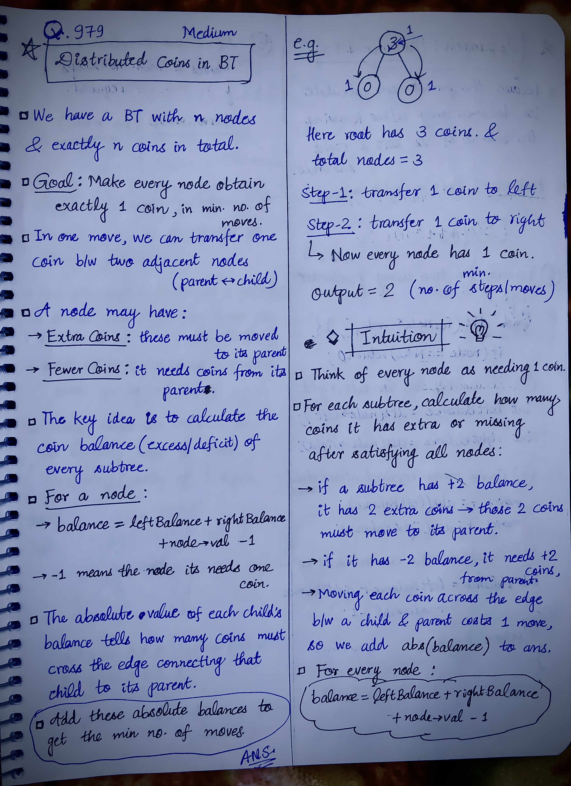
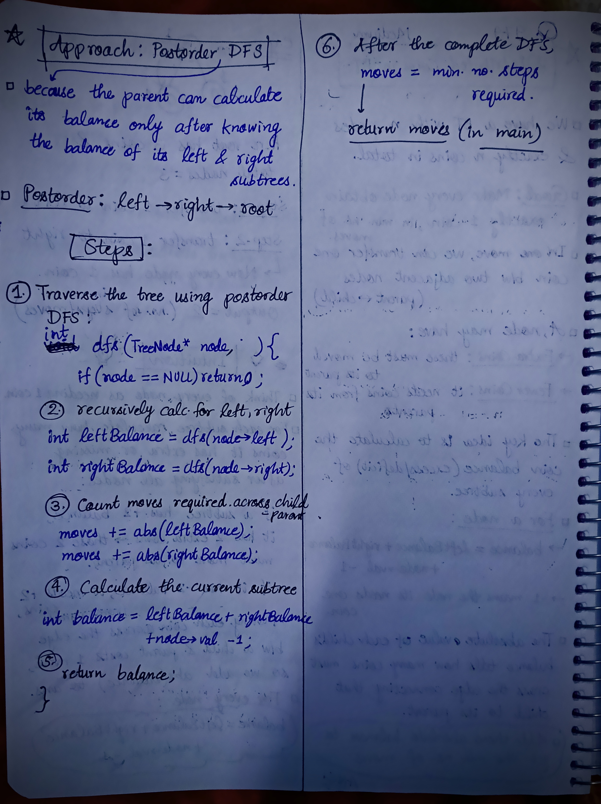

<h2><a href="https://leetcode.com/problems/distribute-coins-in-binary-tree">1021. Distribute Coins in Binary Tree</a></h2><h3>Medium</h3><hr><p>You are given the <code>root</code> of a binary tree with <code>n</code> nodes where each <code>node</code> in the tree has <code>node.val</code> coins. There are <code>n</code> coins in total throughout the whole tree.</p>

<p>In one move, we may choose two adjacent nodes and move one coin from one node to another. A move may be from parent to child, or from child to parent.</p>

<p>Return <em>the <strong>minimum</strong> number of moves required to make every node have <strong>exactly</strong> one coin</em>.</p>

<p>&nbsp;</p>
<p><strong class="example">Example 1:</strong></p>

<pre>
<strong>Input:</strong> root = [3,0,0]
<strong>Output:</strong> 2
<strong>Explanation: </strong>From the root of the tree, we move one coin to its left child, and one coin to its right child.
</pre>

<p><strong class="example">Example 2:</strong></p>

<pre>
<strong>Input:</strong> root = [0,3,0]
<strong>Output:</strong> 3
<strong>Explanation: </strong>From the left child of the root, we move two coins to the root [taking two moves]. Then, we move one coin from the root of the tree to the right child.
</pre>

<p>&nbsp;</p>
<p><strong>Constraints:</strong></p>

<ul>
	<li>The number of nodes in the tree is <code>n</code>.</li>
	<li><code>1 &lt;= n &lt;= 100</code></li>
	<li><code>0 &lt;= Node.val &lt;= n</code></li>
	<li>The sum of all <code>Node.val</code> is <code>n</code>.</li>
</ul>


<!-- AUTO-GENERATED-SOLUTION-START -->
---

## 🧠 Visual Solution & Intuition

### Part 1



### Part 2



---

## 💡 Approach

```text
Approach : DFS(Postorder)
```

---

## ⏱️ Complexity Analysis

```text
Time Complexity = O(n) =>
Space Complexity = O(h) =>
```

---

## 💻 C++ Solution

[View Original C++ File](./0979-distribute-coins-in-binary-tree.cpp)

```cpp
/**
 * Definition for a binary tree node.
 * struct TreeNode {
 *     int val;
 *     TreeNode *left;
 *     TreeNode *right;
 *     TreeNode() : val(0), left(nullptr), right(nullptr) {}
 *     TreeNode(int x) : val(x), left(nullptr), right(nullptr) {}
 *     TreeNode(int x, TreeNode *left, TreeNode *right) : val(x), left(left), right(right) {}
 * };
 */
class Solution {
public:
    //Approach : DFS(Postorder)

    //Time Complexity = O(n) =>
    /* The DFS visits each node exactly once.
    * At every node, we perform constant-time operations:
        * Get left balance
        * Get right balance
        * Calculate balance
        * Add moves
    * Therefore:
    TC = O(n), where n is the number of nodes.
    */

    //Space Complexity = O(h) =>
    /* We use recursion, so the space depends on the height h of the tree.
    * At any time, the recursion stack contains at most h nodes.
    * Skewed tree: h = n → O(n)
    * Balanced tree: h ≈ log n → O(log n)
    */


    int dfs(TreeNode* node, int& moves){
        //1.)base-case
        if(node == NULL) return 0;

        //2.) recursively calculate for left, right
        int leftBalance = dfs(node->left, moves);

        int rightBalance = dfs(node->right, moves);

        //3.) Count moves required across child-parent edges
        moves += abs(leftBalance);
        moves += abs(rightBalance);

        //4.) Calculate the current subtree
        int balance = leftBalance + rightBalance + node->val - 1;

        //5.)
        return balance; //to parent
    }
    int distributeCoins(TreeNode* root) {
        
        int moves = 0;

        dfs(root, moves);


        //finally return the min. no. of steps/moves required.
        return moves;
    }
};
```

<!-- AUTO-GENERATED-SOLUTION-END -->
