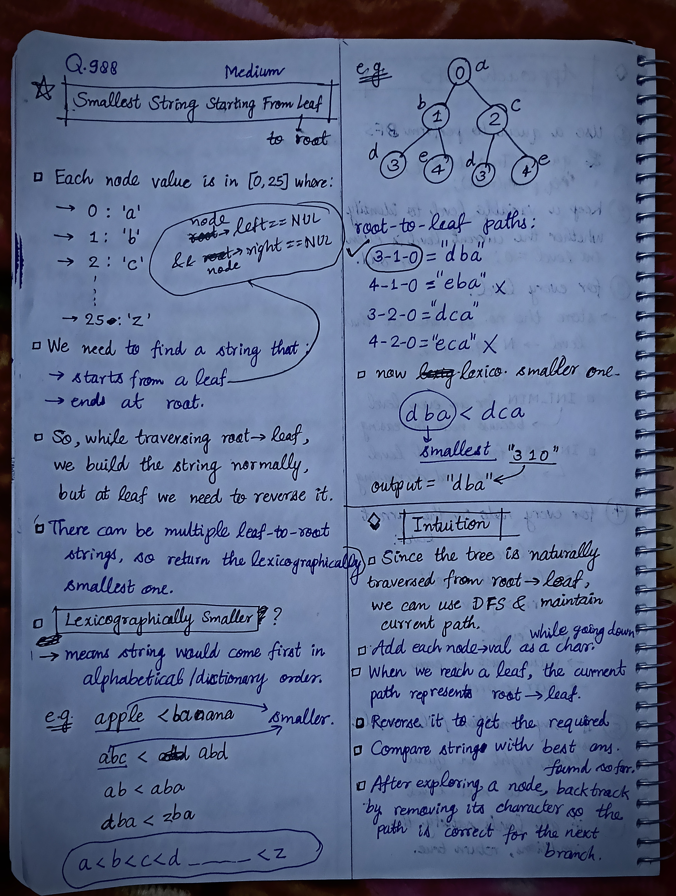

<h2><a href="https://leetcode.com/problems/smallest-string-starting-from-leaf">1030. Smallest String Starting From Leaf</a></h2><h3>Medium</h3><hr><p>You are given the <code>root</code> of a binary tree where each node has a value in the range <code>[0, 25]</code> representing the letters <code>&#39;a&#39;</code> to <code>&#39;z&#39;</code>.</p>

<p>Return <em>the <strong>lexicographically smallest</strong> string that starts at a leaf of this tree and ends at the root</em>.</p>

<p>As a reminder, any shorter prefix of a string is <strong>lexicographically smaller</strong>.</p>

<ul>
	<li>For example, <code>&quot;ab&quot;</code> is lexicographically smaller than <code>&quot;aba&quot;</code>.</li>
</ul>

<p>A leaf of a node is a node that has no children.</p>

<p>&nbsp;</p>
<p><strong class="example">Example 1:</strong></p>

<pre>
<strong>Input:</strong> root = [0,1,2,3,4,3,4]
<strong>Output:</strong> &quot;dba&quot;
</pre>

<p><strong class="example">Example 2:</strong></p>

<pre>
<strong>Input:</strong> root = [25,1,3,1,3,0,2]
<strong>Output:</strong> &quot;adz&quot;
</pre>

<p><strong class="example">Example 3:</strong></p>

<pre>
<strong>Input:</strong> root = [2,2,1,null,1,0,null,0]
<strong>Output:</strong> &quot;abc&quot;
</pre>

<p>&nbsp;</p>
<p><strong>Constraints:</strong></p>

<ul>
	<li>The number of nodes in the tree is in the range <code>[1, 8500]</code>.</li>
	<li><code>0 &lt;= Node.val &lt;= 25</code></li>
</ul>


<!-- AUTO-GENERATED-SOLUTION-START -->
---

## 🧠 Visual Solution & Intuition

### Part 1



### Part 2


---

## 💡 Approach

```text
Approach : DFS (Depth-First Search) + Backtracking + String Comparison
```

---

## ⏱️ Complexity Analysis

```text
Time Complexity = O(N * N) => N nodes × O(N) path operations
Space Complexity = O(N) =>
```

---

## 💻 C++ Solution

[View Original C++ File](./0988-smallest-string-starting-from-leaf.cpp)

```cpp
/**
 * Definition for a binary tree node.
 * struct TreeNode {
 *     int val;
 *     TreeNode *left;
 *     TreeNode *right;
 *     TreeNode() : val(0), left(nullptr), right(nullptr) {}
 *     TreeNode(int x) : val(x), left(nullptr), right(nullptr) {}
 *     TreeNode(int x, TreeNode *left, TreeNode *right) : val(x), left(left), right(right) {}
 * };
 */
class Solution {
public: 
    //Approach : DFS (Depth-First Search) + Backtracking + String Comparison

    //Time Complexity = O(N * N) => N nodes × O(N) path operations 
    /* N = number of nodes.
    * DFS visits every node → O(N).
    * At each leaf, reversing/comparing the path can take up to O(N).
    * In a highly skewed tree, there can be O(N) leaf/path processing in the worst-case analysis.
    */

    //Space Complexity = O(N) =>
    /* path can contain up to N characters for a skewed tree.
    * Recursive DFS call stack can also reach N.
    */

    
    void dfs(TreeNode* node, string& path, string& ans){
        //base-case
        if(node == NULL) return;

        //2.) convert current node into character
        char ch = 'a' + node->val;

        //3.) add this character to path
        path.push_back(ch);

        //4.) if current node is a leaf
        if(node->left == NULL && node->right == NULL){
            
            //4.a) reverse it get a leaf->root path
            reverse(path.begin(), path.end());

            //4.b) compare it with current ans and choose minimum
            if(path < ans){
                ans = path;
            }

            //4.c) reverse back to restore root->leaf path for further traversal
            reverse(path.begin(), path.end());
        }

        //5.) recursively explore left & right subtrees
        dfs(node->left, path, ans);
        dfs(node->right, path, ans);

        //6.) after both subtrees explored backtrack and pop_back()
        path.pop_back();

    }
    string smallestFromLeaf(TreeNode* root) {
        
        //Since we have to find smallest => intialize with greatest
        string ans = "{" ; //this comes after 'z' in ASCII values means greatest of all a-z

        string path;

        dfs(root, path, ans);

        //7.) finally return the smallest string found
        return ans;
    }
};
```

<!-- AUTO-GENERATED-SOLUTION-END -->
