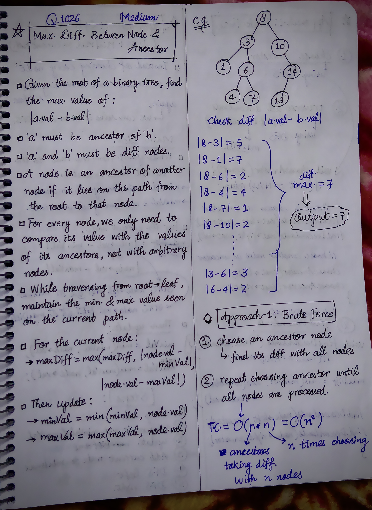
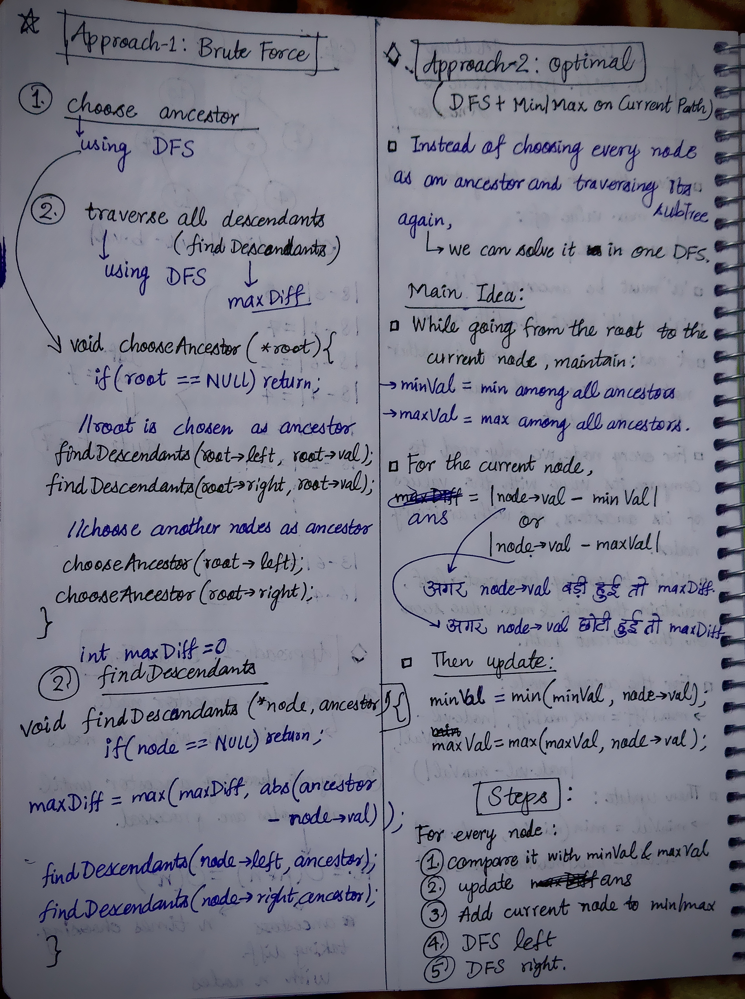

<h2><a href="https://leetcode.com/problems/maximum-difference-between-node-and-ancestor/">1092. Maximum Difference Between Node and Ancestor</a></h2><h3>Medium</h3><hr><p>Given the <code>root</code> of a binary tree, find the maximum value <code>v</code> for which there exist <strong>different</strong> nodes <code>a</code> and <code>b</code> where <code>v = |a.val - b.val|</code> and <code>a</code> is an ancestor of <code>b</code>.</p>

<p>A node <code>a</code> is an ancestor of <code>b</code> if either: any child of <code>a</code> is equal to <code>b</code>&nbsp;or any child of <code>a</code> is an ancestor of <code>b</code>.</p>

<p>&nbsp;</p>
<p><strong class="example">Example 1:</strong></p>

<pre>
<strong>Input:</strong> root = [8,3,10,1,6,null,14,null,null,4,7,13]
<strong>Output:</strong> 7
<strong>Explanation: </strong>We have various ancestor-node differences, some of which are given below :
|8 - 3| = 5
|3 - 7| = 4
|8 - 1| = 7
|10 - 13| = 3
Among all possible differences, the maximum value of 7 is obtained by |8 - 1| = 7.</pre>

<p><strong class="example">Example 2:</strong></p>

<pre>
<strong>Input:</strong> root = [1,null,2,null,0,3]
<strong>Output:</strong> 3
</pre>

<p>&nbsp;</p>
<p><strong>Constraints:</strong></p>

<ul>
	<li>The number of nodes in the tree is in the range <code>[2, 5000]</code>.</li>
	<li><code>0 &lt;= Node.val &lt;= 10<sup>5</sup></code></li>
</ul>
<!---LeetCode Approaches Start-->
<hr>
<h3>💡 Solutions & Approaches</h3>

- [Approach 1 (C++)](1026-maximum-difference-between-node-and-ancestor.cpp) — *Brute Force(Using two separate DFS)*
- [Approach 2 (C++)](1026-maximum-difference-between-node-and-ancestor-approach-2-optimal.cpp) — *Optimal(DFS + Min/Max on Current Path)*

<!---LeetCode Approaches End-->


<!-- AUTO-GENERATED-SOLUTION-START -->
---

## 🧠 Visual Solution & Intuition

### Part 1



### Part 2



---

## 💻 C++ Solution

### 1026-maximum-difference-between-node-and-ancestor.cpp

#### 💡 Approach

```text
Approach-1 : Brute Force(Using two separate DFS)
```

#### ⏱️ Complexity Analysis

```text
Time Complexity = O(n * n)
Space Complexity = O(h) =>
```

[View Original C++ File](./1026-maximum-difference-between-node-and-ancestor.cpp)

```cpp
/**
 * Definition for a binary tree node.
 * struct TreeNode {
 *     int val;
 *     TreeNode *left;
 *     TreeNode *right;
 *     TreeNode() : val(0), left(nullptr), right(nullptr) {}
 *     TreeNode(int x) : val(x), left(nullptr), right(nullptr) {}
 *     TreeNode(int x, TreeNode *left, TreeNode *right) : val(x), left(left), right(right) {}
 * };
 */
class Solution {
public:
    //Approach-1 : Brute Force(Using two separate DFS)

    //Time Complexity = O(n * n)
    /* chooseAncestor() visits every node.
    * For each chosen ancestor, findDescendants() may traverse its whole subtree.
    * Worst case: O(n²)
    */


    //Space Complexity = O(h) =>
    /* Recursion depth = tree height
    * O(h) → worst case O(n). => height of skewed tree = n.
    */

    int maxDiff = 0; //initialize with 0

    void findDescendants(TreeNode* node, int ancestor){
        //base-case
        if(node == NULL) return;

        maxDiff = max(maxDiff, abs(ancestor - node->val));

        //recursively find diff of all descendants
        findDescendants(node->left, ancestor);
        findDescendants(node->right, ancestor);
    }

    void chooseAncestor(TreeNode* root){
        //base-case
        if(root == NULL) return;

        //first choose root as ancestor
        findDescendants(root->left, root->val);
        findDescendants(root->right, root->val);

        //call for choosing next ancestors
        chooseAncestor(root->left);
        chooseAncestor(root->right);
    }

    int maxAncestorDiff(TreeNode* root) {
        
        chooseAncestor(root);
        
        //finally return the output
        return maxDiff;
    }
};
```

### 1026-maximum-difference-between-node-and-ancestor-approach-2-optimal.cpp

#### 💡 Approach

```text
Approach-2 : Optimal(DFS + Min/Max on Current Path)
```

#### ⏱️ Complexity Analysis

```text
Time Complexity = O(n) =>
Space Complexity = O(h) =>
```

[View Original C++ File](./1026-maximum-difference-between-node-and-ancestor-approach-2-optimal.cpp)

```cpp
/**
 * Definition for a binary tree node.
 * struct TreeNode {
 *     int val;
 *     TreeNode *left;
 *     TreeNode *right;
 *     TreeNode() : val(0), left(nullptr), right(nullptr) {}
 *     TreeNode(int x) : val(x), left(nullptr), right(nullptr) {}
 *     TreeNode(int x, TreeNode *left, TreeNode *right) : val(x), left(left), right(right) {}
 * };
 */
class Solution {
public:
    //Approach-2 : Optimal(DFS + Min/Max on Current Path)

    //Time Complexity = O(n) =>
    /* Each node is visited exactly once.
    * At every node, we perform only constant-time operations:
        * abs() → O(1)
        * max() → O(1)
        * min() → O(1)
    * Then we recursively visit the left and right children.
    */

    //Space Complexity = O(h) =>
    /* Recursion depth = tree height
    * O(h) → worst case O(n). => height of skewed tree = n.
    */

    int ans = 0; //initialize with 0

    void dfs(TreeNode* node, int minVal, int maxVal){
        //base-case
        if(node == NULL){
            return;
        }

        ans = max({ans, abs(node->val - minVal), abs(node->val - maxVal)});

        //update minVal, maxVal
        minVal = min(minVal, node->val);
        maxVal = max(maxVal, node->val);

        //DFS left
        dfs(node->left, minVal, maxVal);

        //DFS right
        dfs(node->right, minVal, maxVal);
    }
    int maxAncestorDiff(TreeNode* root) {
        
        int minVal = root->val;
        int maxVal = root->val;

        dfs(root, minVal, maxVal);

        //finally return the output
        return ans;
    }
};
```

<!-- AUTO-GENERATED-SOLUTION-END -->
