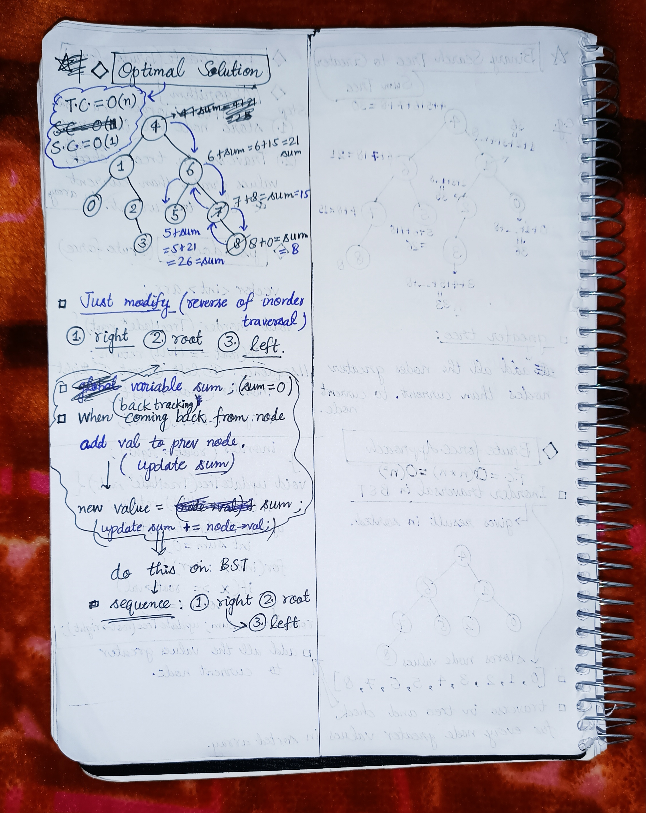

<h2><a href="https://leetcode.com/problems/binary-search-tree-to-greater-sum-tree">1114. Binary Search Tree to Greater Sum Tree</a></h2><h3>Medium</h3><hr><p>Given the <code>root</code> of a Binary Search Tree (BST), convert it to a Greater Tree such that every key of the original BST is changed to the original key plus the sum of all keys greater than the original key in BST.</p>

<p>As a reminder, a <em>binary search tree</em> is a tree that satisfies these constraints:</p>

<ul>
	<li>The left subtree of a node contains only nodes with keys <strong>less than</strong> the node&#39;s key.</li>
	<li>The right subtree of a node contains only nodes with keys <strong>greater than</strong> the node&#39;s key.</li>
	<li>Both the left and right subtrees must also be binary search trees.</li>
</ul>

<p>&nbsp;</p>
<p><strong class="example">Example 1:</strong></p>

<pre>
<strong>Input:</strong> root = [4,1,6,0,2,5,7,null,null,null,3,null,null,null,8]
<strong>Output:</strong> [30,36,21,36,35,26,15,null,null,null,33,null,null,null,8]
</pre>

<p><strong class="example">Example 2:</strong></p>

<pre>
<strong>Input:</strong> root = [0,null,1]
<strong>Output:</strong> [1,null,1]
</pre>

<p>&nbsp;</p>
<p><strong>Constraints:</strong></p>

<ul>
	<li>The number of nodes in the tree is in the range <code>[1, 100]</code>.</li>
	<li><code>0 &lt;= Node.val &lt;= 100</code></li>
	<li>All the values in the tree are <strong>unique</strong>.</li>
</ul>

<p>&nbsp;</p>
<p><strong>Note:</strong> This question is the same as 538: <a href="https://leetcode.com/problems/convert-bst-to-greater-tree/" target="_blank">https://leetcode.com/problems/convert-bst-to-greater-tree/</a></p>


<!-- AUTO-GENERATED-SOLUTION-START -->
---

## 🧠 Visual Solution & Intuition



---

## ⏱️ Complexity Analysis

```text
Time Complexity = O(n)
Space Complexity = O(H) => recursion stack height(height of the tree)
```

---

## 💻 C++ Solution

[View Original C++ File](./1038-binary-search-tree-to-greater-sum-tree.cpp)

```cpp
/**
 * Definition for a binary tree node.
 * struct TreeNode {
 *     int val;
 *     TreeNode *left;
 *     TreeNode *right;
 *     TreeNode() : val(0), left(nullptr), right(nullptr) {}
 *     TreeNode(int x) : val(x), left(nullptr), right(nullptr) {}
 *     TreeNode(int x, TreeNode *left, TreeNode *right) : val(x), left(left), right(right) {}
 * };
 */
class Solution {
public:
    //Time Complexity = O(n)
    //Space Complexity = O(H) => recursion stack height(height of the tree)
    //O(logn) => for balanced tree
    //O(n) => for skewed tree
    void optSolution(TreeNode* root, int &sum){
        //for empty tree
        if(root == NULL) return ;

        //reversed inorder traversal 
        //1.) traverse in right 
        optSolution(root->right,sum) ;
        
        //update sum
        sum += root->val ;

        //update new root->val to sum
        root->val = sum ;

        //2.) traverse in left 
        optSolution(root->left,sum) ;

    }
    TreeNode* bstToGst(TreeNode* root) {
        //sum var to store sum
        int sum = 0 ;

        //func. call to optSolution
        optSolution(root,sum) ;

        return root ;
    }
};
```

<!-- AUTO-GENERATED-SOLUTION-END -->
