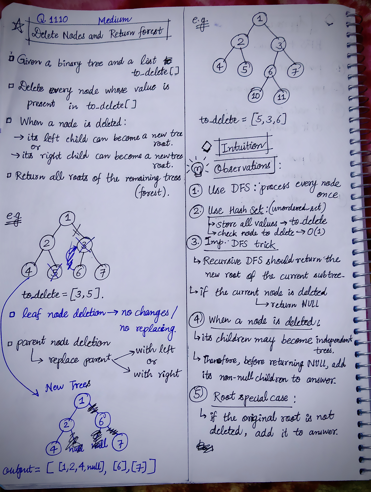
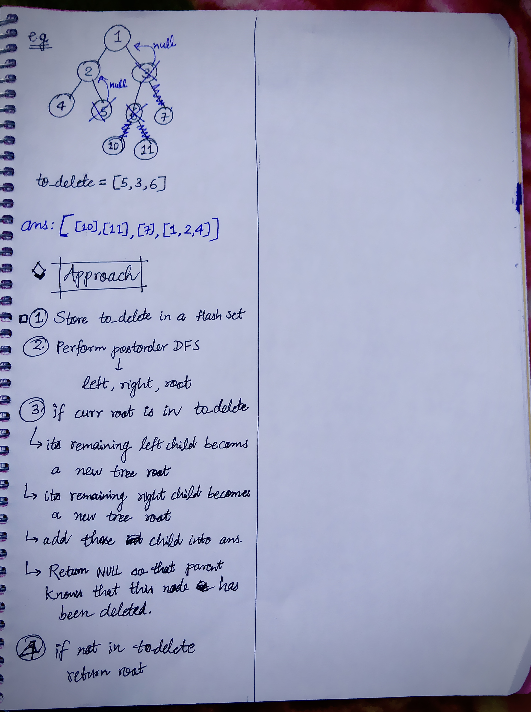

<h2><a href="https://leetcode.com/problems/delete-nodes-and-return-forest">1207. Delete Nodes And Return Forest</a></h2><h3>Medium</h3><hr><p>Given the <code>root</code> of a binary tree, each node in the tree has a distinct value.</p>

<p>After deleting all nodes with a value in <code>to_delete</code>, we are left with a forest (a disjoint union of trees).</p>

<p>Return the roots of the trees in the remaining forest. You may return the result in any order.</p>

<p>&nbsp;</p>
<p><strong class="example">Example 1:</strong></p>

<pre>
<strong>Input:</strong> root = [1,2,3,4,5,6,7], to_delete = [3,5]
<strong>Output:</strong> [[1,2,null,4],[6],[7]]
</pre>

<p><strong class="example">Example 2:</strong></p>

<pre>
<strong>Input:</strong> root = [1,2,4,null,3], to_delete = [3]
<strong>Output:</strong> [[1,2,4]]
</pre>

<p>&nbsp;</p>
<p><strong>Constraints:</strong></p>

<ul>
	<li>The number of nodes in the given tree is at most <code>1000</code>.</li>
	<li>Each node has a distinct value between <code>1</code> and <code>1000</code>.</li>
	<li><code>to_delete.length &lt;= 1000</code></li>
	<li><code>to_delete</code> contains distinct values between <code>1</code> and <code>1000</code>.</li>
</ul>


<!-- AUTO-GENERATED-SOLUTION-START -->
---

## 🧠 Visual Solution & Intuition

### Part 1



### Part 2



---

## 💡 Approach

```text
Approach : DFS + Hash Set
```

---

## ⏱️ Complexity Analysis

```text
Time Complexity = O(N + D) => N = number of tree nodes, D = number of nodes in to_delete
Space Complexity = O(N + D) =>
```

---

## 💻 C++ Solution

[View Original C++ File](./1110-delete-nodes-and-return-forest.cpp)

```cpp
/**
 * Definition for a binary tree node.
 * struct TreeNode {
 *     int val;
 *     TreeNode *left;
 *     TreeNode *right;
 *     TreeNode() : val(0), left(nullptr), right(nullptr) {}
 *     TreeNode(int x) : val(x), left(nullptr), right(nullptr) {}
 *     TreeNode(int x, TreeNode *left, TreeNode *right) : val(x), left(left), right(right) {}
 * };
 */
class Solution {
public:
    //Approach : DFS + Hash Set

    //Time Complexity = O(N + D) => N = number of tree nodes, D = number of nodes in to_delete
    /* Hash Set creation → O(D)
    * DFS visits every node once → O(N)
    * set.find() → O(1) average
    * Overall → O(N + D) = O(N)
    */

    //Space Complexity = O(N + D) => 
    /* Hash Set → O(D)
    * Recursion stack → O(H), worst case O(N)
    * Answer vector → O(N)
    * Overall → O(N)
    */


    TreeNode* helperDFS(TreeNode* root, unordered_set<int>& set, vector<TreeNode*>& ans){

        if(root == NULL){
            return NULL;
        }

        root->left = helperDFS(root->left, set, ans);
        root->right = helperDFS(root->right, set, ans);

        //if curr root is in to_delete then
        if(set.find(root->val) != set.end()){

            if(root->left != NULL){
                ans.push_back(root->left);
            }

            if(root->right != NULL){
                ans.push_back(root->right);
            }

            return NULL;
        }
        else{ //if curr root is not in to_delete
            return root;
        }
    }
    vector<TreeNode*> delNodes(TreeNode* root, vector<int>& to_delete) {
        
        //ans vector to store the output
        vector<TreeNode*> ans;

        //Hash set to store to_delete
        unordered_set<int> set;

        //push all elements of to_delete into set
        for(int num : to_delete){
            set.insert(num);
        }

        //func. call to DFS helper
        helperDFS(root, set, ans);


        //check condition if actual tree root is in to_delete
        //if not then add this root also in ans
        if(set.find(root->val) == set.end()){
            ans.push_back(root);
        }

        //finally return the output
        return ans;
    }
};
```

<!-- AUTO-GENERATED-SOLUTION-END -->
