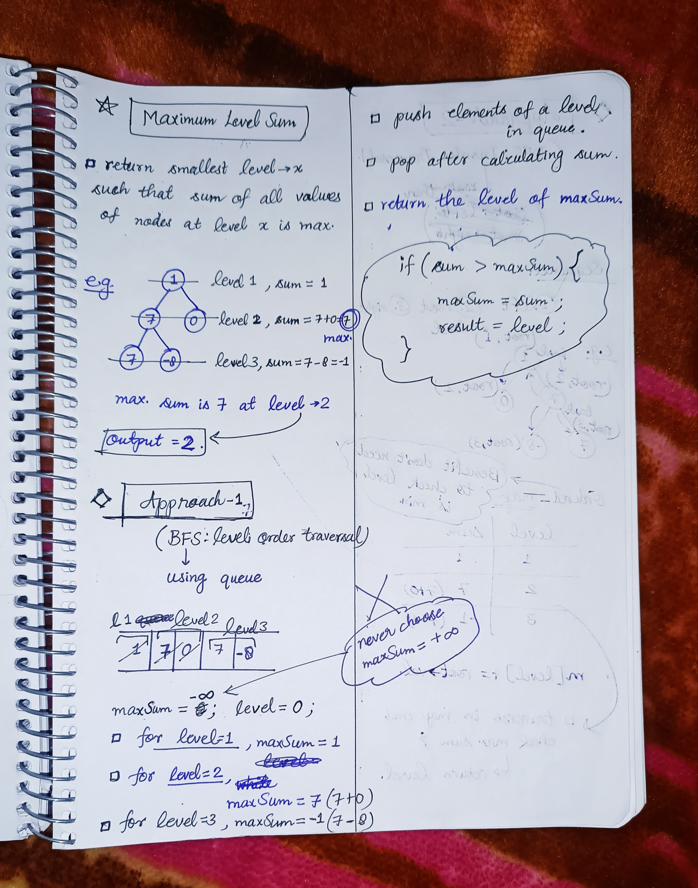
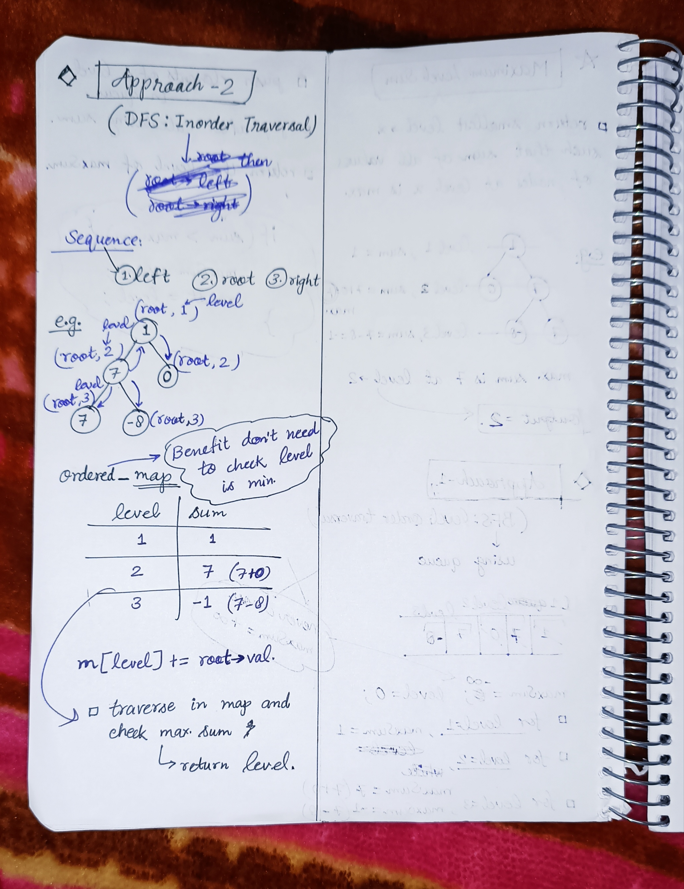

<h2><a href="https://leetcode.com/problems/maximum-level-sum-of-a-binary-tree">1116. Maximum Level Sum of a Binary Tree</a></h2><h3>Medium</h3><hr><p>Given the <code>root</code> of a binary tree, the level of its root is <code>1</code>, the level of its children is <code>2</code>, and so on.</p>

<p>Return the <strong>smallest</strong> level <code>x</code> such that the sum of all the values of nodes at level <code>x</code> is <strong>maximal</strong>.</p>

<p>&nbsp;</p>
<p><strong class="example">Example 1:</strong></p>

<pre>
<strong>Input:</strong> root = [1,7,0,7,-8,null,null]
<strong>Output:</strong> 2
<strong>Explanation: </strong>
Level 1 sum = 1.
Level 2 sum = 7 + 0 = 7.
Level 3 sum = 7 + -8 = -1.
So we return the level with the maximum sum which is level 2.
</pre>

<p><strong class="example">Example 2:</strong></p>

<pre>
<strong>Input:</strong> root = [989,null,10250,98693,-89388,null,null,null,-32127]
<strong>Output:</strong> 2
</pre>

<p>&nbsp;</p>
<p><strong>Constraints:</strong></p>

<ul>
	<li>The number of nodes in the tree is in the range <code>[1, 10<sup>4</sup>]</code>.</li>
	<li><code>-10<sup>5</sup> &lt;= Node.val &lt;= 10<sup>5</sup></code></li>
</ul>


<!-- AUTO-GENERATED-SOLUTION-START -->
---

## 🧠 Visual Solution & Intuition

### Part 1



### Part 2



---

## ⏱️ Complexity Analysis

```text
Time Complexity = O(n) => cause traversing n nodes of the tree.
Space Complexity = O(W) => W is max. width of the tree.
```

---

## 💻 C++ Solution

[View Original C++ File](./1161-maximum-level-sum-of-a-binary-tree.cpp)

```cpp
/**
 * Definition for a binary tree node.
 * struct TreeNode {
 *     int val;
 *     TreeNode *left;
 *     TreeNode *right;
 *     TreeNode() : val(0), left(nullptr), right(nullptr) {}
 *     TreeNode(int x) : val(x), left(nullptr), right(nullptr) {}
 *     TreeNode(int x, TreeNode *left, TreeNode *right) : val(x), left(left), right(right) {}
 * };
 */
class Solution {
public: 
    //Time Complexity = O(n) => cause traversing n nodes of the tree.
    //Space Complexity = O(W) => W is max. width of the tree.
    //DFS : Inorder Traversal and using Map
    map<int,int> m ;

    void inOrder(TreeNode* root, int level){
        //base case
        if(root == NULL){
            return ;
        }
        //push values in map
        m[level] += root->val ;

        //inOrder traversal sequence
        //1.) left
        inOrder(root->left,level+1) ;
        
        //2.) right
        inOrder(root->right,level+1) ;

    }

    int maxLevelSum(TreeNode* root) {
        m.clear() ;
        
        inOrder(root,1) ; //1 is currLevel

        int maxSum = INT_MIN ;
        int resultLevel = 0 ;

        //traverse in map and check maxSum
        for(auto &mp : m){
            int level = mp.first ;
            int sum = mp.second ;

            //check if sum > maxSum
            if(sum > maxSum){
                maxSum = sum ;
                resultLevel = level ;
            }
        }
        //very important to return the ans.
        return resultLevel ;
       
    }
};
```

<!-- AUTO-GENERATED-SOLUTION-END -->
