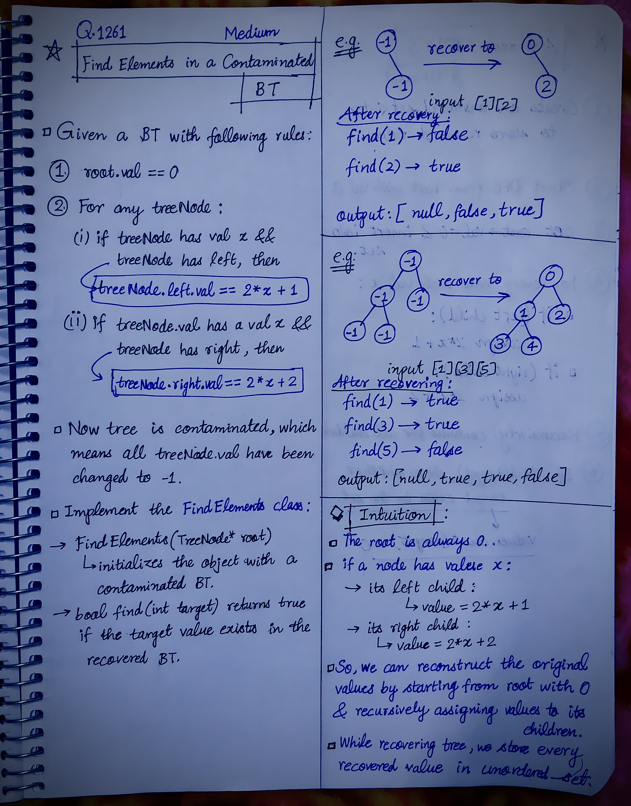

<h2><a href="https://leetcode.com/problems/find-elements-in-a-contaminated-binary-tree/">1387. Find Elements in a Contaminated Binary Tree</a></h2><h3>Medium</h3><hr><p>Given a binary tree with the following rules:</p>

<ol>
	<li><code>root.val == 0</code></li>
	<li>For any <code>treeNode</code>:
	<ol type="a">
		<li>If <code>treeNode.val</code> has a value <code>x</code> and <code>treeNode.left != null</code>, then <code>treeNode.left.val == 2 * x + 1</code></li>
		<li>If <code>treeNode.val</code> has a value <code>x</code> and <code>treeNode.right != null</code>, then <code>treeNode.right.val == 2 * x + 2</code></li>
	</ol>
	</li>
</ol>

<p>Now the binary tree is contaminated, which means all <code>treeNode.val</code> have been changed to <code>-1</code>.</p>

<p>Implement the <code>FindElements</code> class:</p>

<ul>
	<li><code>FindElements(TreeNode* root)</code> Initializes the object with a contaminated binary tree and recovers it.</li>
	<li><code>bool find(int target)</code> Returns <code>true</code> if the <code>target</code> value exists in the recovered binary tree.</li>
</ul>

<p>&nbsp;</p>
<p><strong class="example">Example 1:</strong></p>

<pre>
<strong>Input</strong>
[&quot;FindElements&quot;,&quot;find&quot;,&quot;find&quot;]
[[[-1,null,-1]],[1],[2]]
<strong>Output</strong>
[null,false,true]
<strong>Explanation</strong>
FindElements findElements = new FindElements([-1,null,-1]); 
findElements.find(1); // return False 
findElements.find(2); // return True </pre>

<p><strong class="example">Example 2:</strong></p>

<pre>
<strong>Input</strong>
[&quot;FindElements&quot;,&quot;find&quot;,&quot;find&quot;,&quot;find&quot;]
[[[-1,-1,-1,-1,-1]],[1],[3],[5]]
<strong>Output</strong>
[null,true,true,false]
<strong>Explanation</strong>
FindElements findElements = new FindElements([-1,-1,-1,-1,-1]);
findElements.find(1); // return True
findElements.find(3); // return True
findElements.find(5); // return False</pre>

<p><strong class="example">Example 3:</strong></p>

<pre>
<strong>Input</strong>
[&quot;FindElements&quot;,&quot;find&quot;,&quot;find&quot;,&quot;find&quot;,&quot;find&quot;]
[[[-1,null,-1,-1,null,-1]],[2],[3],[4],[5]]
<strong>Output</strong>
[null,true,false,false,true]
<strong>Explanation</strong>
FindElements findElements = new FindElements([-1,null,-1,-1,null,-1]);
findElements.find(2); // return True
findElements.find(3); // return False
findElements.find(4); // return False
findElements.find(5); // return True
</pre>

<p>&nbsp;</p>
<p><strong>Constraints:</strong></p>

<ul>
	<li><code>TreeNode.val == -1</code></li>
	<li>The height of the binary tree is less than or equal to <code>20</code></li>
	<li>The total number of nodes is between <code>[1, 10<sup>4</sup>]</code></li>
	<li>Total calls of <code>find()</code> is between <code>[1, 10<sup>4</sup>]</code></li>
	<li><code>0 &lt;= target &lt;= 10<sup>6</sup></code></li>
</ul>


<!-- AUTO-GENERATED-SOLUTION-START -->
---

## 🧠 Visual Solution & Intuition

### Part 1



### Part 2


---

## 💡 Approach

```text
Approach : DFS + HashSet
```

---

## ⏱️ Complexity Analysis

```text
Time Complexity = O(n + q) =>
Space Complexity = O(n) =>
```

---

## 💻 C++ Solution

[View Original C++ File](./1261-find-elements-in-a-contaminated-binary-tree.cpp)

```cpp
/**
 * Definition for a binary tree node.
 * struct TreeNode {
 *     int val;
 *     TreeNode *left;
 *     TreeNode *right;
 *     TreeNode() : val(0), left(nullptr), right(nullptr) {}
 *     TreeNode(int x) : val(x), left(nullptr), right(nullptr) {}
 *     TreeNode(int x, TreeNode *left, TreeNode *right) : val(x), left(left), right(right) {}
 * };
 */
class FindElements {
public:
    //Approach : DFS + HashSet

    //Time Complexity = O(n + q) =>
    /* Constructor / Recovery: O(n) — visit every node once.
    * find(): O(1) average — unordered_set lookup.
    * Overall: O(n + q) average, where n = number of nodes and q = number of find() calls.
    */

    //Space Complexity = O(n) =>
    /* Hash Set: O(n)
    * DFS recursion stack: O(h), where h is tree height.
    * Overall: O(n + h), which is effectively O(n).
    */


    unordered_set<int> values;

    void recover(TreeNode* root, int val){

        //base-case
        if(root == NULL) return;

        root->val = val;

        values.insert(val);
        
        //if tree has left => val = 2*val + 1
        recover(root->left, 2*val + 1);

        //if tree has right => val = 2*val + 2
        recover(root->right, 2*val + 2);

    }
    FindElements(TreeNode* root) {
        
        //intial val = 0

        recover(root, 0);
    }
    
    bool find(int target) {
        
        //check whether target exists in the set
        return values.count(target) > 0; 
    }
};

/**
 * Your FindElements object will be instantiated and called as such:
 * FindElements* obj = new FindElements(root);
 * bool param_1 = obj->find(target);
 */
```

<!-- AUTO-GENERATED-SOLUTION-END -->
