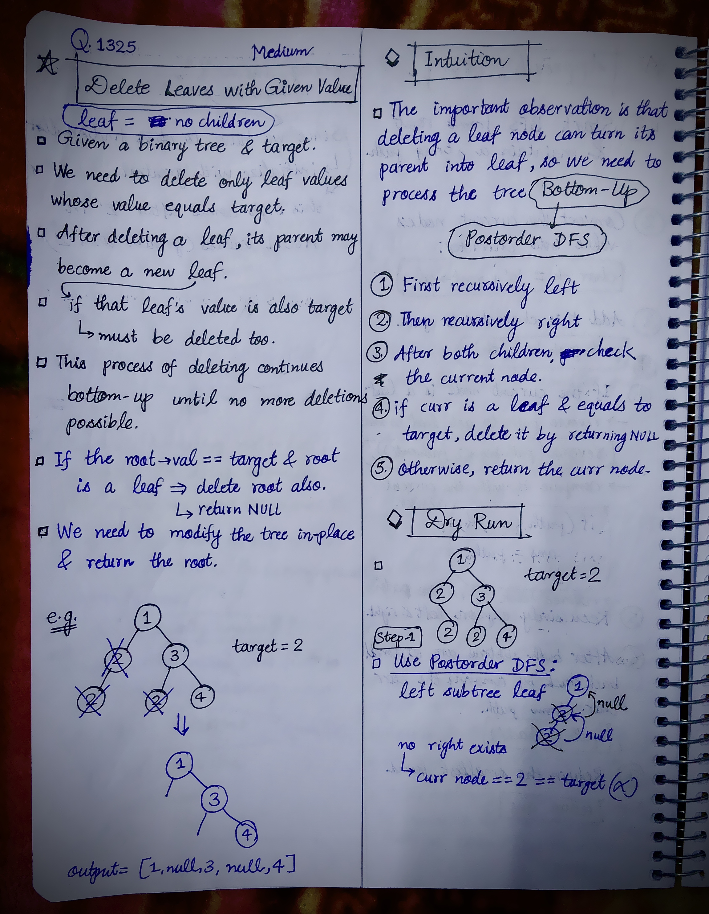
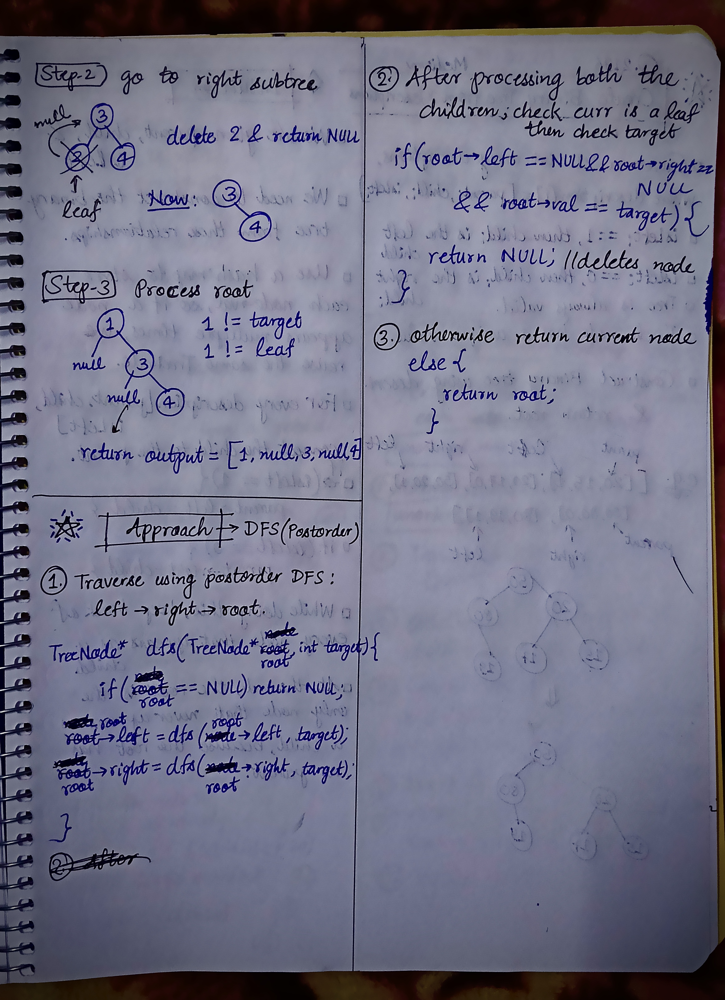

<h2><a href="https://leetcode.com/problems/delete-leaves-with-a-given-value">1450. Delete Leaves With a Given Value</a></h2><h3>Medium</h3><hr><p>Given a binary tree <code>root</code> and an integer <code>target</code>, delete all the <strong>leaf nodes</strong> with value <code>target</code>.</p>

<p>Note that once you delete a leaf node with value <code>target</code><strong>, </strong>if its parent node becomes a leaf node and has the value <code>target</code>, it should also be deleted (you need to continue doing that until you cannot).</p>

<p>&nbsp;</p>
<p><strong class="example">Example 1:</strong></p>

<p><strong></strong></p>

<pre>
<strong>Input:</strong> root = [1,2,3,2,null,2,4], target = 2
<strong>Output:</strong> [1,null,3,null,4]
<strong>Explanation:</strong> Leaf nodes in green with value (target = 2) are removed (Picture in left). 
After removing, new nodes become leaf nodes with value (target = 2) (Picture in center).
</pre>

<p><strong class="example">Example 2:</strong></p>

<p><strong></strong></p>

<pre>
<strong>Input:</strong> root = [1,3,3,3,2], target = 3
<strong>Output:</strong> [1,3,null,null,2]
</pre>

<p><strong class="example">Example 3:</strong></p>

<p><strong></strong></p>

<pre>
<strong>Input:</strong> root = [1,2,null,2,null,2], target = 2
<strong>Output:</strong> [1]
<strong>Explanation:</strong> Leaf nodes in green with value (target = 2) are removed at each step.
</pre>

<p>&nbsp;</p>
<p><strong>Constraints:</strong></p>

<ul>
	<li>The number of nodes in the tree is in the range <code>[1, 3000]</code>.</li>
	<li><code>1 &lt;= Node.val, target &lt;= 1000</code></li>
</ul>


<!-- AUTO-GENERATED-SOLUTION-START -->
---

## 🧠 Visual Solution & Intuition

### Part 1



### Part 2



---

## 💡 Approach

```text
Approach : DFS (Postorder)
```

---

## ⏱️ Complexity Analysis

```text
Time Complexity = O(n) =>
Space Complexity = O(h) =>
```

---

## 💻 C++ Solution

[View Original C++ File](./1325-delete-leaves-with-a-given-value.cpp)

```cpp
/**
 * Definition for a binary tree node.
 * struct TreeNode {
 *     int val;
 *     TreeNode *left;
 *     TreeNode *right;
 *     TreeNode() : val(0), left(nullptr), right(nullptr) {}
 *     TreeNode(int x) : val(x), left(nullptr), right(nullptr) {}
 *     TreeNode(int x, TreeNode *left, TreeNode *right) : val(x), left(left), right(right) {}
 * };
 */
class Solution {
public:

    //Approach : DFS (Postorder)

    //Time Complexity = O(n) =>
    /* Suppose the tree has N nodes.
    * In the DFS, each node is visited exactly once.
    * At every node, we do only constant-time operations:
        * Check left subtree
        * Check right subtree
        * Check whether it is a leaf
        * Compare node->val with target
    * So : N nodes × O(1) work per node = O(N)
    */

    //Space Complexity = O(h) =>
    /* The algorithm uses recursion, so the extra space comes from the recursion call stack.
    * h = height of the binary tree.
    * At any moment, the recursion stack contains at most h nodes.
    */

    TreeNode* removeLeafNodes(TreeNode* root, int target) {
        
        //base-case
        if(root == NULL) return NULL;

        //1.) Traverse in Postorder : left -> right -> root

        root->left = removeLeafNodes(root->left, target);
        root->right = removeLeafNodes(root->right, target);

        //2.) After processing both the children, check if current is a leaf & equals target

        if(root->left == NULL && root->right == NULL && root->val == target){
            return NULL;
        }

        //3.)otherwise return current node
        return root;

    }
};
```

<!-- AUTO-GENERATED-SOLUTION-END -->
