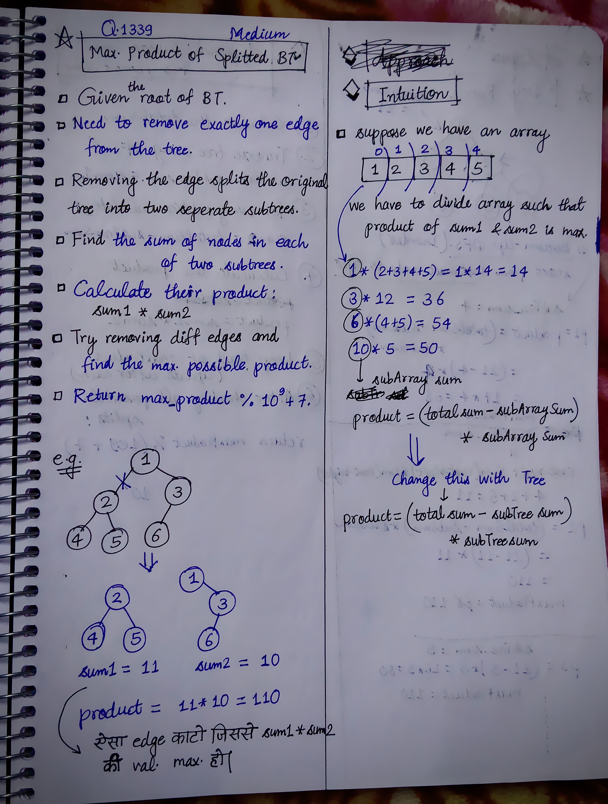
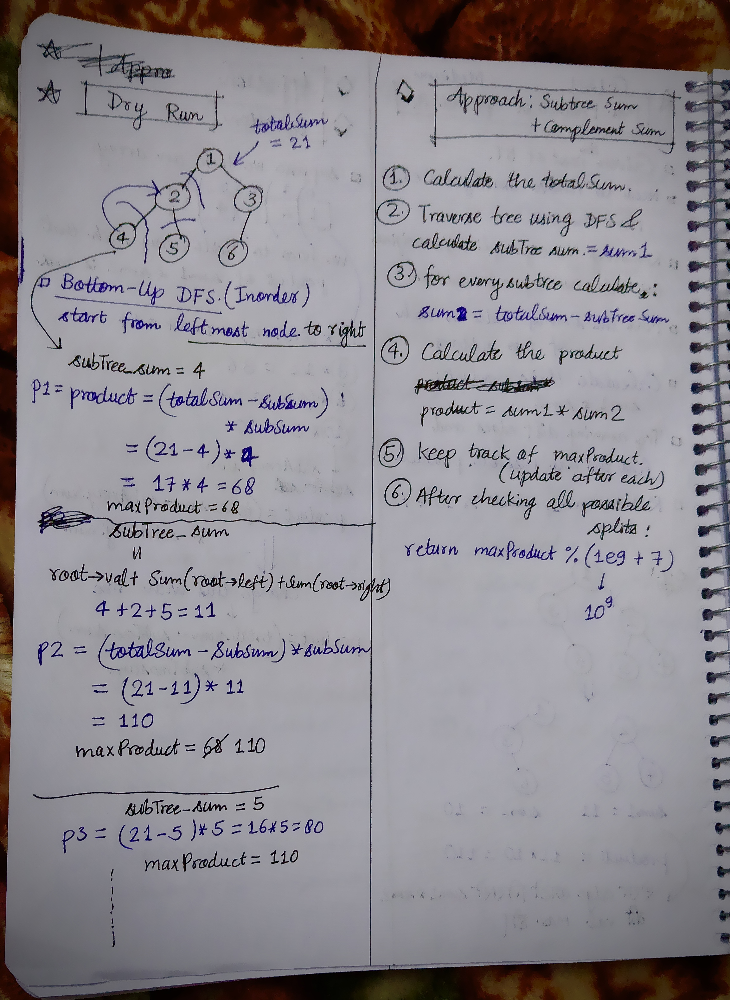

<h2><a href="https://leetcode.com/problems/maximum-product-of-splitted-binary-tree">1465. Maximum Product of Splitted Binary Tree</a></h2><h3>Medium</h3><hr><p>Given the <code>root</code> of a binary tree, split the binary tree into two subtrees by removing one edge such that the product of the sums of the subtrees is maximized.</p>

<p>Return <em>the maximum product of the sums of the two subtrees</em>. Since the answer may be too large, return it <strong>modulo</strong> <code>10<sup>9</sup> + 7</code>.</p>

<p><strong>Note</strong> that you need to maximize the answer before taking the mod and not after taking it.</p>

<p>&nbsp;</p>
<p><strong class="example">Example 1:</strong></p>

<pre>
<strong>Input:</strong> root = [1,2,3,4,5,6]
<strong>Output:</strong> 110
<strong>Explanation:</strong> Remove the red edge and get 2 binary trees with sum 11 and 10. Their product is 110 (11*10)
</pre>

<p><strong class="example">Example 2:</strong></p>

<pre>
<strong>Input:</strong> root = [1,null,2,3,4,null,null,5,6]
<strong>Output:</strong> 90
<strong>Explanation:</strong> Remove the red edge and get 2 binary trees with sum 15 and 6.Their product is 90 (15*6)
</pre>

<p>&nbsp;</p>
<p><strong>Constraints:</strong></p>

<ul>
	<li>The number of nodes in the tree is in the range <code>[2, 5 * 10<sup>4</sup>]</code>.</li>
	<li><code>1 &lt;= Node.val &lt;= 10<sup>4</sup></code></li>
</ul>


<!-- AUTO-GENERATED-SOLUTION-START -->
---

## 🧠 Visual Solution & Intuition

### Part 1



### Part 2



---

## 💡 Approach

```text
Approach : Subtree Sum + Complement Sum
```

---

## ⏱️ Complexity Analysis

```text
Time Complexity = O(N) =>
Space Complexity = O(h) =>
```

---

## 💻 C++ Solution

[View Original C++ File](./1339-maximum-product-of-splitted-binary-tree.cpp)

```cpp
/**
 * Definition for a binary tree node.
 * struct TreeNode {
 *     int val;
 *     TreeNode *left;
 *     TreeNode *right;
 *     TreeNode() : val(0), left(nullptr), right(nullptr) {}
 *     TreeNode(int x) : val(x), left(nullptr), right(nullptr) {}
 *     TreeNode(int x, TreeNode *left, TreeNode *right) : val(x), left(left), right(right) {}
 * };
 */
class Solution {
public:
    //Approach : Subtree Sum + Complement Sum

    //Time Complexity = O(N) =>
    /* O(n) — findTotalSum() visits every node once.
    * O(n) — dfs() visits every node once.
    * Overall: O(n)
    */

    //Space Complexity = O(h) =>
    /* O(h) — recursion stack.
    * h = height of the tree.
    * Worst case (skewed tree): O(n)
    * Balanced tree: O(log n)
    */

    
    typedef long long ll;
    ll totalSum = 0;
    ll ans = 0;
    const ll MOD = 1e9 + 7;
    
    //Step-1:
    ll findTotalSum(TreeNode* root){
        if(root == NULL) return 0;

        return root->val + findTotalSum(root->left) + findTotalSum(root->right);
    }
    
    ll dfs(TreeNode* root){
        //base-case
        if(root == NULL) return 0;
        
        //Step-2 :
        ll subSum = root->val + dfs(root->left) + dfs(root->right);

        
        ll sum1 = subSum;
        //Step-3:
        ll sum2 = totalSum - subSum;
        //Step-4:
        ll product = sum1 * sum2;

        ans = max(ans, product);

        return subSum;
    }
    int maxProduct(TreeNode* root) {
        
        totalSum = findTotalSum(root);
        
        dfs(root);

        //finally return maxProduct with modulo
        return ans % MOD;
    }
};
```

<!-- AUTO-GENERATED-SOLUTION-END -->
