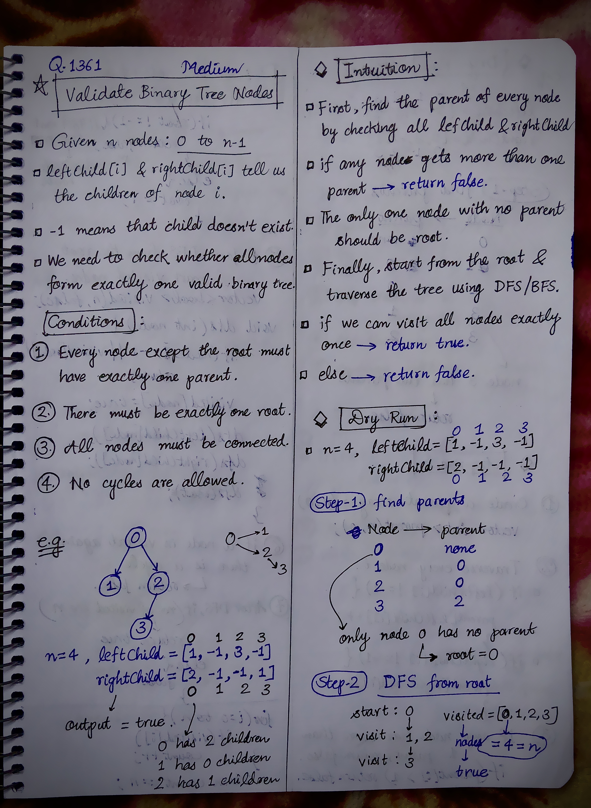
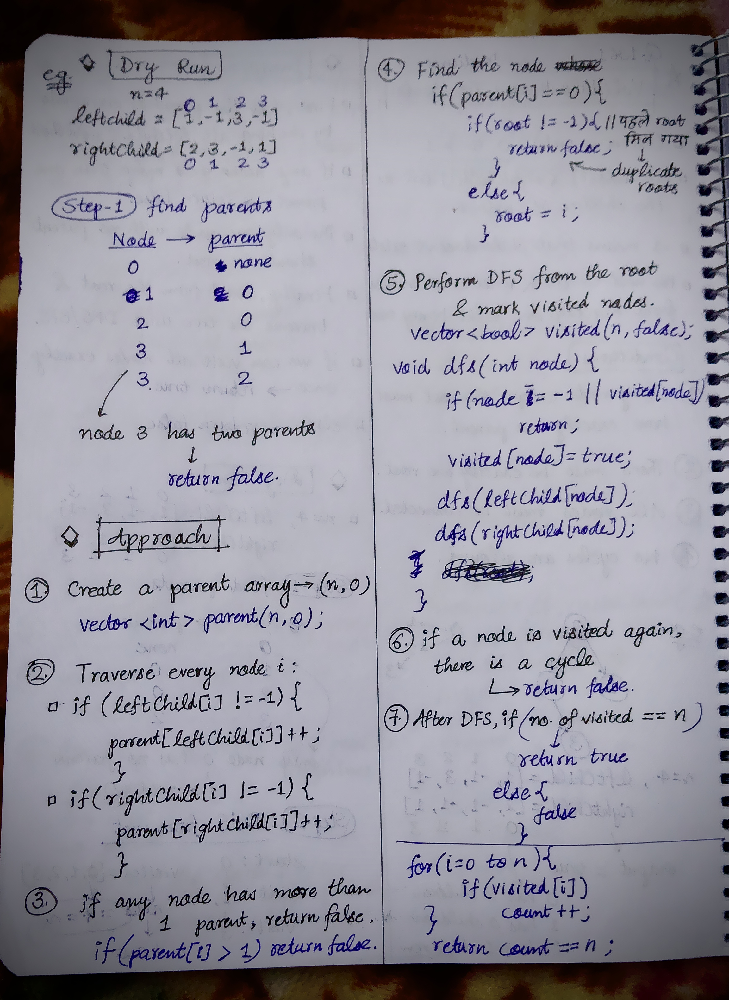

<h2><a href="https://leetcode.com/problems/validate-binary-tree-nodes">1275. Validate Binary Tree Nodes</a></h2><h3>Medium</h3><hr><p>You have <code>n</code> binary tree nodes numbered from <code>0</code> to <code>n - 1</code> where node <code>i</code> has two children <code>leftChild[i]</code> and <code>rightChild[i]</code>, return <code>true</code> if and only if <strong>all</strong> the given nodes form <strong>exactly one</strong> valid binary tree.</p>

<p>If node <code>i</code> has no left child then <code>leftChild[i]</code> will equal <code>-1</code>, similarly for the right child.</p>

<p>Note that the nodes have no values and that we only use the node numbers in this problem.</p>

<p>&nbsp;</p>
<p><strong class="example">Example 1:</strong></p>

<pre>
<strong>Input:</strong> n = 4, leftChild = [1,-1,3,-1], rightChild = [2,-1,-1,-1]
<strong>Output:</strong> true
</pre>

<p><strong class="example">Example 2:</strong></p>

<pre>
<strong>Input:</strong> n = 4, leftChild = [1,-1,3,-1], rightChild = [2,3,-1,-1]
<strong>Output:</strong> false
</pre>

<p><strong class="example">Example 3:</strong></p>

<pre>
<strong>Input:</strong> n = 2, leftChild = [1,0], rightChild = [-1,-1]
<strong>Output:</strong> false
</pre>

<p>&nbsp;</p>
<p><strong>Constraints:</strong></p>

<ul>
	<li><code>n == leftChild.length == rightChild.length</code></li>
	<li><code>1 &lt;= n &lt;= 10<sup>4</sup></code></li>
	<li><code>-1 &lt;= leftChild[i], rightChild[i] &lt;= n - 1</code></li>
</ul>


<!-- AUTO-GENERATED-SOLUTION-START -->
---

## 🧠 Visual Solution & Intuition

### Part 1



### Part 2



---

## 💡 Approach

```text
Approach : Parent Count + Root Detection + DFS Connectivity
```

---

## ⏱️ Complexity Analysis

```text
Time Complexity = O(n) =>
Space Complexity = O(n) =>
```

---

## 💻 C++ Solution

[View Original C++ File](./1361-validate-binary-tree-nodes.cpp)

```cpp
class Solution {
public:
    //Approach : Parent Count + Root Detection + DFS Connectivity


    //Time Complexity = O(n) =>
    /* Build parent[] → O(n)
    * Find root → O(n)
    * DFS → O(n)
    * Final visited check → O(n)
    * Overall → O(n)
    */

    //Space Complexity = O(n) =>
    /* 
    * parent[] → O(n)
    * visited[] → O(n)
    * DFS recursion stack → O(n) in the worst case
    */

    
    //5.) perform dfs
    void dfs(int node, vector<bool>& visited, vector<int>& leftChild, vector<int>& rightChild){
        //base-case
        if(node == -1 || visited[node]){
            return;
        }

        visited[node] = true; //mark current node visited
        
        //left
        dfs(leftChild[node], visited, leftChild, rightChild);
        
        //right
        dfs(rightChild[node], visited, leftChild, rightChild);

    }
    bool validateBinaryTreeNodes(int n, vector<int>& leftChild, vector<int>& rightChild) {
         
        //1.)
        vector<int> parent(n, 0);
        
        vector<bool> visited(n, false);

        //2.) traverse in leftChild, rightChild and store parents
        for(int i=0; i<n; i++){

            if(leftChild[i] != -1){
                parent[leftChild[i]]++;
            }
            if(rightChild[i] != -1){
                parent[rightChild[i]]++;
            }

        }
         
        int root = -1;
        for(int i=0; i<n; i++){
            //3.) check if more than one parent
            if(parent[i] > 1){
                return false;
            }

            //4.) find the root node
            if(parent[i] == 0){
                if(root != -1){
                    return false;
                }
                root = i;
            }
        }

        //if no root
        if(root == -1){
            return false;
        }

        //func. call to dfs
        dfs(root, visited, leftChild, rightChild);


        //6.) check if a node is visited again
        int count = 0;

        for(int i=0; i<n; i++){
            if(visited[i]){
                count++;
            }
        }

        //7.) if(count == n) return true; else{ return false;}
        return count == n;        

    }
};
```

<!-- AUTO-GENERATED-SOLUTION-END -->
