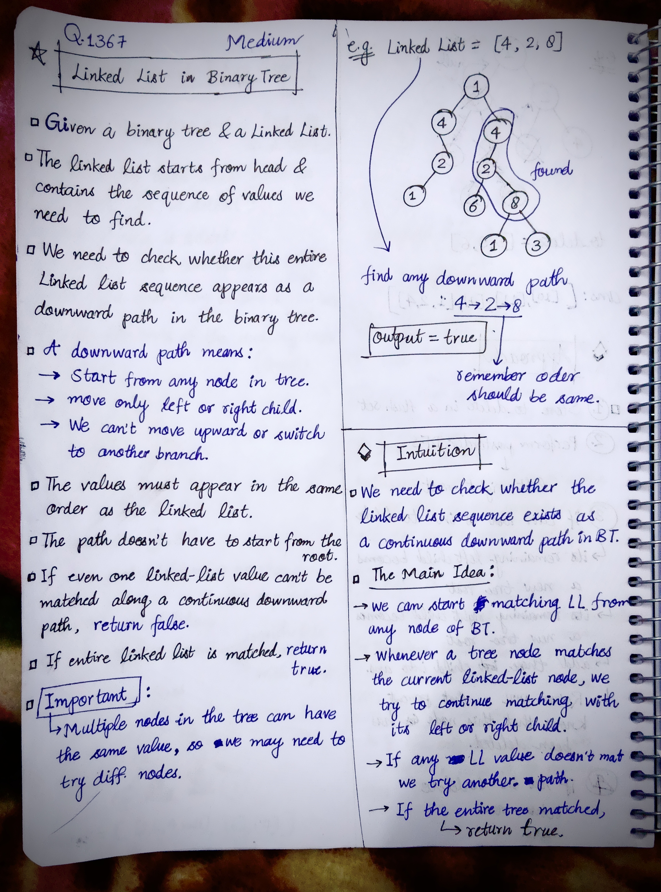
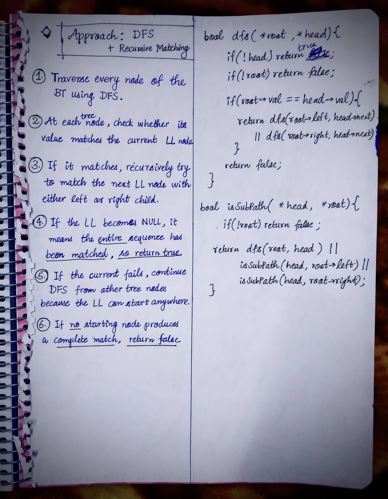

<h2><a href="https://leetcode.com/problems/linked-list-in-binary-tree">1484. Linked List in Binary Tree</a></h2><h3>Medium</h3><hr><p>Given a binary tree <code>root</code> and a&nbsp;linked list with&nbsp;<code>head</code>&nbsp;as the first node.&nbsp;</p>

<p>Return True if all the elements in the linked list starting from the <code>head</code> correspond to some <em>downward path</em> connected in the binary tree&nbsp;otherwise return False.</p>

<p>In this context downward path means a path that starts at some node and goes downwards.</p>

<p>&nbsp;</p>
<p><strong class="example">Example 1:</strong></p>

<p><strong></strong></p>

<pre>
<strong>Input:</strong> head = [4,2,8], root = [1,4,4,null,2,2,null,1,null,6,8,null,null,null,null,1,3]
<strong>Output:</strong> true
<strong>Explanation:</strong> Nodes in blue form a subpath in the binary Tree.  
</pre>

<p><strong class="example">Example 2:</strong></p>

<p><strong></strong></p>

<pre>
<strong>Input:</strong> head = [1,4,2,6], root = [1,4,4,null,2,2,null,1,null,6,8,null,null,null,null,1,3]
<strong>Output:</strong> true
</pre>

<p><strong class="example">Example 3:</strong></p>

<pre>
<strong>Input:</strong> head = [1,4,2,6,8], root = [1,4,4,null,2,2,null,1,null,6,8,null,null,null,null,1,3]
<strong>Output:</strong> false
<strong>Explanation:</strong> There is no path in the binary tree that contains all the elements of the linked list from <code>head</code>.
</pre>

<p>&nbsp;</p>
<p><strong>Constraints:</strong></p>

<ul>
	<li>The number of nodes in the tree will be in the range <code>[1, 2500]</code>.</li>
	<li>The number of nodes in the list will be in the range <code>[1, 100]</code>.</li>
	<li><code>1 &lt;= Node.val&nbsp;&lt;= 100</code>&nbsp;for each node in the linked list and binary tree.</li>
</ul>


<!-- AUTO-GENERATED-SOLUTION-START -->
---

## 🧠 Visual Solution & Intuition

### Part 1



### Part 2



---

## 💡 Approach

```text
Approach : DFS + Recursive Matching
```

---

## ⏱️ Complexity Analysis

```text
Time Complexity = O(N * M) =>
Space Complexity = O(N + M) =>
```

---

## 💻 C++ Solution

[View Original C++ File](./1367-linked-list-in-binary-tree.cpp)

```cpp
/**
 * Definition for singly-linked list.
 * struct ListNode {
 *     int val;
 *     ListNode *next;
 *     ListNode() : val(0), next(nullptr) {}
 *     ListNode(int x) : val(x), next(nullptr) {}
 *     ListNode(int x, ListNode *next) : val(x), next(next) {}
 * };
 */
/**
 * Definition for a binary tree node.
 * struct TreeNode {
 *     int val;
 *     TreeNode *left;
 *     TreeNode *right;
 *     TreeNode() : val(0), left(nullptr), right(nullptr) {}
 *     TreeNode(int x) : val(x), left(nullptr), right(nullptr) {}
 *     TreeNode(int x, TreeNode *left, TreeNode *right) : val(x), left(left), right(right) {}
 * };
 */
class Solution {
public: 
    //Approach : DFS + Recursive Matching

    //Time Complexity = O(N * M) =>
    /* Let:
    * N = number of nodes in the binary tree
    * M = number of nodes in the linked list
    * We visit every tree node as a possible starting point → O(N).
    * For each possible starting node, we may need to compare up to M linked-list nodes along a path.
    * Therefore : TC = O(N × M)

    */

    //Space Complexity = O(N + M) =>
    /* There are two recursive functions, so we need to consider the recursion depth.
    * isSubPath() recursively traverses the binary tree.
    * dfs() recursively follows a possible downward path while matching the linked list.
    * In the worst case:
    * Tree recursion depth can be O(N) for a skewed tree.
    * Path-matching recursion can be O(M).
    */


    bool dfs(TreeNode* root, ListNode* head){

        if(!head){ //head == NULL => means all node matched
            return true;
        }

        if(!root){ //root == NULL
            return false;
        }        

        //2.) if current node matches then recursively match left or right
        if(root->val == head->val){

            return dfs(root->left, head->next) ||
                   dfs(root->right, head->next);
        }

        //3.) if no current node matched
        return false;
    }
    bool isSubPath(ListNode* head, TreeNode* root) {
        
        if(!root){
            return false;
        }
        

        return dfs(root, head) || isSubPath(head, root->left) || isSubPath(head, root->right);

    }
};
```

<!-- AUTO-GENERATED-SOLUTION-END -->
