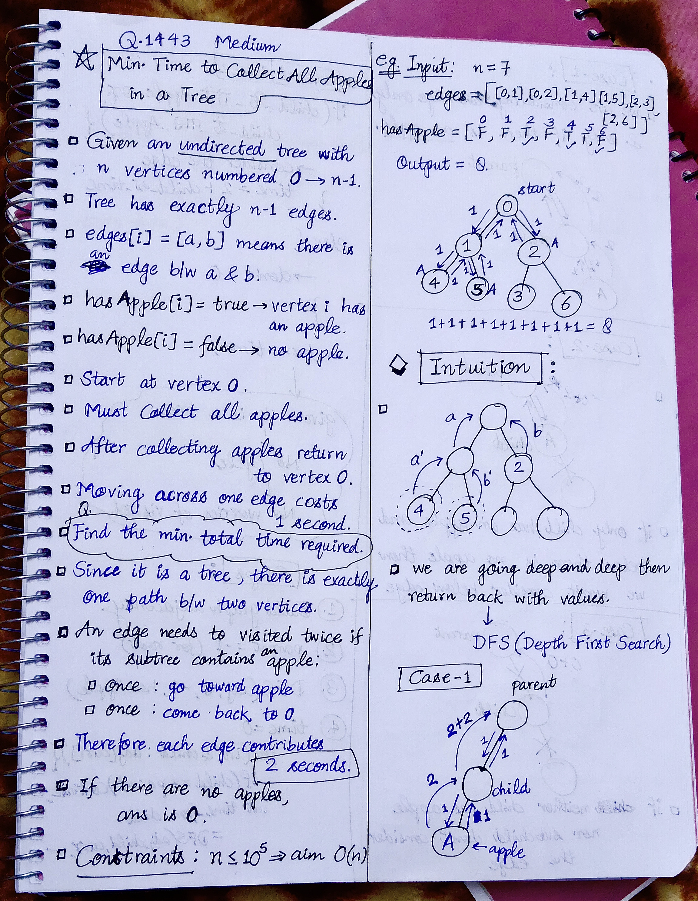
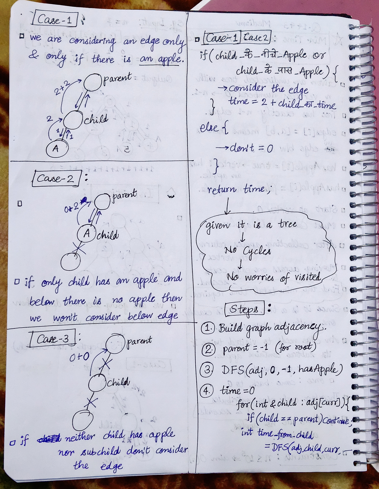
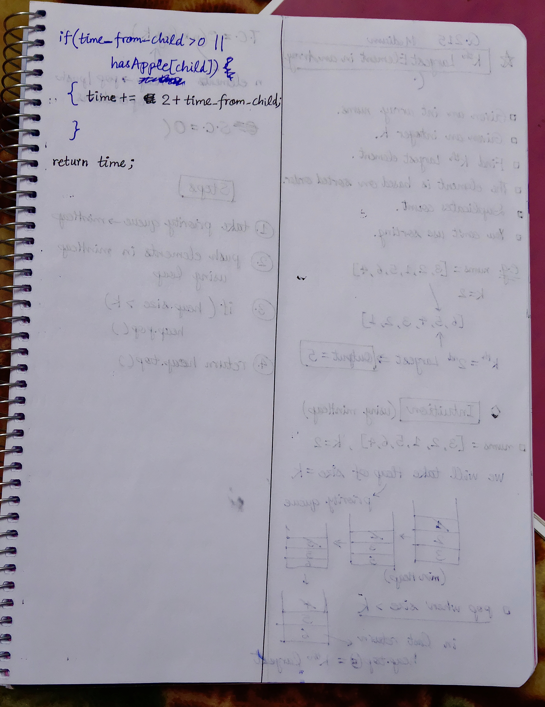

<h2><a href="https://leetcode.com/problems/minimum-time-to-collect-all-apples-in-a-tree/">1554. Minimum Time to Collect All Apples in a Tree</a></h2><h3>Medium</h3><hr><p>Given an undirected tree consisting of <code>n</code> vertices numbered from <code>0</code> to <code>n-1</code>, which has some apples in their vertices. You spend 1 second to walk over one edge of the tree. <em>Return the minimum time in seconds you have to spend to collect all apples in the tree, starting at <strong>vertex 0</strong> and coming back to this vertex.</em></p>

<p>The edges of the undirected tree are given in the array <code>edges</code>, where <code>edges[i] = [a<sub>i</sub>, b<sub>i</sub>]</code> means that exists an edge connecting the vertices <code>a<sub>i</sub></code> and <code>b<sub>i</sub></code>. Additionally, there is a boolean array <code>hasApple</code>, where <code>hasApple[i] = true</code> means that vertex <code>i</code> has an apple; otherwise, it does not have any apple.</p>

<p>&nbsp;</p>
<p><strong class="example">Example 1:</strong></p>

<pre>
<strong>Input:</strong> n = 7, edges = [[0,1],[0,2],[1,4],[1,5],[2,3],[2,6]], hasApple = [false,false,true,false,true,true,false]
<strong>Output:</strong> 8 
<strong>Explanation:</strong> The figure above represents the given tree where red vertices have an apple. One optimal path to collect all apples is shown by the green arrows.  
</pre>

<p><strong class="example">Example 2:</strong></p>

<pre>
<strong>Input:</strong> n = 7, edges = [[0,1],[0,2],[1,4],[1,5],[2,3],[2,6]], hasApple = [false,false,true,false,false,true,false]
<strong>Output:</strong> 6
<strong>Explanation:</strong> The figure above represents the given tree where red vertices have an apple. One optimal path to collect all apples is shown by the green arrows.  
</pre>

<p><strong class="example">Example 3:</strong></p>

<pre>
<strong>Input:</strong> n = 7, edges = [[0,1],[0,2],[1,4],[1,5],[2,3],[2,6]], hasApple = [false,false,false,false,false,false,false]
<strong>Output:</strong> 0
</pre>

<p>&nbsp;</p>
<p><strong>Constraints:</strong></p>

<ul>
	<li><code>1 &lt;= n &lt;= 10<sup>5</sup></code></li>
	<li><code>edges.length == n - 1</code></li>
	<li><code>edges[i].length == 2</code></li>
	<li><code>0 &lt;= a<sub>i</sub> &lt; b<sub>i</sub> &lt;= n - 1</code></li>
	<li><code>hasApple.length == n</code></li>
</ul>


<!-- AUTO-GENERATED-SOLUTION-START -->
---

## 🧠 Visual Solution & Intuition

### Part 1



### Part 2



### Part 3



---

## ⏱️ Complexity Analysis

```text
Time Complexity = O(V + E) =>
Space Complexity = O(V + E)
```

---

## 💻 C++ Solution

[View Original C++ File](./1443-minimum-time-to-collect-all-apples-in-a-tree.cpp)

```cpp
class Solution {
public:
    //Method : DFS Traversal

    //Time Complexity = O(V + E) =>
    /* V = number of vertices
    * E = number of edges
    * Building adjacency list → O(E)
    */
    //Space Complexity = O(V + E)


    int DFS(unordered_map<int, vector<int>>& adj, int curr, int parent, vector<bool>& hasApple){
        //initialize time
        int time = 0;

        //traverse in children of curr
        for(int &child : adj[curr]){
            if(child == parent) continue;//skip 

            int time_from_child = DFS(adj, child, curr, hasApple);

            if(time_from_child > 0 || hasApple[child]){
                time += 2 + time_from_child; 
            }
        }

        //finally return total time
        return time;
    }
    int minTime(int n, vector<vector<int>>& edges, vector<bool>& hasApple) {
        //1.) Build graph adjacency (using unordered_map)
        unordered_map<int, vector<int>> adj;

        for(auto& vec : edges){
            int u = vec[0];  //edges[i] = [u,v] 
            int v = vec[1];

            //make undirected graph connections 
            adj[u].push_back(v); //u--->v
            adj[v].push_back(u);
        }


        //func. call to DFS
        int st = 0;
        int parent = -1; //parent of root = -1

        return DFS(adj, st, parent, hasApple);
    }
};
```

<!-- AUTO-GENERATED-SOLUTION-END -->
