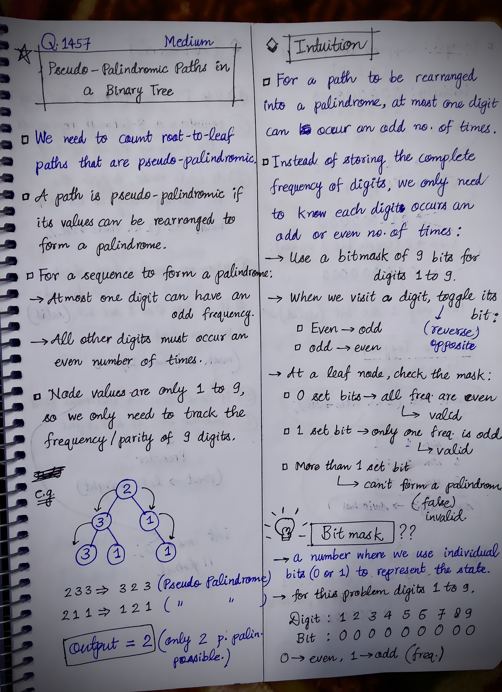
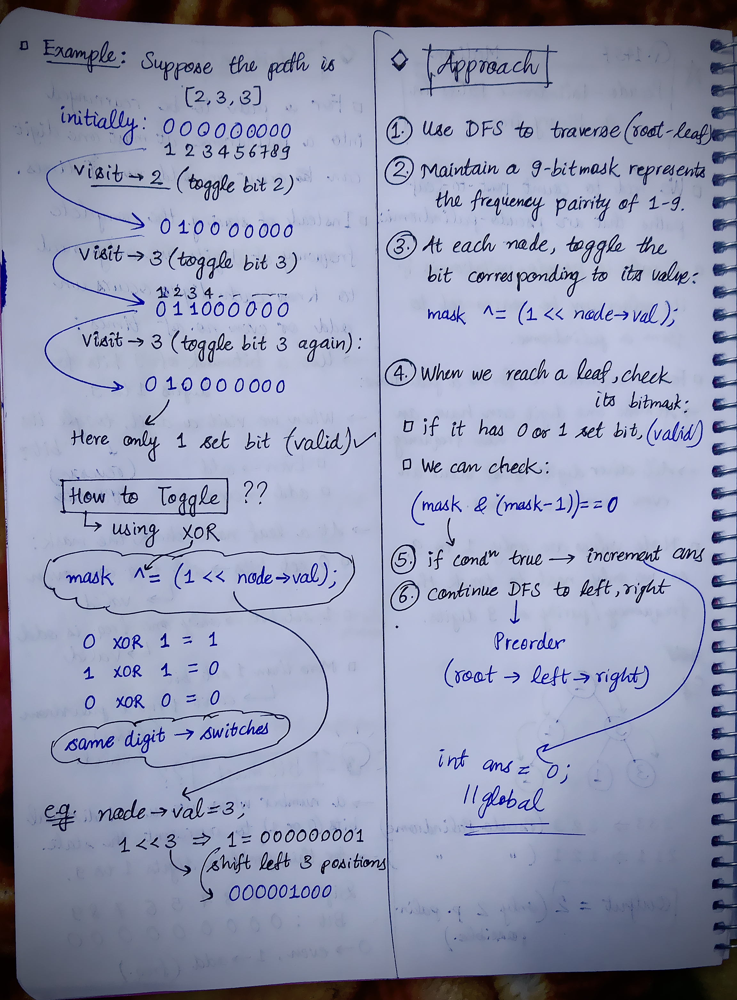

<h2><a href="https://leetcode.com/problems/pseudo-palindromic-paths-in-a-binary-tree">1568. Pseudo-Palindromic Paths in a Binary Tree</a></h2><h3>Medium</h3><hr><p>Given a binary tree where node values are digits from 1 to 9. A path in the binary tree is said to be <strong>pseudo-palindromic</strong> if at least one permutation of the node values in the path is a palindrome.</p>

<p><em>Return the number of <strong>pseudo-palindromic</strong> paths going from the root node to leaf nodes.</em></p>

<p>&nbsp;</p>
<p><strong class="example">Example 1:</strong></p>

<p></p>

<pre>
<strong>Input:</strong> root = [2,3,1,3,1,null,1]
<strong>Output:</strong> 2 
<strong>Explanation:</strong> The figure above represents the given binary tree. There are three paths going from the root node to leaf nodes: the red path [2,3,3], the green path [2,1,1], and the path [2,3,1]. Among these paths only red path and green path are pseudo-palindromic paths since the red path [2,3,3] can be rearranged in [3,2,3] (palindrome) and the green path [2,1,1] can be rearranged in [1,2,1] (palindrome).
</pre>

<p><strong class="example">Example 2:</strong></p>

<p><strong></strong></p>

<pre>
<strong>Input:</strong> root = [2,1,1,1,3,null,null,null,null,null,1]
<strong>Output:</strong> 1 
<strong>Explanation:</strong> The figure above represents the given binary tree. There are three paths going from the root node to leaf nodes: the green path [2,1,1], the path [2,1,3,1], and the path [2,1]. Among these paths only the green path is pseudo-palindromic since [2,1,1] can be rearranged in [1,2,1] (palindrome).
</pre>

<p><strong class="example">Example 3:</strong></p>

<pre>
<strong>Input:</strong> root = [9]
<strong>Output:</strong> 1
</pre>

<p>&nbsp;</p>
<p><strong>Constraints:</strong></p>

<ul>
	<li>The number of nodes in the tree is in the range <code>[1, 10<sup>5</sup>]</code>.</li>
	<li><code>1 &lt;= Node.val &lt;= 9</code></li>
</ul>


<!-- AUTO-GENERATED-SOLUTION-START -->
---

## 🧠 Visual Solution & Intuition

### Part 1



### Part 2



---

## 💡 Approach

```text
Approach : DFS(Preorder) + Bitmasking
```

---

## ⏱️ Complexity Analysis

```text
Time Complexity = O(N) =>
```

---

## 💻 C++ Solution

[View Original C++ File](./1457-pseudo-palindromic-paths-in-a-binary-tree.cpp)

```cpp
/**
 * Definition for a binary tree node.
 * struct TreeNode {
 *     int val;
 *     TreeNode *left;
 *     TreeNode *right;
 *     TreeNode() : val(0), left(nullptr), right(nullptr) {}
 *     TreeNode(int x) : val(x), left(nullptr), right(nullptr) {}
 *     TreeNode(int x, TreeNode *left, TreeNode *right) : val(x), left(left), right(right) {}
 * };
 */
class Solution {
public:
    //Approach : DFS(Preorder) + Bitmasking

    //Time Complexity = O(N) =>
    /* We visit every node exactly once.
    * At each node, toggling a bit and checking the mask take O(1).
    * Therefore, for N nodes: O(N)
    */
 
    //Space Compleixty = O(H) =>
    /* H = height of the binary tree.
    * The DFS recursion stack can go as deep as the tree height.
    * The mask is passed by value, but it is only an integer, so each recursive call uses O(1) extra space. 
    */


    int ans = 0; //initially no nodes are pseudo-palindromic because we haven't started traversing

    void dfs(TreeNode* node, int mask){ //Preorder DFS : root, left, right
        //base-case
        if(node == NULL) return;

        // toggle the current node
        mask ^= (1 << node->val);

        // check if it's a leaf
        if(node->left == NULL && node->right == NULL){
            //check its bitmask
            //if set bit 0 or 1 => ans ++
            if( (mask & (mask-1)) == 0 ){
                ans++;
            }
            //else
            return;
        }


        //continue dfs to left, right
        dfs(node->left, mask);
        dfs(node->right, mask);
    }
    int pseudoPalindromicPaths (TreeNode* root) {
        
        int mask = 0; // 0 in binary has all bits set to 0
        
        //func. call to dfs
        dfs(root, mask);
        
        //finally return the output : no. of pseudo-palidromic paths
        return ans;
    }
};
```

<!-- AUTO-GENERATED-SOLUTION-END -->
