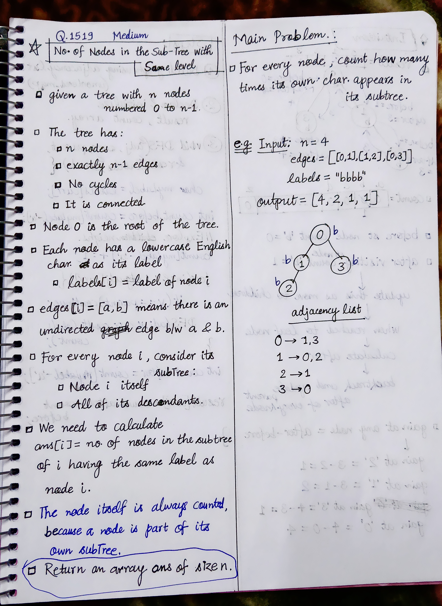
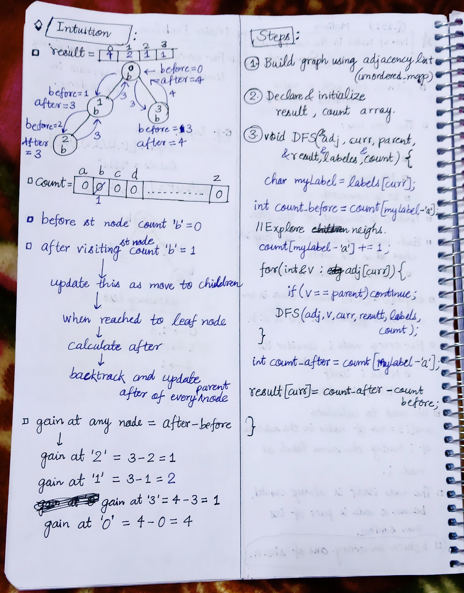

<h2><a href="https://leetcode.com/problems/number-of-nodes-in-the-sub-tree-with-the-same-label">1643. Number of Nodes in the Sub-Tree With the Same Label</a></h2><h3>Medium</h3><hr><p>You are given a tree (i.e. a connected, undirected graph that has no cycles) consisting of <code>n</code> nodes numbered from <code>0</code> to <code>n - 1</code> and exactly <code>n - 1</code> <code>edges</code>. The <strong>root</strong> of the tree is the node <code>0</code>, and each node of the tree has <strong>a label</strong> which is a lower-case character given in the string <code>labels</code> (i.e. The node with the number <code>i</code> has the label <code>labels[i]</code>).</p>

<p>The <code>edges</code> array is given on the form <code>edges[i] = [a<sub>i</sub>, b<sub>i</sub>]</code>, which means there is an edge between nodes <code>a<sub>i</sub></code> and <code>b<sub>i</sub></code> in the tree.</p>

<p>Return <em>an array of size <code>n</code></em> where <code>ans[i]</code> is the number of nodes in the subtree of the <code>i<sup>th</sup></code> node which have the same label as node <code>i</code>.</p>

<p>A subtree of a tree <code>T</code> is the tree consisting of a node in <code>T</code> and all of its descendant nodes.</p>

<p>&nbsp;</p>
<p><strong class="example">Example 1:</strong></p>

<pre>
<strong>Input:</strong> n = 7, edges = [[0,1],[0,2],[1,4],[1,5],[2,3],[2,6]], labels = &quot;abaedcd&quot;
<strong>Output:</strong> [2,1,1,1,1,1,1]
<strong>Explanation:</strong> Node 0 has label &#39;a&#39; and its sub-tree has node 2 with label &#39;a&#39; as well, thus the answer is 2. Notice that any node is part of its sub-tree.
Node 1 has a label &#39;b&#39;. The sub-tree of node 1 contains nodes 1,4 and 5, as nodes 4 and 5 have different labels than node 1, the answer is just 1 (the node itself).
</pre>

<p><strong class="example">Example 2:</strong></p>

<pre>
<strong>Input:</strong> n = 4, edges = [[0,1],[1,2],[0,3]], labels = &quot;bbbb&quot;
<strong>Output:</strong> [4,2,1,1]
<strong>Explanation:</strong> The sub-tree of node 2 contains only node 2, so the answer is 1.
The sub-tree of node 3 contains only node 3, so the answer is 1.
The sub-tree of node 1 contains nodes 1 and 2, both have label &#39;b&#39;, thus the answer is 2.
The sub-tree of node 0 contains nodes 0, 1, 2 and 3, all with label &#39;b&#39;, thus the answer is 4.
</pre>

<p><strong class="example">Example 3:</strong></p>

<pre>
<strong>Input:</strong> n = 5, edges = [[0,1],[0,2],[1,3],[0,4]], labels = &quot;aabab&quot;
<strong>Output:</strong> [3,2,1,1,1]
</pre>

<p>&nbsp;</p>
<p><strong>Constraints:</strong></p>

<ul>
	<li><code>1 &lt;= n &lt;= 10<sup>5</sup></code></li>
	<li><code>edges.length == n - 1</code></li>
	<li><code>edges[i].length == 2</code></li>
	<li><code>0 &lt;= a<sub>i</sub>, b<sub>i</sub> &lt; n</code></li>
	<li><code>a<sub>i</sub> != b<sub>i</sub></code></li>
	<li><code>labels.length == n</code></li>
	<li><code>labels</code> is consisting of only of lowercase English letters.</li>
</ul>


<!-- AUTO-GENERATED-SOLUTION-START -->
---

## 🧠 Visual Solution & Intuition

### Part 1



### Part 2



---

## 💡 Approach

```text
Approach : DFS + Frequency Counting (Subtree DFS)
```

---

## ⏱️ Complexity Analysis

```text
Time Complexity = O(n * 26) = O(n) => O(n) + O(n) + O(26n)
Space Complexity = O(n * 26) = O(n) => O(n) + O(n) + O(n) + O(1)
```

---

## 💻 C++ Solution

[View Original C++ File](./1519-number-of-nodes-in-the-sub-tree-with-the-same-label.cpp)

```cpp
class Solution {
public:
    //Approach : DFS + Frequency Counting (Subtree DFS)

    //Time Complexity = O(n * 26) = O(n) => O(n) + O(n) + O(26n)
    /* Build adjacency list: O(n)
    * Tree has n - 1 edges.
    * Each edge is inserted twice → 2(n-1) → O(n).
    * DFS traversal: O(n)
    * Every node is visited exactly once.
    * Every edge is explored at most twice.
    * Frequency counting: O(26 × n)
    * For every node, we may process 26 lowercase characters.
    * 26 is constant → O(n).
    */

    //Space Complexity = O(n * 26) = O(n) => O(n) + O(n) + O(n) + O(1)
    /* Adjacency list: O(n)
    * Stores n - 1 edges → 2(n-1) entries.
    * Result array: O(n)
    * Stores answer for each node.
    * DFS recursion stack: O(n)
    * Worst case: tree is a straight chain → recursion depth n.
    * Frequency array: O(26) = O(1)
    * Only 26 lowercase letters.
    */

    void DFS(unordered_map<int, vector<int>>& adj, int curr, int parent, vector<int>& result, string& labels, vector<int>& count){

        char myLabel = labels[curr];

        int count_before = count[myLabel - 'a'];//this counts no. of same labels before visiting curr node

        //explore neighs of curr
        count[myLabel - 'a'] += 1;

        for(int& v : adj[curr]){
            
            if(v == parent) continue; //skip

            DFS(adj, v, curr, result, labels, count);
        }

        int count_after = count[myLabel - 'a'];//this counts no. of same labels after visiting curr node

        result[curr] = count_after - count_before;
    }
    vector<int> countSubTrees(int n, vector<vector<int>>& edges, string labels) {
        //1.) Build Graph using Adjacency list
        unordered_map<int, vector<int>> adj;

        for(auto& vec : edges){
            int u = vec[0]; //edges[i] = [a,b] => index 0 = u
            int v = vec[1]; // index 1 = v

            //make undirected graph connections
            adj[u].push_back(v); // u ----> v
            adj[v].push_back(u); // v ----> u
        }


        //2.) Declare & Initialize result, count
        vector<int> result(n, 0);
        vector<int> count(26, 0);


        //func. call to DFS
        int curr = 0; //start node = 0
        int par = -1; //parent of start node = -1

        DFS(adj, curr, par, result, labels, count);


        //finally return the output
        return result;
    }
};
```

<!-- AUTO-GENERATED-SOLUTION-END -->
