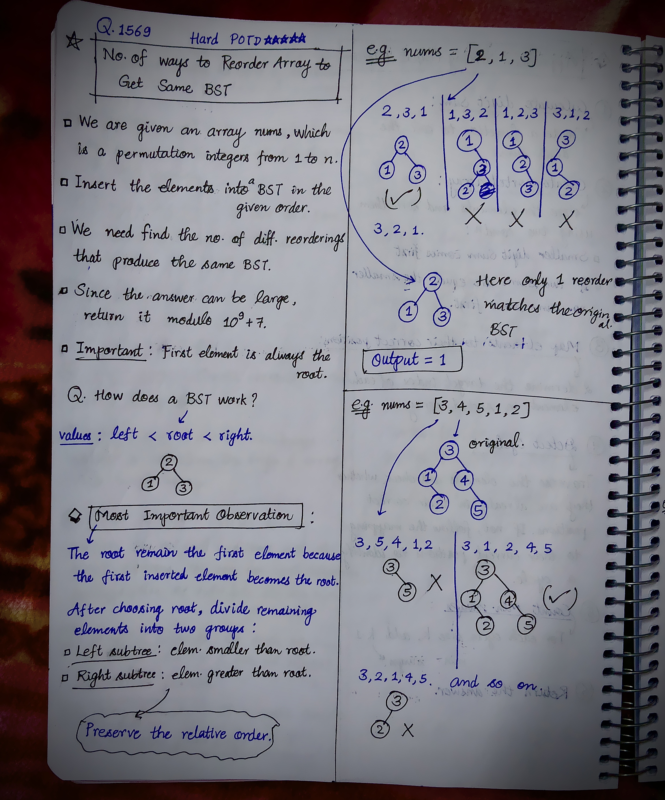
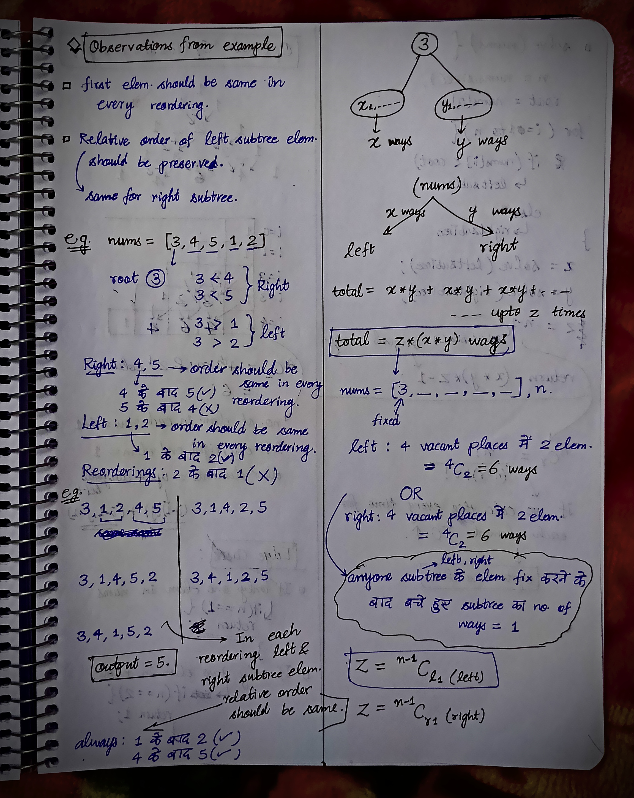
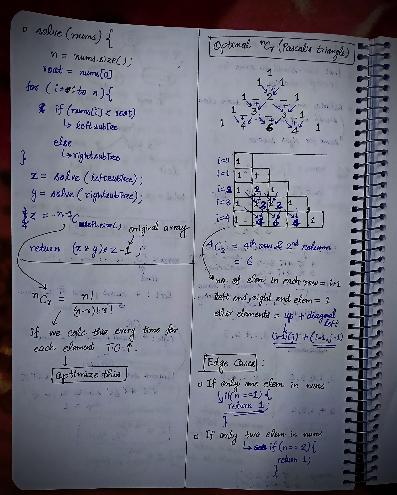

<h2><a href="https://leetcode.com/problems/number-of-ways-to-reorder-array-to-get-same-bst">1692. Number of Ways to Reorder Array to Get Same BST</a></h2><h3>Hard</h3><hr><p>Given an array <code>nums</code> that represents a permutation of integers from <code>1</code> to <code>n</code>. We are going to construct a binary search tree (BST) by inserting the elements of <code>nums</code> in order into an initially empty BST. Find the number of different ways to reorder <code>nums</code> so that the constructed BST is identical to that formed from the original array <code>nums</code>.</p>

<ul>
	<li>For example, given <code>nums = [2,1,3]</code>, we will have 2 as the root, 1 as a left child, and 3 as a right child. The array <code>[2,3,1]</code> also yields the same BST but <code>[3,2,1]</code> yields a different BST.</li>
</ul>

<p>Return <em>the number of ways to reorder</em> <code>nums</code> <em>such that the BST formed is identical to the original BST formed from</em> <code>nums</code>.</p>

<p>Since the answer may be very large, <strong>return it modulo </strong><code>10<sup>9</sup> + 7</code>.</p>

<p>&nbsp;</p>
<p><strong class="example">Example 1:</strong></p>

<pre>
<strong>Input:</strong> nums = [2,1,3]
<strong>Output:</strong> 1
<strong>Explanation:</strong> We can reorder nums to be [2,3,1] which will yield the same BST. There are no other ways to reorder nums which will yield the same BST.
</pre>

<p><strong class="example">Example 2:</strong></p>

<pre>
<strong>Input:</strong> nums = [3,4,5,1,2]
<strong>Output:</strong> 5
<strong>Explanation:</strong> The following 5 arrays will yield the same BST: 
[3,1,2,4,5]
[3,1,4,2,5]
[3,1,4,5,2]
[3,4,1,2,5]
[3,4,1,5,2]
</pre>

<p><strong class="example">Example 3:</strong></p>

<pre>
<strong>Input:</strong> nums = [1,2,3]
<strong>Output:</strong> 0
<strong>Explanation:</strong> There are no other orderings of nums that will yield the same BST.
</pre>

<p>&nbsp;</p>
<p><strong>Constraints:</strong></p>

<ul>
	<li><code>1 &lt;= nums.length &lt;= 1000</code></li>
	<li><code>1 &lt;= nums[i] &lt;= nums.length</code></li>
	<li>All integers in <code>nums</code> are <strong>distinct</strong>.</li>
</ul>


<!-- AUTO-GENERATED-SOLUTION-START -->
---

## 🧠 Visual Solution & Intuition

### Part 1



### Part 2



### Part 3



---

## ⏱️ Complexity Analysis

```text
Time Complexity = O(n²) =>
Space Complexity = O(n²) =>
```

---

## 💻 C++ Solution

[View Original C++ File](./1569-number-of-ways-to-reorder-array-to-get-same-bst.cpp)

```cpp
class Solution {
public:
    //Approach : 

    //Time Complexity = O(n²) =>
    /* 1. Building Pascal’s Triangle — O(n²)
    * 2. Recursive solve() — O(n²) Total work: n + (n-1) + (n-2) + ... + 1
    */

    //Space Complexity = O(n²) =>
    /* 1. Pascal’s Triangle — O(n²)
    * 2. Recursive Calls and Subarrays — O(n²) worst case
    */


    typedef long long ll;

    ll M = 1e9 + 7; //10^9 + 7

    vector<vector<ll>> PT;//Pascal's triangle

    int solve(vector<int>& nums){

        int n = nums.size();

        //edge-case
        if(n <= 2){
            return 1;
        }

        int root = nums[0]; //first element is always root

        vector<int> leftSub, rightSub;
        
        //Fill the leftSub & rightSub
        for(int i = 1; i < n; i++){

            if(nums[i] < root){
                leftSub.push_back(nums[i]);
            }

            else{
                rightSub.push_back(nums[i]);
            }
        }
        
        //Calc. no. of ways of leftSub & rightSub
        ll x = solve(leftSub) % M; //x ways for left
        ll y = solve(rightSub) % M;//y ways for left

        ll z = PT[n-1][leftSub.size()] % M; //n-1C(left.size())

        return (x * y % M) * z % M;
    }
    int numOfWays(vector<int>& nums) {
        
        int n = nums.size();

        PT.resize(n+1);
        
        //Filling Pascal's triangle 
        for(int i = 0; i < n; i++){

            PT[i] = vector<ll>(i+1, 1);//size of row = i+1, filled with 1

            for(int j = 1; j < i; j++){

                PT[i][j] = (PT[i-1][j] + PT[i-1][j-1]) % M; //up + diagonal left
            }
        }

        //finally return the output = x*y*z - 1
       return (solve(nums) - 1 + M) % M;
    }
};
```

<!-- AUTO-GENERATED-SOLUTION-END -->
