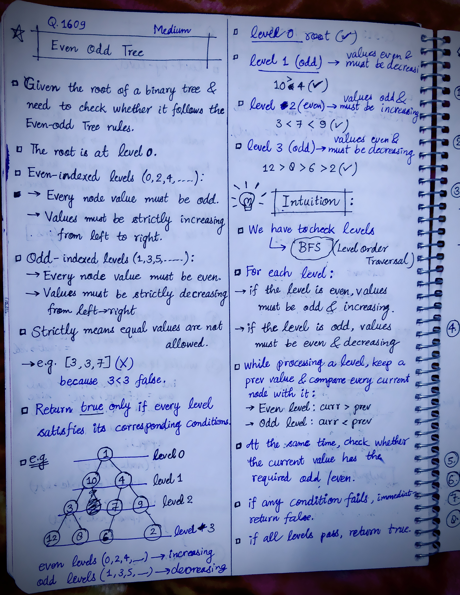
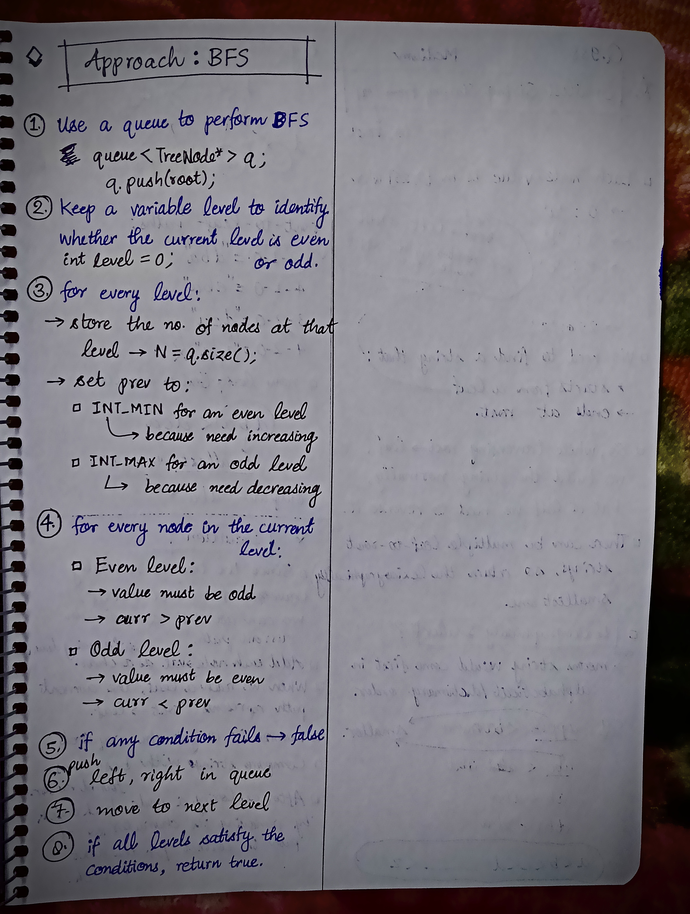

<h2><a href="https://leetcode.com/problems/even-odd-tree">1731. Even Odd Tree</a></h2><h3>Medium</h3><hr><p>A binary tree is named <strong>Even-Odd</strong> if it meets the following conditions:</p>

<ul>
	<li>The root of the binary tree is at level index <code>0</code>, its children are at level index <code>1</code>, their children are at level index <code>2</code>, etc.</li>
	<li>For every <strong>even-indexed</strong> level, all nodes at the level have <strong>odd</strong> integer values in <strong>strictly increasing</strong> order (from left to right).</li>
	<li>For every <b>odd-indexed</b> level, all nodes at the level have <b>even</b> integer values in <strong>strictly decreasing</strong> order (from left to right).</li>
</ul>

<p>Given the <code>root</code> of a binary tree, <em>return </em><code>true</code><em> if the binary tree is <strong>Even-Odd</strong>, otherwise return </em><code>false</code><em>.</em></p>

<p>&nbsp;</p>
<p><strong class="example">Example 1:</strong></p>

<pre>
<strong>Input:</strong> root = [1,10,4,3,null,7,9,12,8,6,null,null,2]
<strong>Output:</strong> true
<strong>Explanation:</strong> The node values on each level are:
Level 0: [1]
Level 1: [10,4]
Level 2: [3,7,9]
Level 3: [12,8,6,2]
Since levels 0 and 2 are all odd and increasing and levels 1 and 3 are all even and decreasing, the tree is Even-Odd.
</pre>

<p><strong class="example">Example 2:</strong></p>

<pre>
<strong>Input:</strong> root = [5,4,2,3,3,7]
<strong>Output:</strong> false
<strong>Explanation:</strong> The node values on each level are:
Level 0: [5]
Level 1: [4,2]
Level 2: [3,3,7]
Node values in level 2 must be in strictly increasing order, so the tree is not Even-Odd.
</pre>

<p><strong class="example">Example 3:</strong></p>

<pre>
<strong>Input:</strong> root = [5,9,1,3,5,7]
<strong>Output:</strong> false
<strong>Explanation:</strong> Node values in the level 1 should be even integers.
</pre>

<p>&nbsp;</p>
<p><strong>Constraints:</strong></p>

<ul>
	<li>The number of nodes in the tree is in the range <code>[1, 10<sup>5</sup>]</code>.</li>
	<li><code>1 &lt;= Node.val &lt;= 10<sup>6</sup></code></li>
</ul>


<!-- AUTO-GENERATED-SOLUTION-START -->
---

## 🧠 Visual Solution & Intuition

### Part 1



### Part 2



---

## 💡 Approach

```text
Approach : BFS(Level Order Traversal)
```

---

## ⏱️ Complexity Analysis

```text
Time Complexity = O(n) =>
Space Complexity = O(n) =>
```

---

## 💻 C++ Solution

[View Original C++ File](./1609-even-odd-tree.cpp)

```cpp
/**
 * Definition for a binary tree node.
 * struct TreeNode {
 *     int val;
 *     TreeNode *left;
 *     TreeNode *right;
 *     TreeNode() : val(0), left(nullptr), right(nullptr) {}
 *     TreeNode(int x) : val(x), left(nullptr), right(nullptr) {}
 *     TreeNode(int x, TreeNode *left, TreeNode *right) : val(x), left(left), right(right) {}
 * };
 */
class Solution {
public:
    //Approach : BFS(Level Order Traversal)

    //Time Complexity = O(n) =>
    /* n = total number of nodes in the tree.
    * BFS visits each node exactly once.
    * For every node, we perform only constant-time operations:
        * Check odd/even value → O(1)
        * Compare with prev → O(1)
        * Push/pop from queue → O(1)
    */

    //Space Complexity = O(n) =>
    /* We use a queue for BFS to store nodes that are waiting to be processed.
    * In the worst case, the tree can be skewed or have a very large level.
    * The queue can contain up to N/2 nodes at once.
    * prev, level, and N use only O(1) extra space.
    */


    bool isEvenOddTree(TreeNode* root) {
        //Step-1.
        queue<TreeNode*> q;

        q.push(root);
        
        //Step-2.
        int level = 0;//current level of root is zero

        //start traversing
        while(!q.empty()){
            
            int N = q.size();
            int prev;
            
            //Step-3.
            if(level % 2 == 0){//even level
                prev = INT_MIN;
            }
            else{ //odd level
                prev = INT_MAX;
            }

            while(N--){
                TreeNode* curr = q.front();
                q.pop();

                //Step-4.
                //check if even level => values must be odd and curr > prev
                if(level % 2 == 0){
                    
                    if(curr->val % 2 == 0 || curr->val <= prev){ //even values or curr <= prev
                        return false; //Step-5
                    }
                }
                //check if odd level => values must be even and curr < prev
                else{
                    
                    if(curr->val % 2 != 0 || curr->val >= prev){ //odd values or curr >= prev
                        return false; //Step-5
                    }
                }

                //Update the prev after checks
                prev = curr->val;

                //6.) push left, right children
                if(curr->left != NULL){
                    q.push(curr->left);
                }
                
                if(curr->right != NULL){
                    q.push(curr->right);
                }
            }
            //move to the next level
            level++;
        }

        //7.) if all levels pass above checks then
        return true;
    }
};
```

<!-- AUTO-GENERATED-SOLUTION-END -->
