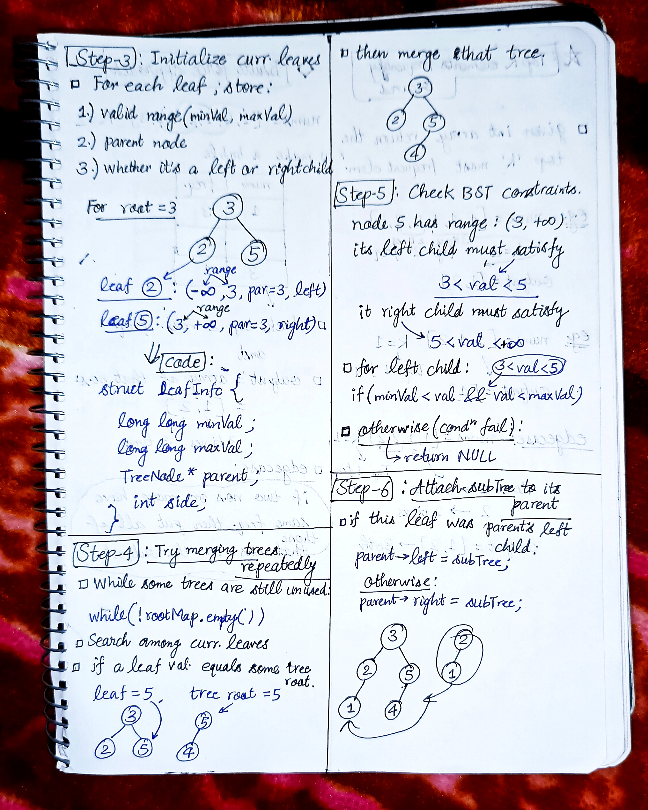
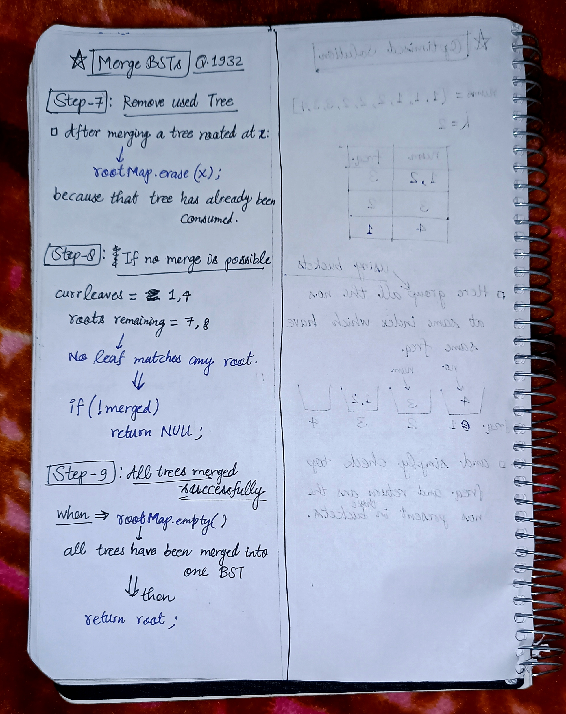

<h2><a href="https://leetcode.com/problems/merge-bsts-to-create-single-bst">2060. Merge BSTs to Create Single BST</a></h2><h3>Hard</h3><hr><p>You are given <code>n</code> <strong>BST (binary search tree) root nodes</strong> for <code>n</code> separate BSTs stored in an array <code>trees</code> (<strong>0-indexed</strong>). Each BST in <code>trees</code> has <strong>at most 3 nodes</strong>, and no two roots have the same value. In one operation, you can:</p>

<ul>
	<li>Select two <strong>distinct</strong> indices <code>i</code> and <code>j</code> such that the value stored at one of the <strong>leaves </strong>of <code>trees[i]</code> is equal to the <strong>root value</strong> of <code>trees[j]</code>.</li>
	<li>Replace the leaf node in <code>trees[i]</code> with <code>trees[j]</code>.</li>
	<li>Remove <code>trees[j]</code> from <code>trees</code>.</li>
</ul>

<p>Return<em> the <strong>root</strong> of the resulting BST if it is possible to form a valid BST after performing </em><code>n - 1</code><em> operations, or</em><em> </em><code>null</code> <i>if it is impossible to create a valid BST</i>.</p>

<p>A BST (binary search tree) is a binary tree where each node satisfies the following property:</p>

<ul>
	<li>Every node in the node&#39;s left subtree has a value&nbsp;<strong>strictly less</strong>&nbsp;than the node&#39;s value.</li>
	<li>Every node in the node&#39;s right subtree has a value&nbsp;<strong>strictly greater</strong>&nbsp;than the node&#39;s value.</li>
</ul>

<p>A leaf is a node that has no children.</p>

<p>&nbsp;</p>
<p><strong class="example">Example 1:</strong></p>

<pre>
<strong>Input:</strong> trees = [[2,1],[3,2,5],[5,4]]
<strong>Output:</strong> [3,2,5,1,null,4]
<strong>Explanation:</strong>
In the first operation, pick i=1 and j=0, and merge trees[0] into trees[1].
Delete trees[0], so trees = [[3,2,5,1],[5,4]].

In the second operation, pick i=0 and j=1, and merge trees[1] into trees[0].
Delete trees[1], so trees = [[3,2,5,1,null,4]].

The resulting tree, shown above, is a valid BST, so return its root.</pre>

<p><strong class="example">Example 2:</strong></p>

<pre>
<strong>Input:</strong> trees = [[5,3,8],[3,2,6]]
<strong>Output:</strong> []
<strong>Explanation:</strong>
Pick i=0 and j=1 and merge trees[1] into trees[0].
Delete trees[1], so trees = [[5,3,8,2,6]].

The resulting tree is shown above. This is the only valid operation that can be performed, but the resulting tree is not a valid BST, so return null.
</pre>

<p><strong class="example">Example 3:</strong></p>

<pre>
<strong>Input:</strong> trees = [[5,4],[3]]
<strong>Output:</strong> []
<strong>Explanation:</strong> It is impossible to perform any operations.
</pre>

<p>&nbsp;</p>
<p><strong>Constraints:</strong></p>

<ul>
	<li><code>n == trees.length</code></li>
	<li><code>1 &lt;= n &lt;= 5 * 10<sup>4</sup></code></li>
	<li>The number of nodes in each tree is in the range <code>[1, 3]</code>.</li>
	<li>Each node in the input may have children but no grandchildren.</li>
	<li>No two roots of <code>trees</code> have the same value.</li>
	<li>All the trees in the input are <strong>valid BSTs</strong>.</li>
	<li><code>1 &lt;= TreeNode.val &lt;= 5 * 10<sup>4</sup></code>.</li>
</ul>


<!-- AUTO-GENERATED-SOLUTION-START -->
---

## 🧠 Visual Solution & Intuition

### Part 1


### Part 2



### Part 3



---

## ⏱️ Complexity Analysis

```text
Time Complexity = O(n) => cause visiting n nodes
Space Complexity = O(n) => cause storing n nodes in the unordered map
```

---

## 💻 C++ Solution

[View Original C++ File](./1932-merge-bsts-to-create-single-bst.cpp)

```cpp
/**
 * Definition for a binary tree node.
 * struct TreeNode {
 *     int val;
 *     TreeNode *left;
 *     TreeNode *right;
 *     TreeNode() : val(0), left(nullptr), right(nullptr) {}
 *     TreeNode(int x) : val(x), left(nullptr), right(nullptr) {}
 *     TreeNode(int x, TreeNode *left, TreeNode *right)
 *         : val(x), left(left), right(right) {}
 * };
 */
class Solution {
public:
     //Time Complexity = O(n) => cause visiting n nodes
    //Space Complexity = O(n) => cause storing n nodes in the unordered map 
    struct LeafInfo {
        long long minVal, maxVal; // valid BST range for this leaf
        TreeNode* parent;
        int side; // 0 = left child, 1 = right child
    };

    TreeNode* canMerge(vector<TreeNode*>& trees) {
        unordered_set<int> leaves;
        unordered_map<int, TreeNode*> rootMap;

        // Store all roots and collect all leaf values
        for (TreeNode* tree : trees) {
            rootMap[tree->val] = tree;

            if (tree->left)
                leaves.insert(tree->left->val);

            if (tree->right)
                leaves.insert(tree->right->val);
        }

        // Find the only root that never appears as a leaf
        TreeNode* root = NULL;
        for (TreeNode* tree : trees) {
            if (!leaves.count(tree->val)) {
                root = tree;
                break;
            }
        }

        if (!root)
            return NULL;

        unordered_map<int, LeafInfo> leafMap;

        // Initialize current leaves of the overall root
        if (root->left)
            leafMap[root->left->val] = {LLONG_MIN, root->val, root, 0};

        if (root->right)
            leafMap[root->right->val] = {root->val, LLONG_MAX, root, 1};

        rootMap.erase(root->val);

        // Keep merging until all trees are used
        while (!rootMap.empty()) {
            bool merged = false;

            vector<int> currentLeaves;
            for (auto& [leafVal, _] : leafMap)
                currentLeaves.push_back(leafVal);

            for (int leafVal : currentLeaves) {
                if (!rootMap.count(leafVal))
                    continue;

                LeafInfo info = leafMap[leafVal];
                leafMap.erase(leafVal);

                long long minVal = info.minVal;
                long long maxVal = info.maxVal;
                TreeNode* parent = info.parent;
                int side = info.side;

                TreeNode* subtree = rootMap[leafVal];

                // Add left child if it satisfies BST constraints
                if (subtree->left) {
                    int val = subtree->left->val;

                    if (minVal < val && val < maxVal &&
                        !leafMap.count(val)) {
                        leafMap[val] = {minVal, subtree->val, subtree, 0};
                    } else {
                        return NULL;
                    }
                }

                // Add right child if it satisfies BST constraints
                if (subtree->right) {
                    int val = subtree->right->val;

                    if (minVal < val && val < maxVal &&
                        !leafMap.count(val)) {
                        leafMap[val] = {subtree->val, maxVal, subtree, 1};
                    } else {
                        return NULL;
                    }
                }

                // Attach the subtree to its parent
                if (side == 0)
                    parent->left = subtree;
                else
                    parent->right = subtree;

                rootMap.erase(subtree->val);
                merged = true;
                break;
            }

            // No valid merge found
            if (!merged)
                return NULL;
        }

        return root; //very important to return 
    }
};
```

<!-- AUTO-GENERATED-SOLUTION-END -->
