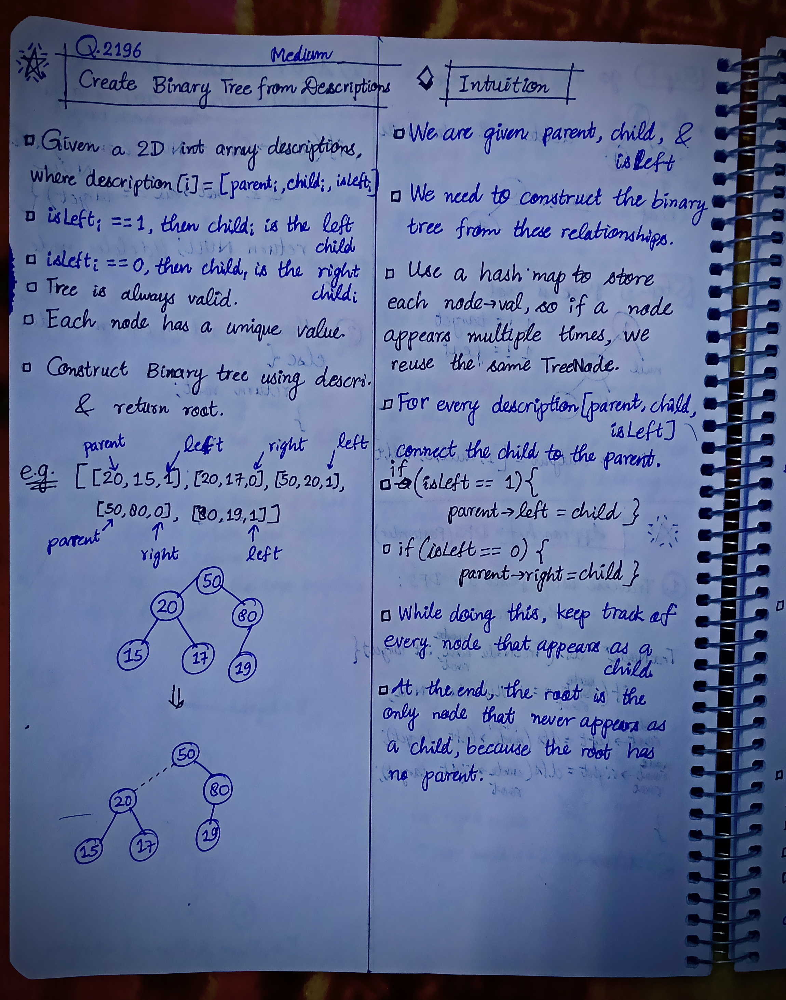
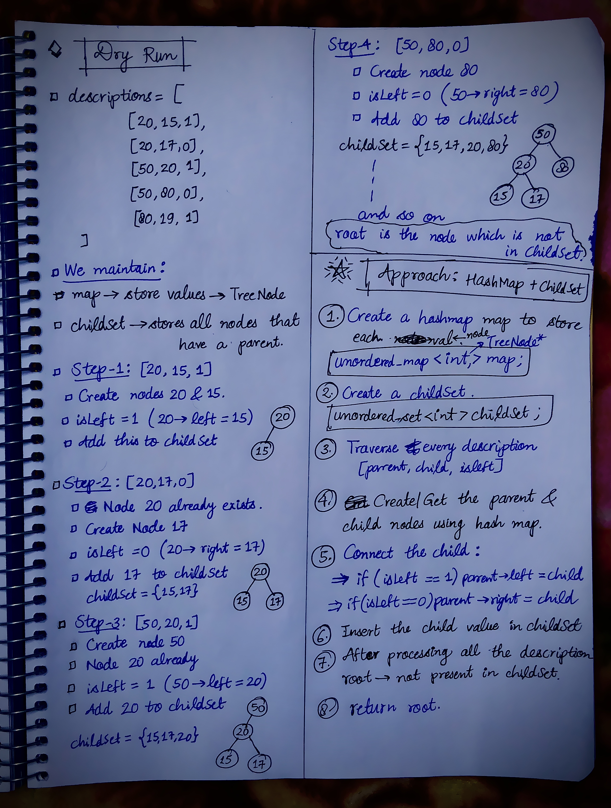

<h2><a href="https://leetcode.com/problems/create-binary-tree-from-descriptions">2306. Create Binary Tree From Descriptions</a></h2><h3>Medium</h3><hr><p>You are given a 2D integer array <code>descriptions</code> where <code>descriptions[i] = [parent<sub>i</sub>, child<sub>i</sub>, isLeft<sub>i</sub>]</code> indicates that <code>parent<sub>i</sub></code> is the <strong>parent</strong> of <code>child<sub>i</sub></code> in a <strong>binary</strong> tree of <strong>unique</strong> values. Furthermore,</p>

<ul>
	<li>If <code>isLeft<sub>i</sub> == 1</code>, then <code>child<sub>i</sub></code> is the left child of <code>parent<sub>i</sub></code>.</li>
	<li>If <code>isLeft<sub>i</sub> == 0</code>, then <code>child<sub>i</sub></code> is the right child of <code>parent<sub>i</sub></code>.</li>
</ul>

<p>Construct the binary tree described by <code>descriptions</code> and return <em>its <strong>root</strong></em>.</p>

<p>The test cases will be generated such that the binary tree is <strong>valid</strong>.</p>

<p>&nbsp;</p>
<p><strong class="example">Example 1:</strong></p>

<pre>
<strong>Input:</strong> descriptions = [[20,15,1],[20,17,0],[50,20,1],[50,80,0],[80,19,1]]
<strong>Output:</strong> [50,20,80,15,17,19]
<strong>Explanation:</strong> The root node is the node with value 50 since it has no parent.
The resulting binary tree is shown in the diagram.
</pre>

<p><strong class="example">Example 2:</strong></p>

<pre>
<strong>Input:</strong> descriptions = [[1,2,1],[2,3,0],[3,4,1]]
<strong>Output:</strong> [1,2,null,null,3,4]
<strong>Explanation:</strong> The root node is the node with value 1 since it has no parent.
The resulting binary tree is shown in the diagram.
</pre>

<p>&nbsp;</p>
<p><strong>Constraints:</strong></p>

<ul>
	<li><code>1 &lt;= descriptions.length &lt;= 10<sup>4</sup></code></li>
	<li><code>descriptions[i].length == 3</code></li>
	<li><code>1 &lt;= parent<sub>i</sub>, child<sub>i</sub> &lt;= 10<sup>5</sup></code></li>
	<li><code>0 &lt;= isLeft<sub>i</sub> &lt;= 1</code></li>
	<li>The binary tree described by <code>descriptions</code> is valid.</li>
</ul>


<!-- AUTO-GENERATED-SOLUTION-START -->
---

## 🧠 Visual Solution & Intuition

### Part 1



### Part 2



---

## 💡 Approach

```text
Approach : HashMap + ChildSet
```

---

## ⏱️ Complexity Analysis

```text
Time Complexity = O(n) =>
Space Complexity = O(n) =>
```

---

## 💻 C++ Solution

[View Original C++ File](./2196-create-binary-tree-from-descriptions.cpp)

```cpp
/**
 * Definition for a binary tree node.
 * struct TreeNode {
 *     int val;
 *     TreeNode *left;
 *     TreeNode *right;
 *     TreeNode() : val(0), left(nullptr), right(nullptr) {}
 *     TreeNode(int x) : val(x), left(nullptr), right(nullptr) {}
 *     TreeNode(int x, TreeNode *left, TreeNode *right) : val(x), left(left), right(right) {}
 * };
 */
class Solution {
public:
    //Approach : HashMap + ChildSet

    //Time Complexity = O(n) =>
    /* There are two main parts:
    1. Processing all descriptions : O(n)
        for (auto& d : descriptions)
            There are N descriptions, and each operation inside the loop is average O(1) because we use unordered_map and unordered_set.

    2. Finding the root : O(n)
        for (auto& it : map)
                There can be at most N + 1 unique nodes, so this takes O(N).
    
    */

    //Space Complexity = O(n) =>
    /* We use two extra data structures:
    1. unordered_map<int, TreeNode*> map
        * Stores every unique node.
        * A binary tree with N descriptions can have at most N + 1 nodes.
        * Space: O(N)
    2. unordered_set<int> childSet
        * Stores every node that appears as a child.
        * At most N values.
        * Space: O(N)
    */

    TreeNode* createBinaryTree(vector<vector<int>>& descriptions) {
        
        //1.)map to store val -> node
        unordered_map<int, TreeNode*> map;

        //2.) childset to store all the children
        unordered_set<int> childSet;

        //3.) traverse every description
        for(auto& d : descriptions){ //description[i] = [parent, child, isLeft]
            int parent = d[0];
            int child = d[1];
            int isLeft = d[2];

            //4.)get/create the parent & child nodes using hashMap
            if(!map.count(parent)){
                map[parent] = new TreeNode(parent);
            }

            if(!map.count(child)){ 
                map[child] = new TreeNode(child);
            }

            //5.) connect the child
            if(isLeft == 1){
                map[parent]->left = map[child];
            }

            if(isLeft == 0){
                map[parent]->right = map[child];
            }

            //6.) Insert the child value in childSet
            childSet.insert(child);
            
        }

        //7.) After processing all the descriptions , root is not present in childSet => return root
        for(auto& it : map){
            if(!childSet.count(it.first)){//first is node->val
                return it.second; //second value is root node
            }
        }
        
        //8.) if no root found
        return NULL;
    }
};
```

<!-- AUTO-GENERATED-SOLUTION-END -->
