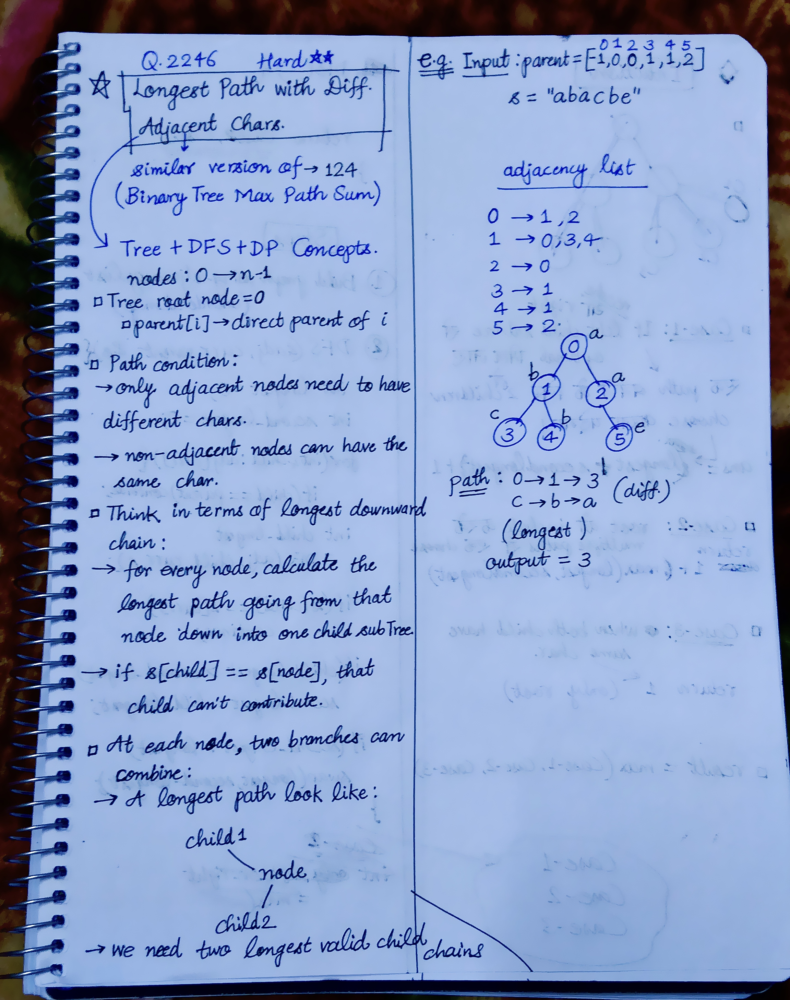
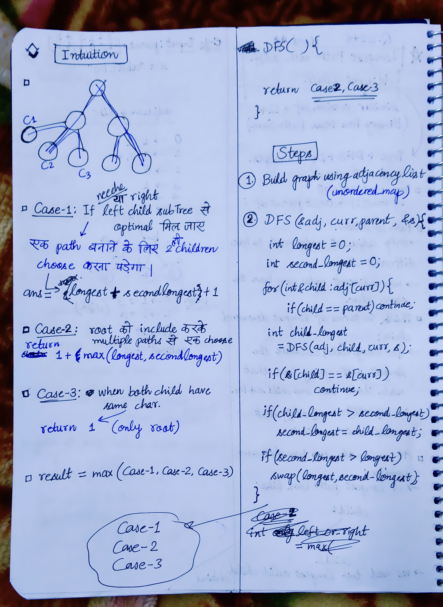

<h2><a href="https://leetcode.com/problems/longest-path-with-different-adjacent-characters">2364. Longest Path With Different Adjacent Characters</a></h2><h3>Hard</h3><hr><p>You are given a <strong>tree</strong> (i.e. a connected, undirected graph that has no cycles) <strong>rooted</strong> at node <code>0</code> consisting of <code>n</code> nodes numbered from <code>0</code> to <code>n - 1</code>. The tree is represented by a <strong>0-indexed</strong> array <code>parent</code> of size <code>n</code>, where <code>parent[i]</code> is the parent of node <code>i</code>. Since node <code>0</code> is the root, <code>parent[0] == -1</code>.</p>

<p>You are also given a string <code>s</code> of length <code>n</code>, where <code>s[i]</code> is the character assigned to node <code>i</code>.</p>

<p>Return <em>the length of the <strong>longest path</strong> in the tree such that no pair of <strong>adjacent</strong> nodes on the path have the same character assigned to them.</em></p>

<p>&nbsp;</p>
<p><strong class="example">Example 1:</strong></p>

<pre>
<strong>Input:</strong> parent = [-1,0,0,1,1,2], s = &quot;abacbe&quot;
<strong>Output:</strong> 3
<strong>Explanation:</strong> The longest path where each two adjacent nodes have different characters in the tree is the path: 0 -&gt; 1 -&gt; 3. The length of this path is 3, so 3 is returned.
It can be proven that there is no longer path that satisfies the conditions. 
</pre>

<p><strong class="example">Example 2:</strong></p>

<pre>
<strong>Input:</strong> parent = [-1,0,0,0], s = &quot;aabc&quot;
<strong>Output:</strong> 3
<strong>Explanation:</strong> The longest path where each two adjacent nodes have different characters is the path: 2 -&gt; 0 -&gt; 3. The length of this path is 3, so 3 is returned.
</pre>

<p>&nbsp;</p>
<p><strong>Constraints:</strong></p>

<ul>
	<li><code>n == parent.length == s.length</code></li>
	<li><code>1 &lt;= n &lt;= 10<sup>5</sup></code></li>
	<li><code>0 &lt;= parent[i] &lt;= n - 1</code> for all <code>i &gt;= 1</code></li>
	<li><code>parent[0] == -1</code></li>
	<li><code>parent</code> represents a valid tree.</li>
	<li><code>s</code> consists of only lowercase English letters.</li>
</ul>


<!-- AUTO-GENERATED-SOLUTION-START -->
---

## 🧠 Visual Solution & Intuition

### Part 1



### Part 2



---

## 💡 Approach

```text
Approach : Tree DP + DFS (Postorder Traversal) + Top 2 Child Paths
```

---

## ⏱️ Complexity Analysis

```text
Time Complexity = O(n) =>
Space Complexity = O(n) =>
```

---

## 💻 C++ Solution

[View Original C++ File](./2246-longest-path-with-different-adjacent-characters.cpp)

```cpp
class Solution {
public:
    //Approach : Tree DP + DFS (Postorder Traversal) + Top 2 Child Paths

    //Time Complexity = O(n) =>
    /* Build adjacency list → O(n)
    * DFS visits every node once → O(n)
    * Each edge is processed at most twice → O(n) 
    */

    //Space Complexity = O(n) =>
    /* Adjacency list → O(n)
    * DFS recursion stack → O(n) in the worst case
    * No extra DP array is required.
    */

    int result;
    int DFS(unordered_map<int, vector<int>>& adj, int curr, int parent, string& s){
        int longest = 0;
        int secondLongest = 0;

        //traverse all children of curr
        for(int& child : adj[curr]){
            
            if(child == parent) continue;

            int childLongest = DFS(adj, child, curr, s);

            if(s[child] == s[curr]) continue;

            if(childLongest > longest){
                secondLongest = longest;
                longest = childLongest;
            }

            else if(childLongest > secondLongest){
                secondLongest = childLongest;
            }
        }

        //Case-1 : if ans found in left/right child subtree 
        int left_right_child_ans = longest + secondLongest + 1;

        //Case-2 : including root choose one from multiple paths
        int choose_one = 1 + max(longest, secondLongest);

        //Case-3 : only root, if both child have same char.
        int only_root = 1;

        result = max(result, left_right_child_ans);

        //return only max(Case-2 or Case-3)
        return max(choose_one, only_root);

    }
    int longestPath(vector<int>& parent, string s) {
        int n = parent.size();
        result = 0;
        //1.) Build Graph using adjacency list
        unordered_map<int, vector<int>> adj;

        //populate the graph : make edge connections
        for(int i=1; i<n; i++){
            int u = i;
            int v = parent[i];

            //make undirected graph connections
            adj[u].push_back(v);
            adj[v].push_back(u);
        }

        //func. call to DFS
        int curr = 0;
        int par = -1; //parent of 0 is -1

        DFS(adj, curr, par, s);

        //finally return the longest path length
        return result;
        
    }
};
```

<!-- AUTO-GENERATED-SOLUTION-END -->
