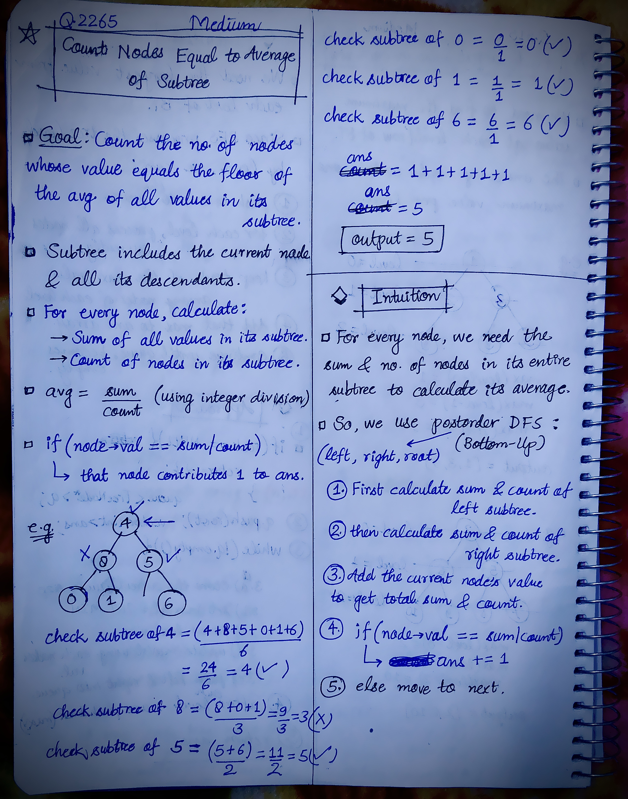
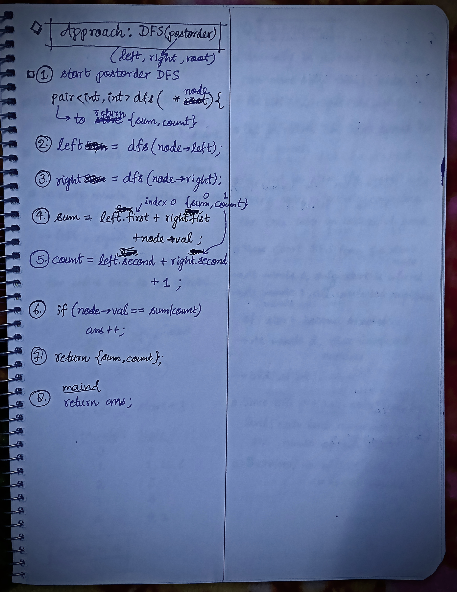

<h2><a href="https://leetcode.com/problems/count-nodes-equal-to-average-of-subtree">2347. Count Nodes Equal to Average of Subtree</a></h2><h3>Medium</h3><hr><p>Given the <code>root</code> of a binary tree, return <em>the number of nodes where the value of the node is equal to the <strong>average</strong> of the values in its <strong>subtree</strong></em>.</p>

<p><strong>Note:</strong></p>

<ul>
	<li>The <strong>average</strong> of <code>n</code> elements is the <strong>sum</strong> of the <code>n</code> elements divided by <code>n</code> and <strong>rounded down</strong> to the nearest integer.</li>
	<li>A <strong>subtree</strong> of <code>root</code> is a tree consisting of <code>root</code> and all of its descendants.</li>
</ul>

<p>&nbsp;</p>
<p><strong class="example">Example 1:</strong></p>

<pre>
<strong>Input:</strong> root = [4,8,5,0,1,null,6]
<strong>Output:</strong> 5
<strong>Explanation:</strong> 
For the node with value 4: The average of its subtree is (4 + 8 + 5 + 0 + 1 + 6) / 6 = 24 / 6 = 4.
For the node with value 5: The average of its subtree is (5 + 6) / 2 = 11 / 2 = 5.
For the node with value 0: The average of its subtree is 0 / 1 = 0.
For the node with value 1: The average of its subtree is 1 / 1 = 1.
For the node with value 6: The average of its subtree is 6 / 1 = 6.
</pre>

<p><strong class="example">Example 2:</strong></p>

<pre>
<strong>Input:</strong> root = [1]
<strong>Output:</strong> 1
<strong>Explanation:</strong> For the node with value 1: The average of its subtree is 1 / 1 = 1.
</pre>

<p>&nbsp;</p>
<p><strong>Constraints:</strong></p>

<ul>
	<li>The number of nodes in the tree is in the range <code>[1, 1000]</code>.</li>
	<li><code>0 &lt;= Node.val &lt;= 1000</code></li>
</ul>


<!-- AUTO-GENERATED-SOLUTION-START -->
---

## 🧠 Visual Solution & Intuition

### Part 1



### Part 2



---

## 💡 Approach

```text
Approach : DFS(Postorder)
```

---

## ⏱️ Complexity Analysis

```text
Time Complexity = O(n) =>
Space Complexity = O(h) =>
```

---

## 💻 C++ Solution

[View Original C++ File](./2265-count-nodes-equal-to-average-of-subtree.cpp)

```cpp
/**
 * Definition for a binary tree node.
 * struct TreeNode {
 *     int val;
 *     TreeNode *left;
 *     TreeNode *right;
 *     TreeNode() : val(0), left(nullptr), right(nullptr) {}
 *     TreeNode(int x) : val(x), left(nullptr), right(nullptr) {}
 *     TreeNode(int x, TreeNode *left, TreeNode *right) : val(x), left(left), right(right) {}
 * };
 */
class Solution {
public:
    //Approach : DFS(Postorder)

    //Time Complexity = O(n) =>
    /* Each node is visited exactly once.
    */

    //Space Complexity = O(h) =>
    /* Recursion stack can hold up to H nodes, where H is the height of the tree.
    * Worst case (skewed tree): O(N)
    * Balanced tree: O(log N)
    */


    pair<int, int> dfs(TreeNode* node, int& ans){ //dfs is paired {sum, count}
        //base-case
        if(node == NULL){
            return {0, 0}; //{sum , count}
        }
        

        //Postorder : left -> right -> root
        //2.)
        auto left = dfs(node->left, ans);
        
        //3.)
        auto right = dfs(node->right, ans);

        //4.)
        int sum = left.first + right.first + node->val;

        //5.)
        int count = left.second + right.second + 1;

        //6.)
        if(node->val == sum / count){
            ans++;
        }

        //7.)
        return {sum, count};

    }

    int averageOfSubtree(TreeNode* root) {
        
        int ans = 0;//initially no nodes have been checked

        
        dfs(root, ans);

        //finally return the output
        return ans;
    }
};
```

<!-- AUTO-GENERATED-SOLUTION-END -->
