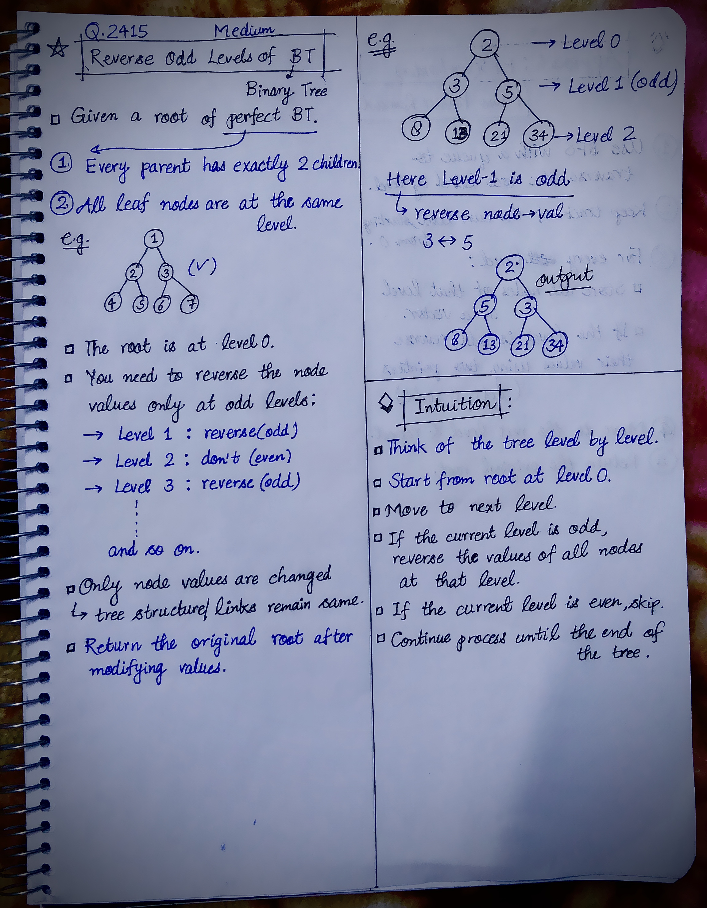

<h2><a href="https://leetcode.com/problems/reverse-odd-levels-of-binary-tree">2493. Reverse Odd Levels of Binary Tree</a></h2><h3>Medium</h3><hr><p>Given the <code>root</code> of a <strong>perfect</strong> binary tree, reverse the node values at each <strong>odd</strong> level of the tree.</p>

<ul>
	<li>For example, suppose the node values at level 3 are <code>[2,1,3,4,7,11,29,18]</code>, then it should become <code>[18,29,11,7,4,3,1,2]</code>.</li>
</ul>

<p>Return <em>the root of the reversed tree</em>.</p>

<p>A binary tree is <strong>perfect</strong> if all parent nodes have two children and all leaves are on the same level.</p>

<p>The <strong>level</strong> of a node is the number of edges along the path between it and the root node.</p>

<p>&nbsp;</p>
<p><strong class="example">Example 1:</strong></p>

<pre>
<strong>Input:</strong> root = [2,3,5,8,13,21,34]
<strong>Output:</strong> [2,5,3,8,13,21,34]
<strong>Explanation:</strong> 
The tree has only one odd level.
The nodes at level 1 are 3, 5 respectively, which are reversed and become 5, 3.
</pre>

<p><strong class="example">Example 2:</strong></p>

<pre>
<strong>Input:</strong> root = [7,13,11]
<strong>Output:</strong> [7,11,13]
<strong>Explanation:</strong> 
The nodes at level 1 are 13, 11, which are reversed and become 11, 13.
</pre>

<p><strong class="example">Example 3:</strong></p>

<pre>
<strong>Input:</strong> root = [0,1,2,0,0,0,0,1,1,1,1,2,2,2,2]
<strong>Output:</strong> [0,2,1,0,0,0,0,2,2,2,2,1,1,1,1]
<strong>Explanation:</strong> 
The odd levels have non-zero values.
The nodes at level 1 were 1, 2, and are 2, 1 after the reversal.
The nodes at level 3 were 1, 1, 1, 1, 2, 2, 2, 2, and are 2, 2, 2, 2, 1, 1, 1, 1 after the reversal.
</pre>

<p>&nbsp;</p>
<p><strong>Constraints:</strong></p>

<ul>
	<li>The number of nodes in the tree is in the range <code>[1, 2<sup>14</sup>]</code>.</li>
	<li><code>0 &lt;= Node.val &lt;= 10<sup>5</sup></code></li>
	<li><code>root</code> is a <strong>perfect</strong> binary tree.</li>
</ul>


<!-- AUTO-GENERATED-SOLUTION-START -->
---

## 🧠 Visual Solution & Intuition

### Part 1



### Part 2


---

## 💡 Approach

```text
Approach : BFS(level order) + Two-Pointer Reversal(left & right)
```

---

## ⏱️ Complexity Analysis

```text
Time Complexity = O(n) => O(2n) = O(n) + O(n)
Space Complexity = O(n) => O(2n) = O(n) + O(n)
```

---

## 💻 C++ Solution

[View Original C++ File](./2415-reverse-odd-levels-of-binary-tree.cpp)

```cpp
/**
 * Definition for a binary tree node.
 * struct TreeNode {
 *     int val;
 *     TreeNode *left;
 *     TreeNode *right;
 *     TreeNode() : val(0), left(nullptr), right(nullptr) {}
 *     TreeNode(int x) : val(x), left(nullptr), right(nullptr) {}
 *     TreeNode(int x, TreeNode *left, TreeNode *right) : val(x), left(left), right(right) {}
 * };
 */
class Solution {
public:
    //Approach : BFS(level order) + Two-Pointer Reversal(left & right)
 
    //Time Complexity = O(n) => O(2n) = O(n) + O(n)
    /* Where n = number of nodes in the tree.
    1. We visit every node exactly once using BFS.
        Every node enters the queue and is removed once.
    2. Reversing odd levels:
        For odd levels, we use two pointers:
            If a level contains K nodes, this takes approximately K/2 operations → O(K)
            Across all odd levels, the total number of nodes is at most n.
    */

    //Space Complexity = O(n) => O(2n) = O(n) + O(n)
    /* We use two extra data structures: 
    1. Queue : The queue stores nodes of the current/next level.
    * In a perfect binary tree, the last level can contain roughly n/2 nodes.
    * So the queue can require: O(n)
    2. Vector : vector<TreeNode*> nodes;
    * This stores all nodes of the current level.
    * The largest level can contain roughly n/2 nodes.
    * So: O(n)
    */


    TreeNode* reverseOddLevels(TreeNode* root) {
        
        //1.) queue for BFS
        queue<TreeNode*> q;

        q.push(root);

        //2.) current level
        int level = 0;

        while(!q.empty()){

            int N = q.size(); //size of current level
            
            //3.a) store all nodes of that level in a vector
            vector<TreeNode*> nodes;

            //3.)for every level
            while(N--){                
                
                TreeNode* curr = q.front();
                q.pop();
                
                nodes.push_back(curr);

                //Add children for next level
                if(curr->left){
                    q.push(curr->left);
                }
                
                if(curr->right){
                    q.push(curr->right);
                }
            }
            //3.b) if curr level is odd => reverse using two pointers
            if(level % 2 != 0){
                
                int left = 0;
                int right = nodes.size() - 1;

                while(left < right){
                    swap(nodes[left]->val, nodes[right]->val);

                    left++;
                    right--;
                }
            }                
            //4.) current level completed
            level++;
        }
        
        //5.)
        return root;
    }
};
```

<!-- AUTO-GENERATED-SOLUTION-END -->
