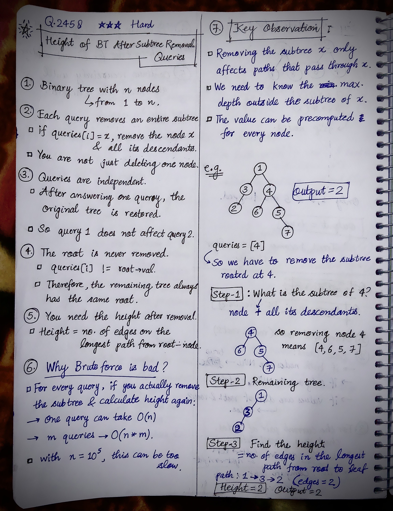
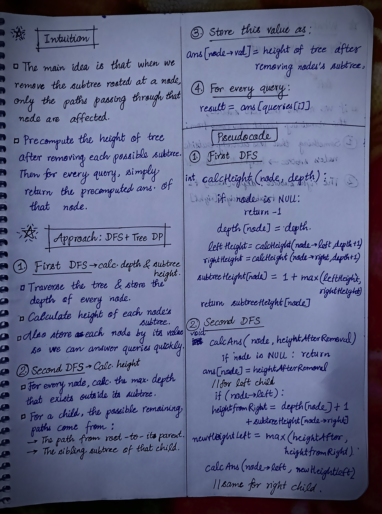
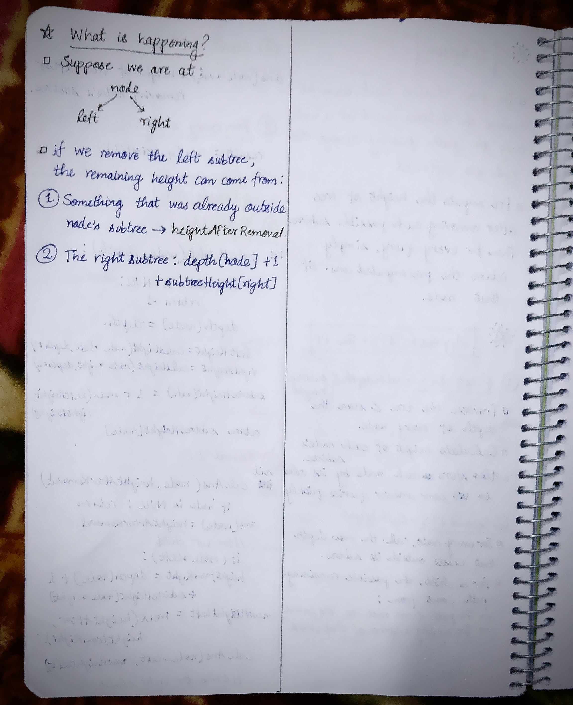

<h2><a href="https://leetcode.com/problems/height-of-binary-tree-after-subtree-removal-queries">2545. Height of Binary Tree After Subtree Removal Queries</a></h2><h3>Hard</h3><hr><p>You are given the <code>root</code> of a <strong>binary tree</strong> with <code>n</code> nodes. Each node is assigned a unique value from <code>1</code> to <code>n</code>. You are also given an array <code>queries</code> of size <code>m</code>.</p>

<p>You have to perform <code>m</code> <strong>independent</strong> queries on the tree where in the <code>i<sup>th</sup></code> query you do the following:</p>

<ul>
	<li><strong>Remove</strong> the subtree rooted at the node with the value <code>queries[i]</code> from the tree. It is <strong>guaranteed</strong> that <code>queries[i]</code> will <strong>not</strong> be equal to the value of the root.</li>
</ul>

<p>Return <em>an array </em><code>answer</code><em> of size </em><code>m</code><em> where </em><code>answer[i]</code><em> is the height of the tree after performing the </em><code>i<sup>th</sup></code><em> query</em>.</p>

<p><strong>Note</strong>:</p>

<ul>
	<li>The queries are independent, so the tree returns to its <strong>initial</strong> state after each query.</li>
	<li>The height of a tree is the <strong>number of edges in the longest simple path</strong> from the root to some node in the tree.</li>
</ul>

<p>&nbsp;</p>
<p><strong class="example">Example 1:</strong></p>

<pre>
<strong>Input:</strong> root = [1,3,4,2,null,6,5,null,null,null,null,null,7], queries = [4]
<strong>Output:</strong> [2]
<strong>Explanation:</strong> The diagram above shows the tree after removing the subtree rooted at node with value 4.
The height of the tree is 2 (The path 1 -&gt; 3 -&gt; 2).
</pre>

<p><strong class="example">Example 2:</strong></p>

<pre>
<strong>Input:</strong> root = [5,8,9,2,1,3,7,4,6], queries = [3,2,4,8]
<strong>Output:</strong> [3,2,3,2]
<strong>Explanation:</strong> We have the following queries:
- Removing the subtree rooted at node with value 3. The height of the tree becomes 3 (The path 5 -&gt; 8 -&gt; 2 -&gt; 4).
- Removing the subtree rooted at node with value 2. The height of the tree becomes 2 (The path 5 -&gt; 8 -&gt; 1).
- Removing the subtree rooted at node with value 4. The height of the tree becomes 3 (The path 5 -&gt; 8 -&gt; 2 -&gt; 6).
- Removing the subtree rooted at node with value 8. The height of the tree becomes 2 (The path 5 -&gt; 9 -&gt; 3).
</pre>

<p>&nbsp;</p>
<p><strong>Constraints:</strong></p>

<ul>
	<li>The number of nodes in the tree is <code>n</code>.</li>
	<li><code>2 &lt;= n &lt;= 10<sup>5</sup></code></li>
	<li><code>1 &lt;= Node.val &lt;= n</code></li>
	<li>All the values in the tree are <strong>unique</strong>.</li>
	<li><code>m == queries.length</code></li>
	<li><code>1 &lt;= m &lt;= min(n, 10<sup>4</sup>)</code></li>
	<li><code>1 &lt;= queries[i] &lt;= n</code></li>
	<li><code>queries[i] != root.val</code></li>
</ul>


<!-- AUTO-GENERATED-SOLUTION-START -->
---

## 🧠 Visual Solution & Intuition

### Part 1



### Part 2



### Part 3



---

## 💡 Approach

```text
Approach : DFS + Tree DP(Rerooting DP using DFS)
```

---

## ⏱️ Complexity Analysis

```text
Time Complexity = O(n + m) => n = number of nodes in the tree,     m = number of queries
Space Complexity = O(n) => O(3n) = O(n + n + n)
```

---

## 💻 C++ Solution

[View Original C++ File](./2458-height-of-binary-tree-after-subtree-removal-queries.cpp)

```cpp
/**
 * Definition for a binary tree node.
 * struct TreeNode {
 *     int val;
 *     TreeNode *left;
 *     TreeNode *right;
 *     TreeNode() : val(0), left(nullptr), right(nullptr) {}
 *     TreeNode(int x) : val(x), left(nullptr), right(nullptr) {}
 *     TreeNode(int x, TreeNode *left, TreeNode *right) : val(x), left(left), right(right) {}
 * };
 */
class Solution {
public:
    //Approach : DFS + Tree DP(Rerooting DP using DFS)

    //Time Complexity = O(n + m) => n = number of nodes in the tree,     m = number of queries
    /* We perform 3 main operations:
    1. First DFS — calcHeight() :
        Every node is visited exactly once. => TC : O(n)
    2. Second DFS — calcAns() :
        Again, every node is visited exactly once. => TC : O(n)
    3. Process queries using loop :
        We directly access ans[q], so each query takes O(1).
        For m queries: TC = O(m)
    */

    //Space Complexity = O(n) => O(3n) = O(n + n + n)
    /* We use three arrays:
    * vector<int> depth;
    * vector<int> subtreeHeight;
    * vector<int> ans;
    * Each has size n + 1.
    depth          → O(n)
    subtreeHeight  → O(n)
    ans            → O(n)

    */

    //global depth, subtreeHeight, ans
    vector<int> depth;
    vector<int> subtreeHeight;
    vector<int> ans;

    int calcHeight(TreeNode* node, int d){
        //base-case
        if(node == NULL){
            return -1;
        }

        depth[node->val] = d;

        int leftHeight = calcHeight(node->left, d+1);
        int rightHeight = calcHeight(node->right, d+1);

        subtreeHeight[node->val] = 1 + max(leftHeight, rightHeight);

        return subtreeHeight[node->val];
    }

    void calcAns(TreeNode* node, int heightAfterRemoval){
        //base-case
        if(node == NULL){
            return;
        }

        ans[node->val] = heightAfterRemoval;

        //for left child
        if(node->left){
            int siblingHeight = -1;

            if(node->right){
                siblingHeight = subtreeHeight[node->right->val];
            }
            int heightFromRight = depth[node->val] + 1 + siblingHeight;

            int newHeightLeft = max(heightFromRight, heightAfterRemoval);

            calcAns(node->left, newHeightLeft);
        }

        //for right child
        if(node->right){
            int siblingHeight = -1;

            if(node->left){
                siblingHeight = subtreeHeight[node->left->val];
            }
            
            int heightFromLeft = depth[node->val] + 1 + siblingHeight;

            int newHeightRight = max(heightFromLeft, heightAfterRemoval);

            calcAns(node->right, newHeightRight);
        }
    }
    vector<int> treeQueries(TreeNode* root, vector<int>& queries) {
        //given n = 10^5
        int n = 100000;

        depth.resize(n+1);
        subtreeHeight.resize(n+1);
        ans.resize(n+1);

        //calling First DFS
        calcHeight(root, 0);

        //calling Second DFS
        calcAns(root, 0);


        //Answer queries
        vector<int> result;

        for(int q : queries){
            result.push_back(ans[q]);
        }
        
        //finally return the output
        return result;
    }
};
```

<!-- AUTO-GENERATED-SOLUTION-END -->
