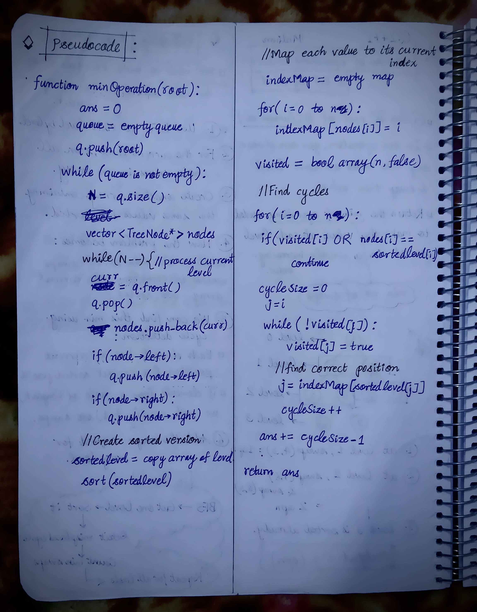

<h2><a href="https://leetcode.com/problems/minimum-number-of-operations-to-sort-a-binary-tree-by-level">2558. Minimum Number of Operations to Sort a Binary Tree by Level</a></h2><h3>Medium</h3><hr><p>You are given the <code>root</code> of a binary tree with <strong>unique values</strong>.</p>

<p>In one operation, you can choose any two nodes <strong>at the same level</strong> and swap their values.</p>

<p>Return <em>the minimum number of operations needed to make the values at each level sorted in a <strong>strictly increasing order</strong></em>.</p>

<p>The <strong>level</strong> of a node is the number of edges along the path between it and the root node<em>.</em></p>

<p>&nbsp;</p>
<p><strong class="example">Example 1:</strong></p>

<pre>
<strong>Input:</strong> root = [1,4,3,7,6,8,5,null,null,null,null,9,null,10]
<strong>Output:</strong> 3
<strong>Explanation:</strong>
- Swap 4 and 3. The 2<sup>nd</sup> level becomes [3,4].
- Swap 7 and 5. The 3<sup>rd</sup> level becomes [5,6,8,7].
- Swap 8 and 7. The 3<sup>rd</sup> level becomes [5,6,7,8].
We used 3 operations so return 3.
It can be proven that 3 is the minimum number of operations needed.
</pre>

<p><strong class="example">Example 2:</strong></p>

<pre>
<strong>Input:</strong> root = [1,3,2,7,6,5,4]
<strong>Output:</strong> 3
<strong>Explanation:</strong>
- Swap 3 and 2. The 2<sup>nd</sup> level becomes [2,3].
- Swap 7 and 4. The 3<sup>rd</sup> level becomes [4,6,5,7].
- Swap 6 and 5. The 3<sup>rd</sup> level becomes [4,5,6,7].
We used 3 operations so return 3.
It can be proven that 3 is the minimum number of operations needed.
</pre>

<p><strong class="example">Example 3:</strong></p>

<pre>
<strong>Input:</strong> root = [1,2,3,4,5,6]
<strong>Output:</strong> 0
<strong>Explanation:</strong> Each level is already sorted in increasing order so return 0.
</pre>

<p>&nbsp;</p>
<p><strong>Constraints:</strong></p>

<ul>
	<li>The number of nodes in the tree is in the range <code>[1, 10<sup>5</sup>]</code>.</li>
	<li><code>1 &lt;= Node.val &lt;= 10<sup>5</sup></code></li>
	<li>All the values of the tree are <strong>unique</strong>.</li>
</ul>


<!-- AUTO-GENERATED-SOLUTION-START -->
---

## 🧠 Visual Solution & Intuition

### Part 1


### Part 2



---

## 💡 Approach

```text
Approach : BFS + Cycle detection
```

---

## ⏱️ Complexity Analysis

```text
Time Complexity = O(n * logn) =>
Space Complexity = O(n) =>
```

---

## 💻 C++ Solution

[View Original C++ File](./2471-minimum-number-of-operations-to-sort-a-binary-tree-by-level.cpp)

```cpp
/**
 * Definition for a binary tree node.
 * struct TreeNode {
 *     int val;
 *     TreeNode *left;
 *     TreeNode *right;
 *     TreeNode() : val(0), left(nullptr), right(nullptr) {}
 *     TreeNode(int x) : val(x), left(nullptr), right(nullptr) {}
 *     TreeNode(int x, TreeNode *left, TreeNode *right) : val(x), left(left), right(right) {}
 * };
 */
class Solution {
public:
    //Approach : BFS + Cycle detection

    //Time Complexity = O(n * logn) =>
    /* BFS visits every node → O(n)
    * Sorting each level → overall worst case O(n log n)
    * Cycle detection → O(n)
    */

    //Space Complexity = O(n) =>
    /* BFS queue → O(n)
    * nodes array → O(n)
    * sortedLevel → O(n)
    * indexMap → O(n)
    * visited → O(n)
    */

    
    int minimumOperations(TreeNode* root) {
        
        int ans = 0;

        //1.) queue for BFS
        queue<TreeNode*> q;

        q.push(root);

        while(!q.empty()){
            
            int  N = q.size();
            //2.) store all node values of curr level
            vector<int> nodes;

            while(N--){//process current level

                TreeNode* curr = q.front();
                q.pop();

                //push current node in nodes
                nodes.push_back(curr->val);
                
                //store children for next level
                if(curr->left){
                    q.push(curr->left);
                }

                if(curr->right){
                    q.push(curr->right);
                }
            }
            //3.) Create a sorted version
            vector<int> sortedLevel = nodes;

            sort(sortedLevel.begin(), sortedLevel.end());

            //4.) Map each value to its current index
            // map
            unordered_map<int, int> indexMap;
            
            int n = nodes.size();

            for(int i = 0; i < n; i++){
                indexMap[nodes[i]] = i;
            }

            //Find Cycles
            vector<bool> visited(n, false);

            for(int i = 0; i < n; i++){

                // Already in correct position
                if(visited[i] || nodes[i] == sortedLevel[i]){
                    continue;
                }

                int cycleSize = 0;
                int j = i;

                while(!visited[j]){
                    visited[j] = true;

                    //find correct position for current value
                    j = indexMap[sortedLevel[j]];
                    cycleSize++;
                }
                //6.) A cycle of size k requires k - 1 swaps
                ans += cycleSize - 1;
            }
        }

        //finally return the output
        return ans;
    }
};
```

<!-- AUTO-GENERATED-SOLUTION-END -->
