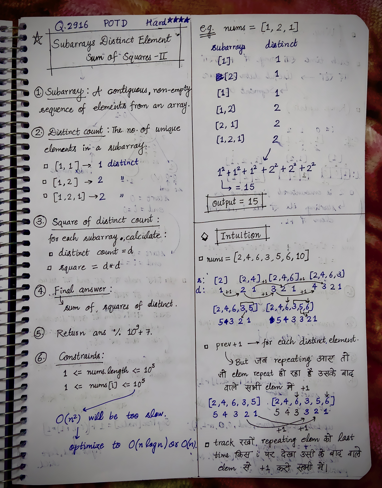
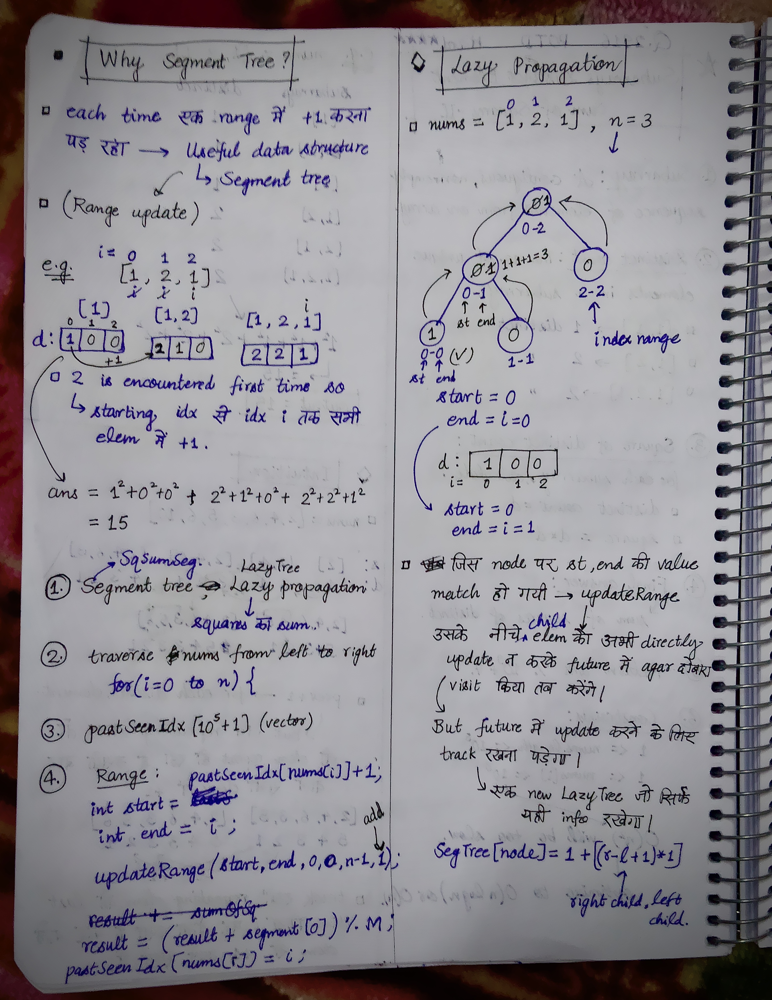
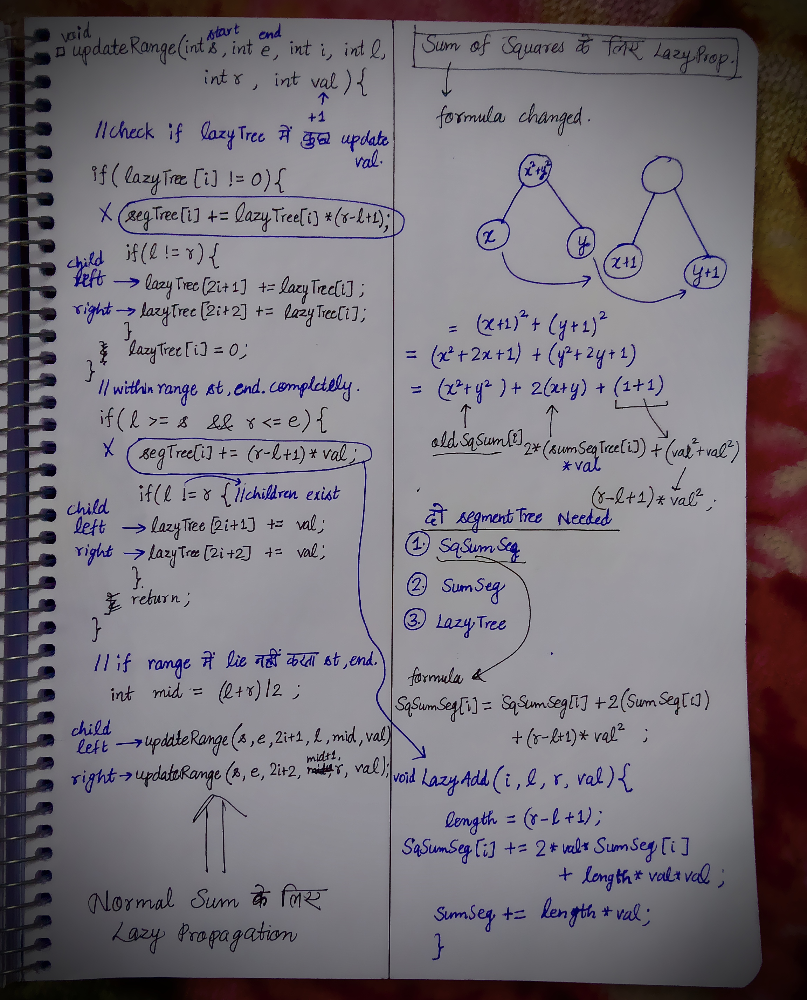

<h2><a href="https://leetcode.com/problems/subarrays-distinct-element-sum-of-squares-ii">3139. Subarrays Distinct Element Sum of Squares II</a></h2><h3>Hard</h3><hr><p>You are given a <strong>0-indexed </strong>integer array <code>nums</code>.</p>

<p>The <strong>distinct count</strong> of a subarray of <code>nums</code> is defined as:</p>

<ul>
	<li>Let <code>nums[i..j]</code> be a subarray of <code>nums</code> consisting of all the indices from <code>i</code> to <code>j</code> such that <code>0 &lt;= i &lt;= j &lt; nums.length</code>. Then the number of distinct values in <code>nums[i..j]</code> is called the distinct count of <code>nums[i..j]</code>.</li>
</ul>

<p>Return <em>the sum of the <strong>squares</strong> of <strong>distinct counts</strong> of all subarrays of </em><code>nums</code>.</p>

<p>Since the answer may be very large, return it <strong>modulo</strong> <code>10<sup>9</sup> + 7</code>.</p>

<p>A subarray is a contiguous <strong>non-empty</strong> sequence of elements within an array.</p>

<p>&nbsp;</p>
<p><strong>Example 1:</strong></p>

<pre>
<strong>Input:</strong> nums = [1,2,1]
<strong>Output:</strong> 15
<strong>Explanation:</strong> Six possible subarrays are:
[1]: 1 distinct value
[2]: 1 distinct value
[1]: 1 distinct value
[1,2]: 2 distinct values
[2,1]: 2 distinct values
[1,2,1]: 2 distinct values
The sum of the squares of the distinct counts in all subarrays is equal to 1<sup>2</sup> + 1<sup>2</sup> + 1<sup>2</sup> + 2<sup>2</sup> + 2<sup>2</sup> + 2<sup>2</sup> = 15.
</pre>

<p><strong>Example 2:</strong></p>

<pre>
<strong>Input:</strong> nums = [2,2]
<strong>Output:</strong> 3
<strong>Explanation:</strong> Three possible subarrays are:
[2]: 1 distinct value
[2]: 1 distinct value
[2,2]: 1 distinct value
The sum of the squares of the distinct counts in all subarrays is equal to 1<sup>2</sup> + 1<sup>2</sup> + 1<sup>2</sup> = 3.</pre>

<p>&nbsp;</p>
<p><strong>Constraints:</strong></p>

<ul>
	<li><code>1 &lt;= nums.length &lt;= 10<sup>5</sup></code></li>
	<li><code>1 &lt;= nums[i] &lt;= 10<sup>5</sup></code></li>
</ul>


<!-- AUTO-GENERATED-SOLUTION-START -->
---

## 🧠 Visual Solution & Intuition

### Part 1



### Part 2



### Part 3



---

## 💡 Approach

```text
Approach : Segment Tree with Lazy Propagation + Range Updates
```

---

## ⏱️ Complexity Analysis

```text
Time Complexity = O(n logn) =>
Space Complexity = O(n + MAX_VALUE) =>
```

---

## 💻 C++ Solution

[View Original C++ File](./2916-subarrays-distinct-element-sum-of-squares-ii.cpp)

```cpp
class Solution {
public:
    //Approach : Segment Tree with Lazy Propagation + Range Updates

    //Time Complexity = O(n logn) =>
    /* 1. The for loop runs n times, once for each array element. Therefore, its complexity is O(n) iterations.
    2. In each iteration, updateRange() updates a range in the segment tree.
    3. A segment tree with lazy propagation performs a range update in O(log n) time for a standard range-update implementation.
    4. Accessing SqSumSeg[0] takes O(1) time because the root stores the sum of squares for the entire array of tracked values.
    5. Updating pastSeenIdx takes O(1) time.
    * Therefore : n iterations × O(log n) per update = O(n logn)
    */

    //Space Complexity = O(n + MAX_VALUE) => 
    /* SqSumSeg stores the sum of squared values for each segment.
    * SumSeg stores the sum of values for each segment.
    * lazyTree stores pending updates.
    * Each array requires O(n) space.
    */


    typedef long long ll;
    const int M = 1e9 + 7; //10^9 + 7
    int n; //global : to use in all the other functions

    vector<ll> SqSumSeg;
    vector<ll> SumSeg;
    vector<ll> lazyTree;
    
    void lazyAdd(int i, int l, int r, int val){
        int length = r - l + 1;

        SqSumSeg[i] += 2*val*SumSeg[i] + length * val * val;

        SumSeg[i] += length * val;
    }
    void updateRange(int st, int e, int i, int l, int r, int val){
        
        //check if lazyTree mein koi val add promise kiya hai
        if(lazyTree[i] != 0){
            lazyAdd(i, l, r, lazyTree[i]);

            //if children exist
            if(l != r){
                lazyTree[2*i + 1] += lazyTree[i];//left child
                lazyTree[2*i + 2] += lazyTree[i];//right child
            }

            lazyTree[i] = 0;
        }
        //if out of range
        if(l > e || r < st ){
            return;
        }


        //if l, r lies within range(st, end)
        if(l >= st && r <= e){
            lazyAdd(i, l, r, val);

            //if chilren exist
            //if children exist
            if(l != r){
                lazyTree[2*i + 1] += val;//left child
                lazyTree[2*i + 2] += val;//right child
            }
            return;
        }

        //if l, r not completely in range
        int mid = (l + r)/2;

        updateRange(st, e, 2*i+1, l, mid, val); //left child
        updateRange(st, e, 2*i+2, mid+1, r, val); //right child

        SumSeg[i] = SumSeg[2*i + 1] + SumSeg[2*i + 2];
        SqSumSeg[i] = SqSumSeg[2*i + 1] + SqSumSeg[2*i + 2];
    }
    int sumCounts(vector<int>& nums) {
        
        n = nums.size();
        
        SqSumSeg.assign(4*n, 0);
        SumSeg.assign(4*n, 0);
        lazyTree.assign(4*n, 0);

        vector<int> pastSeenIdx(100001, -1); //size of 10^5 according to max n.

        ll result = 0;


        //travere nums from left to right
        for(int i = 0; i < n; i++){

            int start = pastSeenIdx[nums[i]] + 1;
            int end = i;

            updateRange(start, end, 0, 0, n-1, 1);

            result = (result + SqSumSeg[0] ) % M;

            pastSeenIdx[nums[i]] = i;
        }


        //finally return the output
        return result;

    }
};
```

<!-- AUTO-GENERATED-SOLUTION-END -->
